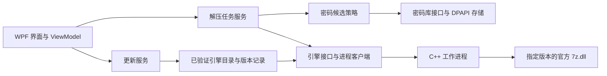

当前状态入口：[docs/CURRENT_STATE.md](docs/CURRENT_STATE.md)。历史计划按需查询，当前开发见下节。

## 2026-10-19：0.3.1 后续功能（实施中，未发布）

用户授权上一轮优先建议三项，并追加更新安装包手动清理。工作目录 `.tools/privacy-clean-worktree-20261019`，独立分支 `codex/task-controls-backup-20261019`，起点9023926，正式标签与原候选保留。与v0.3.1的既有差异仅发行记录及历史映射。

共用主会话/执行者：gpt-6.1-sol / high，无委派；当前回合01a152c6-557e-7b40-8c48-ce38be5faa6d的turn_context包含model与effort，取证自本聊天会话记录末尾，仅提取设置元数据。沿用本项目已验证的WPF实施组合，不切换模型。使用project-stage-planner、ui-design-engineering、ui-ux-pro-max；规范内扩展，以0.3.1运行资源及UI_STYLE_GUIDE为基准。UI技能WPF查询返回异步交互与绑定建议；独立取消依照微软CreateLinkedTokenSource文档，区分单任务和队列取消来源：https://learn.microsoft.com/en-us/dotnet/standard/threading/how-to-listen-for-multiple-cancellation-requests 。

| 阶段 | 依赖、职责及执行位置 | 交付物与验收 |
| --- | --- | --- |
| T1 单任务控制 | 共用组合直接执行；WPF行操作与现有worker暂停协议 | 单任务暂停/继续/取消不影响其它任务；全队列操作保留；并发、全局暂停叠加、取消清理、排队继续通过真实入口检查 |
| T2 密码库备份提醒 | 共用组合；复用独立加密导出 | 显示上次成功导出和导出后变更；仅成功导出更新状态，失败/取消不更新；提醒记录本机加密，锁定时不暴露库内容，无弹窗打断 |
| T3 失败重试 | T1；共用组合；现有解压服务和密码对话框 | 重试失败任务/所选任务/更换密码；保留输出、编码与检查点边界，不重跑成功任务，不改变成功后保存密码约定 |
| T4 更新缓存清理 | 共用组合；更新区域与下载缓存 | 手动清理仅application-updates中本程序生成的安装包；保护已准备包和被占用文件，不跟随目录链接，不碰其它文件；显示数量、大小与失败结果 |
| V 受影响验证与视觉验收 | T1–T4；共用组合；隔离Windows CI | x64先、ARM64随后；中英/浅深/800×600与1152×768截图及受影响流程检查，保留原图和来源；最终交用户验收，不自动发布 |

代表任务：两个解压任务中暂停/取消一项，另一项继续；失败后换密码完成解压；导出库后添加记录看到提醒，取消导出不重置提醒；更新页面清理旧包而保留当前已准备包。字体、配色、图标、胶囊按钮、表单宽度和减少动画沿用采用稿；行操作明确“此任务”，全局按钮明确“队列”。不在本机运行桌面自动化、不读真实库或生产私钥、不替换实际安装；不恢复自动任务，不合并/发布或改变渠道。

2026-10-16 会话交接整理：工作区产品源码已按正式版0.2.1恢复并完成361文件逐字节核对；新增AGENTS.md及当前状态摘要，正式产品代码不变。已清理废弃构建、可生成缓存及工具解压归档，现存正式发行与旧候选的270项文件散列保持一致；清单保存在本地artifacts/workspace-cleanup-result.json。本轮未运行产品测试或本机桌面自动化，不改变实际安装、密码库、公钥、发行资产或更新渠道。新会话等待用户指定下一项任务，不自动重测或恢复旧自动任务。

2026-10-16 0.2.1最终复核完成、发行交接：用户已验收本地UI并授权通过后发布；保留右键/快捷键/导航改进。追加反馈已修复为整行内部细焦点框和轻量“解压规则…”入口；补正配色、紧凑密码库状态提示及英文侧栏换行。完整功能源码95e2809a2a35f5f1f0e78a9f83226a98b67548b5的x64 CI38874590783 / 原生ARM64 CI38874597647全部通过，84/83报告集合、逐项和维护绑定已复核；随后仅五份界面/验收/工作流文件变化，最终UI源码77376ca242a5521cb3b69146ef68003eb7acb017的双架构CI38877290642通过，每架构每语言124项/61图，覆盖三主题、窗口宽度及100%–200%焦点像素。最终原生安装器和程序ZIP保持该CI字节，通用源码仅补发行文档，未受影响的功能证据复用，不冒称同一最终源码跑过全部套件。六项正式资产准备于artifacts/release-0.2.1，包审查stable-0.2.1-ready-review.json，公开后匿名校验public-stable-0.2.1-validation.json；发行状态以GitHub v0.2.1为准，latest保留engine-26.04。本机实际安装、密码库、公钥和旧60项候选保留；不读取生产私钥、不运行本机桌面自动化，完整/安装/注册表仅CI。仅共享运行库轻量版。真实多屏设备受限、讲述人可选；不再扩展功能或重做无关测试。gpt-6.1-sol / high，主会话执行，无子代理。

2026-10-16 0.2.1 UI复核与发行准备进行中：用户已实际验收另一次本地UI改进，并授权无问题后发布0.2.1。找到14份已改文件及新增RowActions，主要为列表右键、快捷键、导航/行/按钮视觉反馈；保留既有功能和WPF轻量路线。复核补回列表单元格内部焦点框，浅色边界/深色错误色达到原对比度标准；完整x64 CI38869253444发现行高因模板外部装饰被撑大、旧恢复主题断言固定旧蓝色，已修复并保留原行高与居中检查。第二轮38870483200前置两语言各90项通过，但真实主密码UI在800x600显示状态提示后首行高度不足；快捷键提示和数量现合并为单行，完整说明保留工具提示及可访问帮助，新增紧凑状态栏回归，再补充三主题非空元数据的选中配色检查，现两语言各94项。当前产品代码已冻结于1066e5c097039f6547bed221d9100e5419b7cc1d，随后x64 CI38872818509仅在深色主题恢复测试的旧RGB断言失败，其余已执行检查通过；只将旧(31,41,55)更新为新主题确切(30,41,59)，断言33项及对比度门槛保留。最终测试源码95e2809a2a35f5f1f0e78a9f83226a98b67548b5的x64 CI38874590783及ARM64 CI38874597647进行中；旧两轮ARM64随对应修正取消，不作通过证据。实际安装、密码库、公钥、旧候选/发行均保留，不在本机运行桌面自动化；完整/安装/注册表仅CI，不读取生产私钥。发布仍待最终双架构CI、源码/轻量包核对和公开附件匿名校验；仅源码发行文档在根工作区待提交，尚未创建0.2.1发行。

2026-10-16 0.2.0正式版交付记录：用户完成本期约定实际体验，重启续作/丢弃正常；丢弃卡顿已改为后台清理并捕获原任务。最终产品源码93c32c8d46f44f729497d60dd7fa5e73bf6585c7的x64 CI38856349591 / 原生ARM64 CI38856351175全部成功；84/83份报告集合、逐项结果及13矩阵/20项文件绑定复核通过。续作界面62项包含两语言每种3000文件实际清理、Dispatcher响应与选择变化，软件更新UI各81及隔离升级各35通过。正式包仅共享运行库轻量版，x64/ARM64各安装EXE和程序ZIP、通用源码及SHA256SUMS共六项；源代码交接仅补发行文档，原生ARM64程序及安装器保持CI字节。最终本地目录artifacts/release-0.2.0，包和旧60项候选资产的检查见stable-0.2.0-ready-review.json，公开匿名下载检查见public-stable-0.2.0-validation.json；正式状态以GitHub v0.2.0发行API为准，latest仍供engine-26.04使用。保留原密码库、实际安装、公钥、旧候选和清理成果，不读取生产私钥，不运行本机桌面自动化。真实多屏设备受限但不阻挡，讲述人可选，不新增功能或恢复自动任务。

2026-10-16 首轮正式版CI38855249347：数据和CLI84项通过，软件更新中文UI80/81；唯一失败是旧测试固定期待“当前为开发预览”的提示，正式0.2.0实际走正式版分支。测试按实际程序集是否预览选择精确期望文字，不修改产品提示、不减断言。原生ARM64同源38855251346随修正取消，均不算正式版最终通过。另核对随包说明发现旧preview.18标题及“不能跨重启续作”的过期句子，已同步修正中英文说明并纳入下一轮CI载荷；避免发行安装器携带旧说明。本轮不运行本机桌面自动化。

2026-10-16 用户完成重启续作/丢弃验收，除丢弃大量文件时短暂卡顿后正常完成外无异常；此前其它实际体验均已通过，不再等待用户重复验收。已定位丢弃的目录核对与删除同步运行于WPF线程，调整为后台执行并捕获原任务，避免界面恢复响应后切换选中项影响清理结果；补充两语言真实3000文件清理、Dispatcher响应和切换选中行回归。正式版本准备为0.2.0，FileVersion 0.2.0.31高于已测preview.30，原生ARM64包路径随版本更新。本地仅构建、不运行桌面自动化，完整及安装/注册表验收仍只在CI。用户既有条件发行授权已满足实际体验部分；需新代码双架构CI、最终打包与公开资产完整性通过后才发布v0.2.0，不读取生产私钥、不覆盖旧候选。主会话gpt-6.1-sol / high已核实，无子代理。

2026-10-16 用户确认除重启续作/丢弃外其它真实体验均已验收：Explorer拖出及冲突、可见通知、系统图标记录为用户通过；SMB复用已通过的独立真实协议证据，不推定新增远端NAS场景通过。当前仅剩真实Windows重启后的续作/丢弃，未发布0.2.0。已生成artifacts/reboot-acceptance-fixture/nomozip-reboot-test.zip：28168916字节，9600个48KiB合成文本数据文件，完整包9603文件、展开472783780字节；附9602项SHA-256清单，符合软件10000项导入上限。所有条目CRC/精确SHA-256及官方26.04测试通过，步骤已按实际“暂停队列 / 取消队列 / 丢弃所选进度”标签核对；只流式生成/校验，未在本机展开450MiB夹具、不运行桌面自动化、不触发重启、不改写已封存候选。包外使用说明和校验报告在同目录，手动流程见docs/SYSTEM_ACCEPTANCE.md。本轮核实gpt-6.1-sol / high，无子代理。

2026-10-16 preview.30本地轻量候选交接：产品源码69ae853b24dd7578558ec1c0d202f5eac955a432的x64/原生ARM64完整CI及独立SMB证据沿用；本轮只组装及核对候选，不重跑完整回归、不启动桌面自动化、不安装或改动注册表。最终目录为artifacts/release-0.2.0-preview.30-final及artifacts/release-0.2.0-preview.30-arm64-final，各保留安装器、程序ZIP、源码ZIP和SHA256SUMS.txt；ARM64程序及安装器保持原生CI字节，源码只补四份交接文档及单独通过的SMB验收脚本。旧候选、正式程序、公钥和清理成果保留。交接当时真实系统剩余四组，后续用户复验结论以上方最新记录为准。当前回合核实gpt-6.1-sol / high，无子代理。

2026-10-16 本机桌面验收辅助脚本被安全软件判为可疑行为，用户提供告警截图。已停止本机桌面自动化；告警脚本已不在原位置，另外两份本轮桌面辅助脚本已删除，限定路径核对未发现相关辅助进程或隔离候选仍在运行。辅助脚本从未提交到仓库；不恢复隔离文件、不放行或关闭防护、不替用户执行清除/重启，也不将告警认定为已证实误报。已完成的仓库审查、源代码和CI证据保留；当时preview.30最终本地发行资产尚未组装，后续交接以本文件最上方记录为准。其余四组真实体验仍未通过；公开正式版保持0.1.0。

2026-10-16 真实SMB验收发现并修复发布前缺陷：首轮38843782529真实SMB3.1.1协商及文件哈希成功，产品创建失败；诊断38844143968证明本地对照成功；原生探针38844875848证明GetFileAttributesExW直接访问成功，而MinGW std::filesystem::absolute处理后属性访问失败、输出CreateFileW返回Win32 3。已将worker的源/输出、附加卷和编辑路径解析统一改为Windows GetFullPathNameW，归档内部safeRelative和路径保护不变。产品源码69ae853b24dd7578558ec1c0d202f5eac955a432的修复后SMB CI38845434299成功：21项检查、27次实际CLI调用；仅增加中文嵌套/空目录的c408dd5在CI38846323959达到25项、仍27次CLI调用。26.03/26.04及ZIP/7z的创建/校验/解压、冲突/跳过/替换、精确字节、源保留及临时共享清理全部通过；原生旧解析仍失败、新辅助函数成功的同场对照保留。仅证明实际SMB回环协议，不冒称远端NAS或断网。独立本地探针与12项创建/校验/解压对照通过；完整x64 CI38845432921及原生ARM64 CI38845438271的84/83份报告精确集合、逐项结果及维护绑定均已下载复核通过。新开发版本preview.30，x64载荷11386328字节/54文件，仅增加896字节，无新增依赖；18个旧最终目录的54项资产、原正式程序和公钥哈希通过。旧preview.29封存资产保留，不覆盖实际安装。另两轮原生探针的入口链接/无返回值错误已修正，失败及取消记录不计作产品通过。

2026-10-16 用户确认保留公开仓库，要求隐私审查、参考高星项目精简首页，并由代理尽可能完成五组真实体验。已核实gpt-6.1-sol / high，无子代理。审查当前350文件、159提交的1487个可达blob、10份公开源码ZIP和公开发行元数据；Gitleaks8.30.1官方校验和核对后运行，历史唯一命中为CheckpointValidation明确虚构的测试密码，公开源码ZIP无凭据命中。当前三处个人路径改为通用项目说明或按UserProfile解析；历史提交和十份旧源码ZIP仍含旧路径，不重写历史或覆盖旧资产。未读取生产私钥、原密码库或本机令牌文件；公开提交邮箱均为GitHub隐藏邮箱。

README按NanaZip/PeaZip的下载、功能、快速开始和文档入口结构整理，新增docs/README.md和仓库维护约定，今后不向首页追加逐版代理流水账。真实桌面环境可访问Explorer，隔离候选已启动，但旧PowerShell执行失败且观察到本机安全软件告警、辅助UI脚本随后不可读取；首张截图被其它前台窗口遮挡，不能作为图标/通知通过证据，停止鼠标自动化路径，不修改安全设置、不把原因推定为产品问题。随后标准UIAutomation实际触发一次解压，输出逐字一致、候选正常关闭，但观察窗口内没有找到可见nomozip通知，不记为投递通过。真实Windows重启不在用户电脑自动执行。旧候选、实际安装和清理成果保留，不公开发行0.2.0。

2026-10-16 0.2.0发布与仓库可见性核查：用户授权“没有未进行项目则发布0.2.0”，并希望私有化不影响后续开发时改为私有。当前约定功能开发剩余0，preview.29产品源码e95a684的x64 CI38837358763和原生ARM64 CI38837360085已实时复核为成功；仍有五组真实体验未验收：Windows重启后恢复/丢弃进度、Explorer鼠标拖出文件及目标冲突交互、可见系统通知、真实SMB共享目录、新图标在Explorer/任务栏/通知区的显示。因此尚不满足本次条件发布，保留现有候选和正式版0.1.0，未创建0.2.0发行或改写旧资产。软件升级事务回滚未实现，属于既有交付限制；Windows代码签名和原生菜单公开部署仍移出范围，不新增为发行任务。

仓库Nomoziya/nomozip实时状态为PUBLIC。现有GitHubApplicationChannel与GitHubEngineChannel均匿名访问该仓库Releases，软件来源固定、引擎默认来源同仓库；直接私有化会使既有客户端无法检查/下载对应更新，且CI中的旧正式版匿名下载路径需要调整。私有仓库的GitHub托管CI还会计入账号分钟数/存储额度，不能视为后续开发完全无影响。因此本次不直接变更可见性。若之后选择源码私有，应先明确独立公开发行渠道或认证方案并验证旧客户端迁移，未擅自新建仓库或改变渠道。官方依据：[Releases接口认证](https://docs.github.com/en/rest/releases/releases#list-releases)、[Actions计费](https://docs.github.com/en/billing/concepts/product-billing/github-actions)。主会话已核实gpt-6.1-sol / high，无子代理；本次仅核查与记录，不重新运行完整测试。

2026-10-16 用户调整当前自用版本验收范围：真实多屏/物理混合 DPI 因没有第二块屏幕，记录“设备受限，未实测”，不再作为发行阻塞项；Windows 讲述人实际发声体验改为可选，可跳过且不阻挡发行准备。保留 PMv2、可访问性实现及已有单屏缩放、布局、UIA 和键盘检查；不得把未实测项目记为通过。其余真实系统体验范围不变，旧记录中“多屏/讲述人仍待体验”的要求以此决定为准。此次仅调整文档，不修改已封存候选、不公开发布、不恢复自动任务。见 docs/SYSTEM_ACCEPTANCE.md。

2026-10-16 F28 / F29 开发及自动验收完成：新增 nomozip 蓝色折角 N / 拉链图标，提供可编辑 WPF 矢量母版、九档透明 ICO 与 PNG，接入 EXE、窗口、侧栏、通知和安装/卸载器。任务/内容操作菜单移除默认侧栏并共用完整样式；设置卡片限定阅读宽度，短选项左对齐，按钮自然换行且保留间距；修复英语压缩级别、自解压长标签截断和分卷标签贴连。界面沿用 ui-ux-pro-max、既有 WPF 与动态主题，无新增运行依赖。

最终产品源码 e95a684a6a0c2b03dbcd574d3bddd2f97db1ea35 的 [x64 CI38837358763](https://github.com/Nomoziya/nomozip/actions/runs/38837358763) / [原生 ARM64 CI38837360085](https://github.com/Nomoziya/nomozip/actions/runs/38837360085) 全部成功。下载的84 / 83份报告精确集合和逐项结果、13份引擎矩阵/20项文件绑定复核通过；新增两语言各53项及各33张布局图，原DPI97、可访问性45、隔离安装升级各35项保持通过。图标可重建，实际EXE/安装器的第一个原生图标组包含九档母版字节。本地通知63项通过。200%渲染与隐藏UIA不代替物理DPI或讲述人真实发声。

仅制作 preview.29 本地 x64 / ARM64 共享运行库轻量候选：artifacts/release-0.2.0-preview.29-final 与 artifacts/release-0.2.0-preview.29-arm64-final，各四项资产及包外校验报告；ARM64程序/安装器保持已测CI字节，最终源码仅补交接文档。x64载荷11385432字节 / 54文件，增加60444字节。旧16个 preview.21–28 最终候选、稳定程序与公钥50项散列核对通过，保留密码库和清理成果。未公开发布、未替换实际安装、不读取生产私钥；安装/注册表及完整测试只在CI，本地无GiB夹具。操作与证据见 docs/VISUAL_IDENTITY.md、artifacts/visual-*-ci-review.json 与 visual-final-handoff.json。

首轮 e827322 的 x64 CI38836397958 发现全局新增卡片边框挤占512×360文件校验首行；本地还复现内容浏览首行不完整。已将边框限定为主页面 WorkspaceCard，工具窗口恢复原 Card；相同97项DPI检查从失败转为全部通过，未降低断言。早轮失败/取消报告保留，不计最终通过；修复前证据 artifacts/visual-dpi-before-fix.json。

本回合已核实 gpt-6.1-sol / high，主会话执行，无子代理。F28/F29约定开发及自动验收已完成；真实系统体验继续独立保留：新图标在实际Explorer/任务栏/通知区的显示、主观视觉反馈，以及真实SMB、可见通知和拖放等边界。F23物理混合DPI/多屏未实测但不阻挡当前自用版本，讲述人实际发声为可选验收，依照本文顶部用户决定。只完成本次追加范围，不自动增加功能或恢复已暂停的旧自动任务。

2026-10-16 C / F07 开发及代理验收完成：默认关闭“保留解压进度”；启用后，将成功完整条目的哈希与完成记录刷盘，停止/退出/进程中断后可从任务菜单恢复或明确丢弃。恢复核对完整源文件集合、引擎/架构/编码绑定与实际文件，仅重解未完成或核对失效的条目；交付意图和结果可跨进程核对。不保存密码，保留解密暂存与路径；中断文件从头解出，固实包可能重新解码前缀，不承诺字节内续传或硬件断电事务。

产品源码 `d046b8a7992a6ea403b0f448429b79e32dc5d7a1` 的 [x64 CI 38808550897](https://github.com/Nomoziya/nomozip/actions/runs/38808550897) / [原生 ARM64 CI 38808552282](https://github.com/Nomoziya/nomozip/actions/runs/38808552282) 全部成功，84 / 83 份报告精确集合及逐项结果、13 份引擎矩阵/20 项文件绑定摘要复核通过。新增双引擎数据256、中英文 WPF/UIA58、854条资源37、两架构隔离安装升级各35、引擎维护53项通过。 本地普通取消6、坏导出原生探测6（24次）、编码/暂停组合16及可访问性45项通过；18个两语言/三主题/两尺寸布局样本已复核。x64 载荷 11324988 字节 / 54 文件，比 preview.27 增加 105659 字节，无新增运行组件。

仅制作 preview.28 本地 x64 / 原生 ARM64 共享运行库轻量候选，不公开发行、不替换实际安装、不读取生产更新私钥。旧14个 preview.21–27 最终候选、实际安装/公钥/官方引擎与清理成果保留。本地只用小夹具，完整与安装/注册表检查仅在一次性 CI。最终资产为 artifacts/release-0.2.0-preview.28-final 与 artifacts/release-0.2.0-preview.28-arm64-final，各四项资产和包外 validation.json；原生程序/安装器保留已测 CI 字节，最终源码只补五项交接文档。最终证据 artifacts/checkpoint-final-handoff.json，操作 docs/EXTRACTION_CHECKPOINTS.md。

早轮失败证据保留：普通取消契约错误已限制到检查点路径；强制结束后改写目标的夹具等待实际独占写入；设置滚动断言改为检查既有按需滚动策略，未改产品布局；慢保存回调必须收敛后才释放会话，已复现并修复；绑定选择器和丢弃后界面刷新、跨重启跳过提示已复现并修复。

第四轮 x64 一次正常停止断言失败，70次小夹具未复现，新增退出诊断并保留该轮失败；诊断轮2b1803b的完整x64 CI38795925440随后通过且诊断为空，第五轮维护中RAR停止状态再次不符；新增真实worker退出后读句柄占用写入锁的反例，稳定复现取消被异常覆盖，改为仅成功交付前取锁后新增6项通过。原CI缺少结果码，未证明当时由哪个进程占用，不把推断写成确诊。旧失败报告保留，当前通过依据为上述同源完整 CI。

第四轮 ARM64 的旧暂停 UI 改为启动后立即观察并从打开的文件句柄读取长度；目录元数据可能滞后是依据官方说明的测量问题判断，本机小夹具未重现该缓存差异，最终以原生CI原标准通过为准；第六轮x64新增采样因GENERIC_READ与worker独占写入冲突而失败，现改为FILE_READ_ATTRIBUTES元数据权限，64KiB独占写入的两语言真实调用验证通过，坏导出引擎拒绝路径统一等待原生退出后再清理 DLL，24次独立探测/立即删除的6项检查通过。

第七轮原生ArchitectureValidation仍在缺导出DLL清理时出现AccessDenied，具体占用者未确认；现仅准备目录清理对Win32 5/32/33最多等待2秒，永久错误仍抛出，操作门闩在嵌套finally总会释放。新增真实更新服务临时DLL占用/下一次操作的两项回归，以及本地4KiB文件占用、释放、永久只读拒绝与限定清理6项；本地未运行组件安装或注册表检查。第八轮新增回归误将InstallAsync返回版本号当目录路径，已改为在准备根目录下核对该版本DLL精确字节及无临时残留，产品代码未因此变更。日志及修复前报告在 artifacts/checkpoint-*；原判定的字节、时间戳、仅剩余项、实际两进程和暂停 ACK 要求保留。

沿用已核实 gpt-6.1-sol / high，主会话执行，无子代理。ui-ux-pro-max 沿用 WPF 与既有设计规范。约定开发子项剩余0；实际 Windows 重启后的续作与丢弃、讲述人发声/键盘焦点、物理混合 DPI/多屏、真实 SMB、可见系统通知及 Explorer 拖放仍需用户体验；隐藏窗口/UIA/独立进程验收不能代替这些项目。F23 独立保留。Windows 代码签名和原生菜单公开启用继续移出范围；软件事务回滚未实现，不记为本次完成。完成本次候选及交接后暂停自动任务，不自动增加功能。

2026-10-16 C / F04 开发及代理验收完成：在“查看内容”中勾选后拖动文件名，可准备并复制所选内容到目标文件夹；未勾选使用高亮项。保留目录结构、隐藏勾选范围和目录后代，固实加密/逐条密码沿用官方引擎。内容操作菜单提供预先准备，松开鼠标后可再次拖动；键盘/单击替代仍是“解压所选”。同步 CF_HDROP 仅提供复制，返回、拒绝或取消后清理；被占用时主界面和内容窗口显示实际残留路径，保留取消清理重试。准备/拖放不保存密码或成功关联，不改变整包完成状态。见 docs/DRAG_OUT.md。

最终产品源码 9c201b76adc60dc27013f59aba1c7c886b15a7c5 的完整 x64 CI 38772592760 / 原生 ARM64 CI 38772595268 全部成功；下载的 82 / 81 份报告精确集合和逐项结果、十二矩阵/19 文件维护绑定复核通过。新增双引擎数据 110、中英文隐藏 WPF/COM 界面 56、828 条资源的 37 项及两架构隔离升级各 31 项通过；原压缩/密码库/主密码/选择性解压/内容编辑/预览/更新/队列与暂停保持通过。18 张布局截图，六张最小窗口中英/三主题联系图已检查；原生 HDROP 解析并复制至自有目标、同步接口和真实 OLE 取消通过，未冒称实际 Explorer 鼠标拖放。旧编辑按钮名称断言已同步新菜单名称，失败/取消运行未作通过证据。

preview.27 仅本地共享运行库轻量候选，x64 载荷 11219329 字节 / 54 文件，增加 47968 字节，无新依赖/运行组件。最终目录 release-0.2.0-preview.27-final 与 release-0.2.0-preview.27-arm64-final，各四项资产及包外校验报告；原生 ARM64 程序/安装器保持已测 CI 字节。实际安装、公钥、官方引擎及旧候选保留，不公开发行、不读取生产私钥，保留工作区清理成果。剩余开发子项 F07 跨重启续作，按用户本回合明确指令在本项收尾后自动推进，无须再次询问；F23 真实物理环境验收独立保留。真实讲述人、物理混合 DPI/多屏、真实 SMB、可见通知及实际 Explorer 拖放保持未验证边界。沿用已核实 gpt-6.1-sol / high，无子代理；ui-ux-pro-max 复用既有内容浏览布局、动态主题、操作区和键盘替代。

2026-10-15 C / F03 开发及代理验收完成：软件正式版检查新增匹配架构的轻量安装包下载、实际大小/SHA-256 校验、可取消进度、10 分钟全程时限、安装前再次校验/只读锁及明确的安装重启确认。仅当前用户登记的安装版可自动升级，ZIP 副本继续使用发行页面；缺少 digest 时保留下载页。NSIS /UPDATE 检查登记目录、等待 GUI/CLI 释放，超时在修改前拒绝，成功后重启；下载/启动失败保持当前程序可用，密码库与设置保留。软件事务回滚、断电恢复及跨重启续作没有宣称实现，商业代码签名继续移出范围。见 docs/APPLICATION_UPDATES.md。

最终产品源码 11de81db88bee0638dde54133fe4c0ac88c3b512 的完整 x64 CI 38744221783 / 原生 ARM64 CI 38744250096 全部成功；下载的 80 / 79 份报告精确集合和逐项结果、十二矩阵/19 文件维护绑定复核通过。下载/版本数据 55、中英文实际 WPF/UIA 各 81、817 条资源的 37 项和两架构隔离安装升级各 31 项通过；包括响应头后停滞、下载中途取消、文件变更拒绝、真实文件占用超时、错目录拒绝、实际安装后专用资料重启与离线解压、旧库/设置/菜单和无关文件保留。12 张中英/三主题/两尺寸就绪卡片截图复核。真实匿名 GitHub API/CDN 的公开安装包下载、校验、只读锁和清理另五项通过，未执行安装器。旧暂停测试竞态采用较长非固实 UI 夹具修正，并逐用例清理输出；原两原生确认及 52 项判定保留，本地小夹具 52 项和 64 KiB 隔离夹具脚本四项通过，没有在本机生成 GiB 数据。初轮失败/取消运行不作为通过结果，本地假设与绑定修正记录保留。

preview.26 仅本地 x64 / ARM64 共享运行库轻量候选，最终目录 release-0.2.0-preview.26-final 与 release-0.2.0-preview.26-arm64-final；各四项资产及包外 validation.json。原生 ARM64 安装器与载荷保持已测 CI 字节，最终源码仅补交接文档。x64 载荷 11171361 字节 / 54 文件，增加 37364 字节，无新增运行组件或依赖。实际安装、公钥、官方引擎及旧候选保持不变，未发布、不读取生产私钥，工作区清理成果保留。剩余 2 项开发子项：F04 拖出内容、F07 跨重启续作；另有 F23 物理环境验收。下一项 F04，尚未实施。讲述人真实发声、物理混合 DPI、多屏、真实 SMB 与可见系统通知保持原未验证边界；ARM64 runner 通知接口不可用不算投递通过。沿用本回合核实 gpt-6.1-sol / high，主会话执行、无子代理；ui-ux-pro-max 沿用设置卡片及现有主题/焦点规范。

2026-10-15 C / F03 实施及本地定向检查：本回合记录核实 gpt-6.1-sol / high，主会话执行、无子代理。软件正式版检查保留固定仓库及架构筛选，新增 GitHub digest/实际字节 SHA-256 下载校验、进度/取消、安装前再次校验与只读锁、默认拒绝的安装重启确认。仅当前用户登记安装可自动升级，ZIP 保留发行页面。NSIS /UPDATE 等待 GUI/CLI 释放、登记目录不符/等待超时拒绝，完成后重启；软件事务回滚与跨重启续作不在本项，缓存安装包保留供修复，未增加商业签名要求。复用 ui-ux-pro-max 现有卡片、动态主题、36 DIP 按钮与中英文名称，不增加运行依赖。

本地数据 55 项、每种语言真实 WPF/UIA 81 项、817 条资源的 37 项检查通过；12 张中英/三主题/两尺寸就绪卡片截图复核通过。初轮路径分隔符比较、ProgressBar 默认 TwoWay 绑定（已显式 OneWay）与测试误设 40 DIP 最小高度已纠正，原 36 DIP 规范保留；旧报告不会被当作新验证，异常写失败结果。完整双架构 CI、隔离实际安装/重启/超时拒绝和最终轻量候选待完成。自查按 Microsoft 文档补充整个下载流的 10 分钟时限及响应体停滞用例，不能仅依赖 HttpClient 响应头超时；初轮源码 028ffce 对应 x64 CI 38740358362 / ARM64 38740385918 因该修正取消，不计最终通过。不发布、不替换本机实际安装，不读取生产私钥；物理环境边界及工作区清理成果保留。详见 docs/APPLICATION_UPDATES.md。
2026-10-15 C / F26 开发及代理验收完成：在查看内容中高亮一行，使用“预览文件”或 Ctrl+P；勾选框保持解压范围语义。常见文本按纯文本读取，支持严格 UTF-8 和带 BOM 的 Unicode；PNG/JPEG/BMP/GIF 使用内置指定编解码器，GIF 只显示首帧，图片适配窗口不放大。文本 1 MiB、图片 8 MiB、1600 万像素/单边 16384 的限制明确提示；工作进程预检和实际输出流均限制字节。预览不调用 Shell/浏览器，不写密码库/关联/最近使用、不标记已解压；单条目验证和提取后立即清理本次临时文件，再显示内存内容，关闭清除视图引用。清理失败显示实际路径，普通删除不承诺安全擦除或断电清理。见 docs/CONTENT_PREVIEW.md。

最终产品源码 5525698b7a8d002def332b1e6f9f7721e6d6d84f 的完整 x64 CI 38733935559 / 原生 ARM64 CI 38733943532 全部成功；下载的 79 / 78 份报告精确集合及逐项结果、十二矩阵/19 文件维护绑定复核通过。新增真实双引擎数据 100 / WPF/UIA 174 项本地与双架构 CI 通过，含自动/手动密码及禁保存、APV1/APV2 库字节、RAR 独立官方 CLI、ZIP 编码、伪造尺寸实际字节上限、超限/畸形内容、取消/关闭、清理锁及无关文件保留。本地 42 张双语言/三主题内容与预览截图已复核（24 张预览、18 张内容；内容三种尺寸、预览两种尺寸），802 条资源 37 项、CLI 84 项和安装升级各 26 项回归通过；维护 51 项，新增预览证据篡改阻止签发。早期测试假设、UIA 派发和误用隔离参数的修正记录保留，不当作通过结果。

preview.25 仅本地 x64 / ARM64 共享运行库轻量候选，最终目录 release-0.2.0-preview.25-final 与 release-0.2.0-preview.25-arm64-final，各四项资产和包外 validation.json；原生 ARM64 安装器/程序保持已测 CI 字节，最终源码只补交接文档。x64 载荷 11133997 字节 / 54 文件，比 preview.24 增加 78676 字节，无新增依赖或用户运行组件。实际安装、官方引擎、公钥及旧候选保留，未发布、未读取生产私钥；本地未生成大型夹具，工作区清理成果保留。剩余 3 项开发子项：F03 软件自动安装更新、F04 拖出内容、F07 跨重启续作；另有 F23 物理环境验收。下一项 F03 自动安装更新，尚未实施。讲述人实际发声、物理混合 DPI 多屏、真实 SMB、可见系统通知等既有边界保留，ARM64 runner 通知接口不可用不等同投递通过。沿用本回合核实 gpt-6.1-sol / high，主会话执行、无子代理；ui-ux-pro-max 复用 WPF 键盘、动态主题和固定操作区规则。

2026-10-15 C / F26 实施中：本回合记录核实 gpt-6.1-sol / high，主会话执行、无子代理。复用选择性验证与官方引擎，新增单条目有界预览操作（文本 1 MiB、图片 8 MiB）；WPF 原生纯文本与 PNG/JPEG/BMP/GIF 首帧，像素受限，不调用 Shell/浏览器。列表高亮行预览独立于解压勾选，固定底栏和现有主题/中英资源；临时文件读取后立即清理，密码库只读，不改变任务状态。参考 Microsoft WPF imaging、UTF8Encoding 文档和 dotnet/wpf #3503 的损坏图片解码异常案例；不增加依赖。完整验收和轻量候选待完成，不发布、不替换实际安装，物理环境边界保留。

2026-10-15 C / F25 开发及代理验收完成：独立 nomozip-cli.exe 提供解压、测试、五种格式创建和仅元数据的密码库编号查询，复用现有 Core/Infrastructure 与官方引擎。标准输入、库 ID 或真实终端遮罩输入密码；默认不交互、不覆盖、不读取库，显式库访问只读，APV2 仅本进程解锁。stdout 单个 schema 1 JSON，stderr 可选进度，退出码 0/1/2/7/8/255；支持 Ctrl+C、Esc 与取消信号文件。批处理由 shell 循环多包，暂不提供 CLI 分卷/SFX/修改/转换入口；GUI 原有功能保留。详见 docs/COMMAND_LINE.md。

最终产品源码 5e6361dc0e17aedd5be08f815b2fef5736652160 的完整 x64 CI 38705765726 / 原生 ARM64 CI 38705767399 全部成功；下载的 77 / 76 份报告精确集合及逐项结果、十一矩阵/18 文件维护绑定复核通过。新增真实 CLI 进程、双引擎、五种格式、APV1/APV2、只读库、cmd/PowerShell 与隔离 ConPTY 共 84 项本地和双架构 CI 通过，安装升级各 26 项、x64 发行维护 28 项通过。首轮维护负例检查顺序、终端句柄及早期测试目录遗漏的修正记录保留下文，没有放宽预期拒绝、回显或生产数据隔离要求。

preview.24 仅本地 x64 / ARM64 共享运行库轻量候选，最终目录 release-0.2.0-preview.24-final 与 release-0.2.0-preview.24-arm64-final；各四项资产及包外 validation.json，原生 ARM64 程序和安装器保持已测 CI 字节，最终源码仅补交接文档。x64 载荷 11055321 字节 / 54 文件，比 preview.23 增加 277025 字节，含既有固定版本 DPAPI 依赖 39760 字节；不新增用户运行组件安装。实际安装、公钥、官方引擎和旧候选保留，不发布、不读取生产私钥。本地未生成大型夹具，清理成果保留。剩余 4 项开发子项：F26 完整文本/图片预览、F03 软件自动安装更新、F04 拖出内容、F07 跨重启续作；另有 F23 物理环境验收。下一项 F26，完整界面尚未实施。实际讲述人发声、物理混合 DPI 多屏、真实 SMB、可见通知等既有边界保留，ARM64 runner 通知接口不可用不等同投递通过。沿用本回合核实 gpt-6.1-sol / high，主会话执行，无子代理。

2026-10-15 F25 验收修正：CLI 本地真实进程/双引擎/五种格式/两种密码库/批处理/隔离 ConPTY 共 84 项通过。首轮 x64 CI 38703468177 的业务和安装升级 26 项通过，发行维护 25/26：新增控制台预检抢先遮蔽了旧捆绑运行库负例的预期拒绝原因，已恢复先做通用输入检查、再检查控制台，不降低拒绝要求。本地修复 26 项通过，另补缺失控制台/错误控制台版本两项拒绝用例；最终完整双架构 CI 继续验证。原 ARM64 38703469182 因源码修正取消，不作失败或通过结果。首轮 ConPTY 因继承父进程重定向句柄而未得到控制台，按 Microsoft Terminal 官方讨论 #15814 显式空标准句柄修复，保持测试私有且实际不回显/退出码条件。早轮一项创建测试遗漏显式数据目录，可能读取默认引擎选择（未访问生产密码库、未写用户数据）；最终所有业务子进程强制且校验私有目录。说明已准确区分 APV1 的当前用户 DPAPI 与 APV2 的主密码保护；实现不改保护方式。

2026-10-15 C / F25 实施中：沿用本回合核实 gpt-6.1-sol / high，主会话执行、无子代理。独立 nomozip-cli.exe 控制台入口，复用 Core/Infrastructure 和共享 .NET，首期解压/测试/创建及仅元数据的库记录编号查询。stdout 单个 schema 1 JSON 结果、stderr 可选进度，退出码 0/1/2/7/8/255，默认不交互/不覆盖，不接受命令行明文密码。支持 UTF-8 标准输入、遮罩终端提示或库 ID，APV2 主密码仅本进程解锁，CLI 库访问不写记录；Ctrl+C、Escape 或取消信号文件受控取消。目标架构控制台随轻量包交付，不新增运行组件、不改 GUI 启动参数。定向参考本地官方 7-Zip ExitCode.h、PeaZip 官方命令行说明 https://peazip.github.io/peazip-command-line.html 及 Microsoft Main 返回值文档 https://learn.microsoft.com/en-us/dotnet/csharp/fundamentals/program-structure/main-command-line ；借鉴退出码与批处理行为，不照搬将密码放入参数的方式。新增进程级及隔离伪终端验证、完整双架构 CI/最终候选尚待完成；不发布、不替换实际安装，十一类引擎矩阵保留。

2026-10-15 C / F22 开发及代理验收完成：普通 7z/ZIP/RAR 全部内容可转换为独立 7z/ZIP，保留原包；源密码自动尝试或手动输入，新包加密显式重选，不写密码库。受控临时解压、创建、完整测试和清单核对、再次解压逐文件 SHA-256 比较后交付；已有目标明确确认替换，正常失败/取消保留。支持空文件/目录、隐式父目录和多源密码；不提供 RAR 写入，空包、分卷/SFX/其它输入暂不转换。临时两份明文普通删除及空间需求已明确提示，清理失败给出路径。

最终产品源码 59d8e025cfb086537e8693d10a20ffbbe2a26b92 的完整 x64 CI 38697572814 / 原生 ARM64 CI 38697575377 全部成功，下载的 76 / 75 份报告精确集合及逐项结果、十一矩阵/18 项维护绑定摘要均复核通过。新增双引擎数据 196、实际 WPF/UIA 80 项本地和双架构 CI 通过；包含官方 CLI 精确字节/名称、空条目、独立新密码、多密码 ZIP、RAR、NTFS 来源、四阶段取消、内容被替换但仍有效的候选拒绝、实际共享锁失败和明确覆盖。两语言/三主题/两尺寸共 24 个转换布局样本，实际工具栏/源密码库自动读取/新加密/原包与库字节保留、遮罩及清理、窄窗固定操作区通过。首轮纠正 7z 空文件无数据流的加密标记判定，非空文件加密及逐字节内容标准保留；结束状态避免被延迟进度覆盖。774 条完整资源的 37 项及两架构安装升级各 23 项通过，既有业务、主密码、队列、主题/语言和引擎更新回归通过。

preview.23 仅本地 x64 / ARM64 共享运行库轻量候选，最终目录 release-0.2.0-preview.23-final 与 release-0.2.0-preview.23-arm64-final，包外 validation.json 记录完整性和源码一致性复核；不发布、不替换实际安装、不访问生产更新私钥。x64 载荷 10778296 字节 / 47 文件，增加 58966 字节；ARM64 7594392 字节 / 33 文件，安装器 1901556 字节来自原生 CI，本地不冒称原生执行。没有新增运行组件，保留清理成果、实际安装/公钥/引擎及旧候选。实际讲述人发声、物理混合 DPI 多屏、真实 SMB、可见系统通知等既有环境边界保留，ARM64 runner 通知接口不可用不等同投递通过。剩余 5 项开发子项及 F23 物理验收，下一项 F25 命令行与批处理入口，尚未开始。沿用本回合核实 gpt-6.1-sol / high，无子代理；ui-ux-pro-max 复用现有表单、动态主题及焦点规范。详见 docs/ARCHIVE_CONVERSION.md。

2026-10-15 C / F22 实施中：沿用已核实 gpt-6.1-sol / high，无子代理。普通 7z/ZIP/RAR 全部内容转为独立 7z/ZIP，源密码只读使用、输出加密明确重选；保留原包，临时解压/创建/测试/清单核对/再次解压逐文件 SHA-256 后提交。既有目标须明确确认替换，取消/失败保留；临时两份内容需空间且普通删除，分卷/SFX/其它输入不在首期。界面沿用 ui-ux-pro-max 既有卡片、动态主题和固定操作区；本地针对性、完整双架构 CI 与轻量候选尚待验证，不发布、不替换安装。参考 PeaZip 官方转换流程 https://peazip.github.io/peazip-help.html ，借鉴解压后重新打包，复用项目官方引擎接口，不新增运行依赖。

2026-10-15 C / F16 开发及代理验收完成：跟随系统/浅色/深色在设置中保存后立即生效，系统高对比度优先、关闭后恢复选择。沿用 WPF DynamicResource 与既有布局，独立 appearance.json，未知版本/读取失败保留原文件，保存失败保留当前主题；无新增运行组件。源码 791fa1df94a2b42534daa74cfbfe2c6d6db4ab4d 的完整 x64 CI 38693057995 / 原生 ARM64 CI 38693067933 全部通过；74 / 73 份报告精确集合和逐项结果、十矩阵维护/17 文件绑定复核通过。新增偏好数据 19、每种语言深色/高对比度真实业务和布局 74、每种语言外观/控件 33、独立进程重启 4；745 条资源的 37 项检查及两架构安装升级各 23 项通过。每种语言 46 个页面/对话框样本及控件/禁用/弹层/设置区截图已复核，修正记录型下拉缺少显示模板及重复提示，保留实际展开/关闭、输入目录、密码框与焦点语义。preview.22 仅本地 x64 / ARM64 轻量候选，最终目录 release-0.2.0-preview.22-final 与 release-0.2.0-preview.22-arm64-final，包外 validation.json 记录 CRC/SHA/源码一致性；不发布、不替换实际安装、不读取生产更新私钥。x64 10719330 字节 / 47 文件（+48829），ARM64 7531274 字节 / 33 文件、安装器 1882108 字节；ARM64 程序来自已测原生 CI，本地不冒称原生执行。真实讲述人发声、物理混合 DPI、多屏、真实 SMB、可见通知等既有环境边界保持原状态；ARM64 runner 通知登记不可用不等同投递通过。已保留工作区清理成果、实际安装/公钥/引擎和旧候选；本期不在本地生成大型夹具。剩余 6 项开发子项及 F23 物理验收，下一项 F22 归档格式转换，尚未开始。沿用本回合核实 gpt-6.1-sol / high，无子代理；ui-ux-pro-max 设计规则和深色颜色已补入 design-system/MASTER.md。详见 docs/APPEARANCE.md。

2026-10-15 C / F15 开发及代理验收完成：用户确认简体中文＋英语，设置保存后重启生效。734 条 resx 文案、启动前文化设置、独立 ui-language.json、各页/对话框及可访问名称已接入，不翻译用户数据，不改原设置/密码库格式，无新增运行组件。源码 70185489fba0e278035bac83927010bd0c5ec724 的完整 x64 CI 38685093353 与原生 ARM64 CI 38685102209 均成功；68 / 67 份报告精确集合与逐项结果、十矩阵维护/17 文件绑定摘要复核通过。资源偏好 37、两种语言 WPF/UIA 各 74、独立进程重启 4、两架构安装升级各 23 项通过；每种语言 46 个布局样本，真实双引擎加密创建、Unicode 密码保存和自动解密保持正确。首轮 CRLF 资源导致旧并发测试误读文件名，以及安装检查旧总数误判均已定位修复；未知版本语言偏好的保存提示/原文件保留补充回归通过。preview.21 仅本地 x64 / ARM64 轻量候选，最终资产目录 release-0.2.0-preview.21-final 与 release-0.2.0-preview.21-arm64-final，各有包外 validation.json；实际安装、引擎、公钥和旧候选保留，未发布或读取生产私钥。x64 10670501 字节 / 47 文件（+174967），ARM64 7481057 字节 / 33 文件；ARM64 安装器 1869987 字节来自已测 CI，未在本地 x64 冒称原生执行。工作区本轮测量约 6.30 GiB，保留已完成的清理成果。剩余 7 项开发子项及 F23 物理验收，下一项 F16 深色主题，尚未开始。真实讲述人发声、物理混合 DPI、多屏、真实 SMB 和可见通知环境边界保持原状态；ARM64 runner 的通知登记不可用不等同投递通过。沿用本回合核实 gpt-6.1-sol / high，无子代理；ui-ux-pro-max 复用既有布局与高对比度规则。详见 docs/LOCALIZATION.md。

2026-10-14 C / F14 本期完成：原生 Windows ARM64 CI 38588623992 与 x64 CI 38588623164 对应产品源码 b0436d12a8332cff79483fdc72112ad54e63ea36 全部通过，下载的 63 / 64 份报告集合和逐项结果、十矩阵/17 文件绑定摘要均已复核。原生架构 31、更新 29、维护 47、轻量安装升级 21、实际 x64↔ARM64 APV1/APV2 复用 17 项通过；WPF、队列/暂停、格式、SFX、传统菜单及 exFAT 回归通过。preview.20 只准备本地 x64 / ARM64 轻量候选，不公开发行、不替换实际安装。ARM64 载荷 7307285 字节 / 31 文件，安装器 1824221 字节；同版官方 SFX 是 x86，兼容运行通过，不称原生 ARM64。ARM64 runner 的托盘登记与独立 Win32 对照均返回 E_FAIL；报告明确记录接口不可用和拒绝清理，通过不代表登记/可见投递成功。x64 登记通过，可见通知、物理混合 DPI 多屏与真实 SMB 环境项保持未验证。当前阶段收尾后按用户要求清理可重建测试数据和重复运行库下载，保留开发、现有安装/公钥/旧候选及维护绑定记录。剩余 8 项开发子项及 F23 物理验收，下一开发项 F15 多语言；清理完成前不启动新功能。详见 docs/ARM64.md。沿用此前核实 gpt-6.1-sol / high，无子代理。

2026-10-14 C / F13 本期完成：TAR、单文件 GZIP/XZ 已接入现有压缩页和官方 DLL 写入。明确单文件约束，禁用加密/分卷/EXE，TAR 只打包、禁用级别；切换清除不适用状态与待用密码。GZIP 省略旧代码页文件名，新建流格式以包名决定解压名称，列表、选择性解压和完整解压一致。临时创建后测试与格式/路径/类型/大小清单核对才交付，确认替换、取消、候选错误及提交锁失败保留原文件。TAR 本身无数据 CRC；没有把清单检查当作逐文件内容哈希。tar.gz/tar.xz 可通过先 TAR 再压缩两个明确操作创建，解压也为两步；其它写入格式与自动递归展开未宣称实现。见 [更多创建格式](docs/CREATION_FORMATS.md)。

最终产品源码 `f0916263ff690caa5836289199c8900c35ed9ed7` 的完整 [Windows CI 38551360865](https://github.com/Nomoziya/nomozip/actions/runs/38551360865) 两个作业成功，63 份普通报告与原 61 份加两份格式报告的集合完全一致，逐项通过。新增双引擎数据 294、实际 WPF/UIA 70 项本地及 CI 通过：官方 CLI 双向互读、精确字节/名称、独立 .NET TAR/GZIP 解码、中文和长 TAR 名称、空文件/目录、三阶段取消、真实提交锁、错误清单及覆盖保护；格式切换/密码清理/实际创建解压/普通与高对比度窄窗也通过。原压缩 38、分卷 154/界面 58、自解压 258/界面 38、修改 184/界面 61，以及主密码/密码库、队列/暂停、来源、菜单、跨 Windows 用户备份与安装升级保持通过。闭合 WPF 下拉测试入口曾选错包装 peer，按官方数据条目 peer 修正；截图中的单行完整提示不要求虚构两行高度，改为实际边界与字体高度检查。产品使用静态五个可读选项，约束仍集中在 Core。

九类引擎维护矩阵/45 项本地及 CI 通过，九份报告绑定哈希一致，共 16 项文件绑定。格式证据要求目标版本覆盖与实际 DLL 哈希，缺失/篡改阻止启用及签发；补充证据仍进入原有 RSA/哈希覆盖记录，schema 1/五条目 ZIP 格式保留。首轮本地 44/45 是测试仍断言八矩阵，实际九矩阵已通过；失败报告保留在 `artifacts/formats-maintenance-first.json`，修正为精确九份集合后复验成功。已知使用旧断言的 CI 38550619310 被取消，最终完整 CI 是上述 38551360865，未把取消记录当作通过。测试私钥清理复核通过，未访问生产更新私钥或发布生产引擎包；未来真实官方版本仍需同样矩阵。

本地共享运行库候选 `0.2.0-preview.19` 载荷 10486779 字节 / 45 文件（约 10.00 MiB），比上一候选增加 31323 字节（约 31 KiB）；安装器 2464236 字节。仅改功能二进制、版本与指南，worker 只导入 Windows 系统库，未新增用户运行组件。两版官方 DLL/CLI/SFX、manifest、公钥、更新渠道与实际正式启动文件原哈希保留；依赖图只有产品版本变化。证据 `artifacts/formats-payload-validation.json`、`artifacts/formats-maintenance-review.json`、`artifacts/formats-ci-review.json`。首包四项资产在 `artifacts/release-0.2.0-preview.19/`，保留打包时源码快照；本次完成交接后的最终源码/轻量资产另存 `artifacts/release-0.2.0-preview.19-final/`，其独立 validation.json 八项通过后作为最终交付，不覆盖旧资产或替换实际安装。公开正式版仍为 0.1.0。

下一项 C / F14 ARM64 原生发行：先审计官方 ARM64 文件、worker 工具链及架构隔离更新，目标架构实际运行验收不可用 x64 仿真替代。C 未整体完成；按现有编号仍有 9 项开发子项及 F23 物理多屏验收，真实 SMB/可见系统通知环境项保留原状态。Windows 代码签名与原生菜单公开部署仍在范围外。沿用本回合核实 gpt-6.1-sol / high，无子代理；ui-ux-pro-max 复用现有表单、动态主题、禁用状态和焦点规范，未因交接重跑不受影响的历史工作。

2026-10-14 C / F12 完成：官方同版 Windows 7z 自解压模块已接入现有压缩页。默认关闭，仅 7z/不分卷，切换选项同步目标扩展名并说明互斥条件；支持内容/文件名加密。模块保持原始字节，不加入执行脚本。临时 EXE 完整测试与清单核对后交付，明确确认替换，取消/损坏/提交失败保留原文件。成功密码关联 EXE，软件可自动解压这种 EXE，但不执行它；内容修改只读。异步模块读取先进入忙碌状态，避免重复提交或期间切换引擎。见 [自解压包](docs/SELF_EXTRACTING.md)。

最终产品源码 `ac80a8c5278feeee7aa580feacd849063ff3118c` 的完整 [Windows CI 38544289926](https://github.com/Nomoziya/nomozip/actions/runs/38544289926) 两个作业成功，61 份普通报告与前 59 份加两份 SFX 报告的集合完全一致，逐项通过。新增双引擎数据 258、实际 WPF/UIA 38、扩展更新 29 项本地/CI 通过；数据矩阵实际运行生成的 EXE，使用不可见且不切换到的临时 Windows 桌面和仅系统目录 PATH，核对精确输出与包内脚本不执行。本地沙箱 CreateDesktop 被拒后使用已批准的同一合成测试范围，未显示窗口或改用户桌面。检查压缩级别、加密/文件名加密、原样模块前缀、中文/空目录/空文件、错误密码、取消、替换、候选损坏和真实提交锁。原有压缩、分卷 154/界面 58、包修改 184/界面 61、密码库/主密码、队列/暂停、来源、菜单、跨 Windows 用户迁移与安装升级保持通过，Windows 签名身份不在门槛内。

引擎维护八类矩阵/43 项本地及 CI 通过，八份报告与绑定记录哈希一致，共 15 项文件绑定。SFX 证据同时绑定 DLL 和模块 SHA-256，缺失/篡改阻止签发。模块嵌入原有 RSA/哈希覆盖的兼容记录，schema 1/五条目更新 ZIP/1 MiB 记录限制保留。新客户端独立读取签名模块，错误版本/哈希/Base64 拒绝使用；旧包仅可复用相同版本/DLL 哈希的内置模块，否则禁用 SFX 而保留普通解压。未访问生产更新私钥、未生成生产引擎包或发布新版本；真实未来官方引擎仍须经过同样矩阵。两个官方 GUI 模块各 215552 字节，为 x86 Windows 程序；产品及引擎 DLL 仍是 x64，没有重编译官方模块或引擎。

本地共享运行库候选 `0.2.0-preview.18` 载荷 10455456 字节 / 45 文件（约 9.97 MiB），增加 465515 字节（约 455 KiB，主要是两个官方模块）；安装器 2457679 字节。没有新增运行组件；依赖图只有产品版本变化，worker、两版 DLL/CLI、固定公钥、更新渠道和实际正式启动文件原哈希保留；manifest 只增加模块摘要。证据 `artifacts/sfx-payload-validation.json`、`artifacts/sfx-local-review.json`、`artifacts/sfx-ci-review.json`。首包四项资产在 `artifacts/release-0.2.0-preview.18/`，八项 CRC/SHA-256/源码一致性复核通过，源码快照对应产品提交并保留实施中记录。完成交接后的最终源码快照另存到 `artifacts/release-0.2.0-preview.18-final/`，该目录独立 validation.json 八项全部通过后作为本回合交付资产，不覆盖首包或替换实际安装。公开正式版仍为 0.1.0。

下一项 C / F13 更多创建格式：先按官方写入能力验证 TAR、单文件 GZ/XZ 等真实输出和格式约束，再接入现有压缩页。C 未整体完成；按路线图编号，仍有 10 项待开发及 F23 真实多屏验收，Windows 代码签名/原生菜单公开部署继续在范围外。沿用本回合核实的 gpt-6.1-sol / high，无子代理；使用 ui-ux-pro-max 的表单标签、禁用状态及既有主题规范。保留历史有效验收，不因交接重跑未受影响的工作。
2026-10-14 C / F12 实施中：官方 Windows 7z 自解压模块已接入现有压缩页，默认关闭；仅 7z/不分卷，输出 EXE，可加密内容和文件名，不设置执行脚本。完整测试/清单核对后交付，取消/失败保留原文件，成功密码关联 EXE。已完成本地数据初版 254、实际界面 38、扩展更新 29 项，最终新增原包保护检查、八矩阵维护及完整 Windows CI 尚在复核。模块使用与引擎相同的官方版本；旧五条目更新格式保留，模块放在 RSA/哈希覆盖的兼容记录中，旧包无匹配模块时禁用 SFX。Windows 安装包签名仍在范围外，没有新增运行库或公开发布。下一项 C / F13 更多创建格式尚未开始。沿用本回合已核实 gpt-6.1-sol / high，无子代理，界面复用 ui-ux-pro-max 现有主题。见 [自解压包](docs/SELF_EXTRACTING.md)。
2026-10-14 C / F11 完成：7z/ZIP 分卷压缩、连续编号（含 .1000）、首卷实际内容浏览/校验/解压，以及成功密码关联与自动使用均已接入。默认不分卷；预设 100 MiB/1 GiB/4 GiB，自定义正整数 MiB/GiB、最多 1 TiB。已有基础文件或数字分卷不覆盖，全组临时创建/完整校验/清单核对后逐个交付，正常取消和碰撞清理本次拥有文件。分卷只读修改；多文件交付不承诺断电组原子性或跨重启续作。见 [分卷压缩](docs/SPLIT_VOLUMES.md)。

最终产品源码 `a8daa3c65eea56ee83998f96e9b6ee2537502154` 的完整 [Windows CI 38537947485](https://github.com/Nomoziya/nomozip/actions/runs/38537947485) 两个作业成功。59 份普通报告与原 57 份加两份分卷报告的集合一致，逐项通过：双引擎分卷数据 154、实际 WPF/UIA 58、原压缩 38、已有包修改 184/界面 61，以及原有密码库/主密码、队列/暂停、焦点/显示、来源、菜单、跨 Windows 用户备份迁移和安装升级回归。额外本地维护 38/38 通过；CI 七类候选矩阵与绑定记录哈希一致，共 13 项文件绑定，分卷证据缺失/篡改阻止启用及签发。未访问生产更新私钥，Windows 代码签名不在验收范围。

本地共享运行库候选 `0.2.0-preview.17` 载荷 9989941 字节 / 43 文件（约 9.53 MiB，比上一候选增加 65204 字节，约 64 KiB）；安装器 2338251 字节。未增加运行组件；依赖图只有产品版本变化，两版官方 DLL/CLI、固定公钥和渠道配置逐字节保留，实际正式启动文件原哈希未变。证据 `artifacts/volume-payload-validation.json`、`artifacts/volume-local-review.json`、`artifacts/volume-ci-review.json`。首包四项资产在 `artifacts/release-0.2.0-preview.17/`，八项 CRC/SHA-256/源码一致性复核通过，源码快照含实施中记录，对应上述产品源码。按本完成交接另存最终快照到 `artifacts/release-0.2.0-preview.17-final/`，其独立 validation.json 八项全部通过后作为本回合交付资产，不覆盖首包。未公开发布或替换实际安装，公开正式版仍 0.1.0。

下一项 C / F12：先审计官方 7z 自解压模块、来源/分发与随官方更新的方式，首期仅解压、不附加执行脚本的安装逻辑。C 尚未整体完成；F04 拖出、F07 跨重启续作、F26 完整预览与物理混合 DPI 等仍保留。沿用本回合核实的 gpt-6.1-sol / high，无子代理；界面按 ui-ux-pro-max 复用现有主题、内部焦点框及异步命令。截图发现并排选项截断后改为独立分卷行，未放宽数据或界面验收。
2026-10-14 C / F11 实施中：普通 7z/ZIP 分卷创建、首卷直接浏览/校验/解压与成功密码关联已接入现有压缩页，默认不分卷。全组临时创建并完整校验后逐个交付，已有基础文件或数字分卷不覆盖；正常取消/碰撞只清理本次拥有文件，断电组原子性及跨重启恢复不在本期范围。分卷仍只读修改。双引擎本地数据 154/154、实际 WPF/UIA 58 项通过，普通压缩 38 项回归通过。引擎维护加入第七类分卷矩阵及 13 项绑定哈希。完整 Windows CI/最终轻量包待完成，不能标作已发布。下一项 C / F12 自解压模块审计尚未启动。操作见 [分卷压缩](docs/SPLIT_VOLUMES.md)。沿用本回合核实的 gpt-6.1-sol / high，无子代理。
2026-10-14 C / F10 首期完成：已有普通 7z/ZIP 支持向根目录添加文件/文件夹、删除勾选内容（含子项）及替换单文件并保留包内路径。官方更新接口保留未修改数据/属性；先完整测试原包，写临时新包并完整测试/清单核对，再原子替换且保留 .bak 原包副本。成功自动刷新列表并清除旧结果，失败/取消保留原包。RAR、分卷及带自解压前缀的包只读；多个密码的包暂不修改，加密文件名 7z 不允许删空而丢失加密。手动输入使用校验密码窗口，不误称只读查看，不保存密码库记录。操作与边界见 [修改已有压缩包](docs/ARCHIVE_EDITING.md)。

最终产品源码 `d948123f95e47227843b548f46e8b6a86ee751fb` 的 [Windows CI 38530974283](https://github.com/Nomoziya/nomozip/actions/runs/38530974283) 两个作业成功，57 份报告与原普通 55 份加新增两份的集合完全一致，逐项通过。新增双引擎数据 184 项、实际 WPF/UIA 61 项、本地及 CI 全部通过；包含官方 CLI 精确解压字节、7z 固实/加密文件名、明文/AES/传统 ZIP、GBK 名称、文件夹/空目录、原包副本字节、错误密码、路径冲突、取消、候选损坏、真实共享锁导致提交失败、NTFS 来源和只读容器。保留原有密码库/主密码、队列/暂停、显示/焦点、来源、安装升级、独立 Windows 用户迁移及其它功能回归。Windows 代码签名身份原型未运行，不作为发行门槛。

引擎维护同步增为六类兼容矩阵，绑定六份报告、worker/固定公钥和引擎文件，共 12 项哈希。维护 36/36 通过，六份 CI 候选报告与绑定记录的 SHA-256 完全一致；缺失或篡改编辑证据阻止签发，仍未访问生产私钥或进行引擎发布。初轮源码 459cdab 的 CI 38529367959 全部通过（编辑 180/界面 53）；加入只读前缀及真实手动密码流程后，以最终 CI 为准。中间 CI 38530195396 已因源码更新取消，不计为通过或产品故障。

本地共享运行库轻量候选 `0.2.0-preview.16` 载荷 9924737 字节 / 43 文件，比上一候选增加 68978 字节（约 67 KiB），无新增运行组件。worker 因新增官方更新调用而变化；两版官方 DLL、固定公钥、渠道配置及其它依赖逐字节未变。载荷复核 `artifacts/editing-payload-validation.json`，完整 CI 复核 `artifacts/editing-ci-review.json`，本地首包四项发行资产已生成于 `artifacts/release-0.2.0-preview.16/`，独立校验报告八项全部通过（CRC/SHA-256/源码与上传内容一致及私密材料排除）。首包源码快照对应 02575483ac51d11f6f68da205fa464dc32b159b2；按完成交接记录另存最终快照至 `artifacts/release-0.2.0-preview.16-final/`，该目录的独立校验报告成功后作为本回合交付资产，保持首包不变。未公开发布新正式/预览版，未替换实际安装，原正式启动文件保持原哈希。

下一项 C / F11 分卷压缩：先核对官方输出/分卷接口，验证完整重组、缺卷、取消和已有目标保留，再接入与现有压缩页一致的分卷设置。C 未整体完成；F04 拖出、F07 跨重启续作、F26 完整预览和实际物理混合 DPI 等仍保留。沿用本回合已核实的 gpt-6.1-sol / high，无子代理；界面按 ui-ux-pro-max 的明确确认、反馈和 WPF 异步命令建议，复用现有主题和内部焦点框。

2026-10-14 C / F10 实施中：沿用本回合已核实的 gpt-6.1-sol / high，无子代理。官方 SDK 原位打开后通过 UpdateItems 写到独立新包，保留未修改条目数据/属性；完整验证和清单核对后原子替换，保留原始 .bak 副本。实际界面已接入“查看内容 → 修改内容”，RAR 只读，多密码包不推定新增密码，加密文件名 7z 不允许删空而丢失加密。当前本地双引擎数据 184 项与 WPF 61 项已通过，完整 CI/轻量发行仍待最终复核；不能记作正式已发布。操作与边界见 [修改已有压缩包](docs/ARCHIVE_EDITING.md)。下一步完成双引擎矩阵、原有回归和引擎维护六矩阵验收，再生成 preview.16 本地轻量候选；不发布正式/预览、不修改实际安装或用户库。

# 项目规划

2026-10-14 C / F08 主密码与空闲锁定实施及代理验收完成：APV2 的主密码派生密钥真实保护密码库与应用恢复副本，旧 APV1 默认行为保留；正式界面提供启用、更改、关闭、立即解锁/锁定，以及默认 5 分钟、可选 0/1/5/15/30 分钟的空闲锁定。任务期间延后，锁定清理列表、选择、待压缩密码和派生密钥，拒绝库取用/修改；锁定时仍能手动解压且不保存。忘记主密码按用户确认的独立加密备份恢复，预览/明确确认后创建新主密码库并保留原密文，不增加重置通道或恢复码。

产品实现 `6cd5d7e5c251ef234d47d846d93ecdfc680126d7`，补充暂停诊断的源码 `5a44c70732727b0b1e8f918cd935dd7e6491a9ac` 的 [Windows CI 38521102578](https://github.com/Nomoziya/nomozip/actions/runs/38521102578) 两个作业成功；55 份普通验收报告按原 53 份加主密码两份逐项全部通过，新增数据 36 / 正式 WPF/UIA 45 项。本地同样通过，包含实际写入失败回滚、错密/篡改拒绝、业务访问限制、真实自动/手动解压、主密码更改/关闭、本机与独立备份恢复、空闲阈值/任务延期、设置持久化、缓存/关闭清理，以及两种尺寸/高对比度/小窗对话框。首轮小窗列表高度不足已改为标题右侧锁定操作；首轮 CI 38519850192 的暂停等待超时，保留失败报告并补充阶段/虚构任务状态诊断，同一检查本地 52 项及完整复验通过。首轮超时具体原因未确认，未降低暂停条件或其它业务标准。

本地轻量候选 `0.2.0-preview.15` 载荷 9855759 字节 / 43 文件，比上一候选增加 110663 字节；worker、两版官方引擎、更新公钥和渠道配置逐字节未变，无新增运行组件。四项轻量资产在 `artifacts/release-0.2.0-preview.15/`，载荷、完整 CI 集合及打包/CRC/SHA-256/源码一致性分别见 `artifacts/master-payload-validation.json`、`artifacts/master-ci-review.json`、`artifacts/release-0.2.0-preview.15-validation.json`。源码已上传；没有访问真实用户密码库、替换安装或发布新正式版。

APV2 不由旧正式版读取，降级前需在支持版本中授权关闭主密码或使用独立备份迁移；锁定不撤回已交给正在运行进程的密码，托管字符串不承诺立即全内存擦除。物理混合 DPI、多屏/真实 SMB/可见系统通知等原环境项保持未验证；Windows 代码签名和原生菜单公开部署继续移出范围。下一工作包 C / F10：先审计已有压缩/选择性解压流程，验证已有 7z/ZIP 内容修改的临时写入、完整校验和原包保留，再接入界面；RAR 保持只读。沿用本回合已核实 gpt-6.1-sol / high，无子代理。操作见 [主密码与空闲锁定](docs/MASTER_PASSWORD.md)。

2026-10-14 F09 引擎维护发布的工具实施与代理验收完成：同一入口提供隔离 Prepare、复核后 RSA Sign、两项资产 Draft 及明确批准后的 Publish。五类矩阵通过才生成可签名记录，签名前再次绑定当前 worker、公钥、DLL 和报告；草稿与发布前后回下载比对，重复候选、签名资产和 Release 标签不覆盖，失败保留可检查状态。包保留现有客户端的五条目格式，原固定公钥、安装校验与回退不变。

源码 `410cebb5096412e7d9f3a6acbdee218673d1d9ec` 的 [Windows CI 38513508645](https://github.com/Nomoziya/nomozip/actions/runs/38513508645) 两个作业成功；53 份普通验收报告按此前 52 份加新增维护一份逐项核对全部通过，五份候选矩阵的字节哈希也与候选记录一致。新增本地/CI 34 项覆盖真实命令入口、RSA/DPAPI 测试身份与客户端验签、报告篡改/错误密钥/失败候选拒绝、私钥临时清理，以及离线 GitHub 模拟的精确资产、草稿、重复标签、批准门槛、远端异常、稳定渠道与发布后复核。既有桌面、队列/暂停/通知、安装升级、独立用户迁移及传统菜单报告保持通过；Windows 签名身份原型按约定不参与普通验收。

实际官方下载入口另在 `artifacts/e9-download-20261014/` 取得官方 26.04、核对安装包摘要，并通过实际两版五类矩阵 101/38/86/75/31。曾因深层测试夹具触发原生路径长度限制，短目录复测通过；未放宽输出标准或宣称任意长路径支持。官方仍为 26.04，没有真实未来版本；本轮未访问产品发布私钥、创建/发布生产草稿或覆盖既有公开引擎包，模拟发布不是生产发布验收。

产品源码/版本、worker、固定公钥、现有引擎与原第十四候选四项资产未变；仍 9745096 字节 / 43 文件，无新增用户运行组件。当前源码与复用轻量载荷的维护快照另放 `artifacts/engine-maintenance-final/`，不覆盖旧包或用户安装。CI 集合、官方下载及测试密钥清理的复核分别见 `artifacts/engine-maintenance-ci-review.json`、`artifacts/engine-official-download-review.json` 和 `artifacts/engine-maintenance-local-review.json`；快照一致性见 `artifacts/engine-maintenance-final-validation.json`。操作见 [引擎维护发布](docs/ENGINE_RELEASE_MAINTENANCE.md)。

下一项 C / F08 可选主密码与空闲锁定：已完成源码审计，用户确认通过事先导出的独立加密备份恢复，不增加重置通道或恢复码；数据层加密/迁移原型与正式界面尚未实现，按 [主密码规划](docs/MASTER_PASSWORD_PLAN.md) 继续。物理混合 DPI、真实 SMB/系统通知体验、跨重启续作、拖出条目及完整预览分别保留原状态。沿用已核实 gpt-6.1-sol / high，无子代理。

2026-10-14 B4 轻量发行维护与 B 阶段当前实施范围收尾完成：`scripts/build-release.ps1` 从项目与实际 EXE 读取版本，默认在独立目录构建，生成轻量安装 EXE/ZIP、源码及 SHA-256 四项资产；`scripts/review_release.py` 可复用精确文件集、CRC、SHA-256、载荷/源码和上传 checkout 一致性检查。版本不一致、随包运行库、私密材料或已有目录会拒绝；源码目标已占用时不会先留下新软件 ZIP。公开安装器默认不再沿用旧固定版本，隔离升级夹具的显式版本仍保留。

源码 `f5bc87495c3a62220463014e980fffecc5defeab` 的 [Windows CI 38509356682](https://github.com/Nomoziya/nomozip/actions/runs/38509356682) 两个作业成功；52 份报告按此前 51 份加维护一份逐项全部通过，新增本地/CI 26 项包含真实 NSIS 编译、复用载荷/默认构建两种命令入口、PE 版本、旧包保留、异常输入和篡改拒绝，以及原启动入口/worker/固定公钥不变。现有轻量安装升级 21 项、独立用户迁移、引擎、桌面、队列/暂停/通知、来源、DPI 与传统菜单报告保持通过；Windows 签名身份原型不参与普通验收。

产品源码、版本与既有第十四候选的四项资产未修改；原资产 SHA-256 与 `artifacts/notification-package-validation.json` 逐项一致。复用载荷仍为 9745096 字节 / 43 文件，无新增用户运行组件；本轮维护演练资产另放 `artifacts/release-maintenance-final/`，包与当前源码及上传 checkout 一致性见 `artifacts/release-maintenance-final-validation.json`，完整 CI 集合见 `artifacts/release-maintenance-ci-review.json`。未发布新正式版或替换用户安装。

当前 B 阶段约定的代理实施子项已收尾，不表示全部扩展或真实环境验收完成：跨重启续作、拖出包内条目、完整预览界面仍未实现；物理混合 DPI、真实 SMB 来源及用户系统可见通知体验分别保留未验证。Windows 代码签名和第一层原生菜单公开部署移出范围，引擎 RSA 真实性校验仍保留。下一项 F09 引擎维护发布一键化，按 P2 顺序先补候选准备与复核流程；C 阶段 F08 实际为“可选主密码与空闲锁定”，实现前必须确定加密和恢复方案。沿用本回合已核实 gpt-6.1-sol / high，无子代理。操作和边界见 [轻量发行维护](docs/RELEASE_MAINTENANCE.md)。

2026-10-14 B4 / F21 解压成功通知完成：默认关闭，在设置中明确保存；整批全部成功提醒一次，多任务仅显示数量，单项重试成功也可提醒，失败/取消/部分失败不误报。点击返回任务列表，不自动运行包内文件，既有打开结果目录动作独立保留。Windows 自带接口，不增加运行组件或签名依赖。窗口关闭后 WPF 句柄会归零的问题已复现并修复，保留创建时 HWND 完成清理，加入实际关闭回归；不重放 Explorer 重启前的旧提醒。

源码 `21fdca0fbe64767bcc60c58d56b6862efb5aae1b` 的 [Windows CI 38505385610](https://github.com/Nomoziya/nomozip/actions/runs/38505385610) 两个作业成功，51 份报告按既有 50 份加通知一份逐项核对全部通过。新增本地 63 / CI 65 项，包含真实 26.03/26.04 解压、并发汇总、单项重试、失败/取消、旧设置/重启/未来设置保留、真实 WPF/UIA 入口、两种尺寸/高对比度、HWND 点击/键盘/过期/关闭与 Explorer 重建消息处理；CI 另有隔离 Windows Shell 图标登记、清理再登记。可见通知实际投递未测试，不把登记和合成回调当作人工体验。既有队列、暂停、来源、DPI、编码、密码备份/独立用户、压缩、更新、传统菜单、轻量安装和升级报告保持通过；Windows 签名身份原型按用户范围未运行。

本地轻量候选 `0.2.0-preview.14` 载荷 9745096 字节 / 43 文件，比上一候选增加 35330 字节；安装器 2277654 字节。官方 26.03/26.04 DLL、worker、公钥和渠道配置逐字节未变，无新增运行组件。四项资产位于 `artifacts/release-0.2.0-preview.14/`，载荷、CI 集合及 CRC/SHA-256/源码一致性和私密材料排除分别见 `artifacts/notification-payload-validation.json`、`artifacts/notification-ci-review.json`、`artifacts/notification-package-validation.json`。源码已上传，未发布新正式版或替换实际安装。

下一项轻量发行维护与 B 阶段收尾；真正跨重启续作仍单独后续，F07/B4 未整体完成。Windows 代码签名和原生菜单公开部署继续移出范围，保留传统菜单及引擎 RSA 真实性校验；物理混合 DPI 多屏与真实通知可见体验保持未验证。沿用已核实 gpt-6.1-sol / high，无子代理。操作见 [解压完成通知](docs/COMPLETION_NOTIFICATIONS.md)。

更新：2026-10-14，Asia/Shanghai。轻量发行维护新增本地/CI 26 项、完整 Windows CI 52 份报告通过，B 阶段当前代理实施子项收尾。产品/第十四候选不变；下一项 F09 引擎维护发布一键化，环境验收及跨重启续作等独立保留。

## 当前进度

2026-10-14 B4 / F07 运行中暂停完成：解压队列可协作暂停/继续，排队项停止启动，两个活动工作进程各自在回调/读写检查点确认并等待；继续保留当前进程及暂存结果，暂停中取消会唤醒引擎并等待清理。托管队列、提示和交付前等待同一请求；密码完整成功后才记录，取消按钮明确为“取消队列”。源码 `b74957772fe5a806af64a0766477d89d370f1597` 的 [Windows CI 38501929794](https://github.com/Nomoziya/nomozip/actions/runs/38501929794) 两个作业成功，50 份报告按既有 48 份加新增两份逐项核对全部通过。新增基础/真实引擎 CI 31 项、本地含旧 worker 拒绝另 2 项共 33；桌面双引擎 52 项。既有并发 37/60、队列 58、引擎 101、压缩 38、混合密码 48、来源 96/20/exFAT 36、DPI 97、编码 75/31、解压规则 104/58、选择 86/31、备份及跨用户、更新、传统菜单和安装升级等保持通过。

本地轻量候选 `0.2.0-preview.13` 载荷 9709766 字节 / 43 文件，比上一候选增加 39493 字节；安装器 2272156 字节。worker 随协作暂停升级，匹配本地构建；官方 26.03/26.04 DLL、公钥和渠道配置逐字节未变，原生程序仅导入 Windows 系统库，无新增运行组件。四项资产位于 `artifacts/release-0.2.0-preview.13/`；载荷、CI 集合和 CRC/SHA-256/源码一致性及私密材料排除分别见 `artifacts/pause-payload-validation.json`、`artifacts/pause-ci-review.json`、`artifacts/pause-package-validation.json`。源码已上传，未发布新正式版或替换实际安装。

下一项 B4 / F21 结果通知。真正跨重启续作仍单独规划，不能把当前进程暂停或取消重跑当作续传；压缩、校验、浏览、更新和备份暂不支持暂停，F07/B4 未整体完成。Windows 代码签名和原生菜单公开部署继续移出验收，保留传统菜单；物理混合 DPI 多屏仍待真实环境。

本回合核实 gpt-6.1-sol / high，沿用共用组合，无子代理。UI 沿用 ui-ux-pro-max 的异步进度建议。小样本结束太快后改用较长合成归档，修正验证路径标准化和 UIA 等待刷新；未放宽进程身份、暂停稳定或字节要求。未来官方引擎候选启用前新增暂停兼容矩阵，失败保留 protocol 0；本地已按 CSV 参数复验重复版本去重，实际未来版本尚不存在。操作和限制见 [任务队列](docs/TASK_QUEUE.md)。

2026-10-14 B4 / F07 受控并发完成：默认顺序执行，可选最多两个独立基础输出位置的任务；任务按列表顺序启动，输出重叠/源包可能被改写时顺序处理，密码和覆盖交互串行，跳过只作用于所选运行任务，整批取消等待活动任务清理。源码 `6d4b46439a68484632ea6cccd496a5376f1c5381` 的 [Windows CI 38442019776](https://github.com/Nomoziya/nomozip/actions/runs/38442019776) 两个作业成功，48 份报告按原普通验收 46 份加新增两份逐项核对全部通过。新核心调度 37 项、实际 WPF/双引擎 60 项，本地及 CI 均通过；原有队列 58、DPI 97、来源 96/20/exFAT 36、编码 75/31、引擎 101、混合密码 48、压缩 38、解压规则 104/58、选择 86/31、备份 34/24/跨用户 5、更新、传统菜单和安装升级等保持通过。Windows 签名身份原型步骤按用户决定未运行，不作为发行门槛。

本地轻量候选 `0.2.0-preview.12` 载荷 9670273 字节 / 43 文件，比上一候选增加 48982 字节；安装器 2259017 字节。worker、官方 26.03/26.04 DLL、固定公钥与渠道配置逐字节未变，无新增运行组件。四项资产位于 `artifacts/release-0.2.0-preview.12/`；载荷、完整 CI 集合和 CRC/SHA-256/源码一致性及私密材料排除分别见 `artifacts/concurrency-payload-validation.json`、`artifacts/concurrency-ci-review.json`、`artifacts/concurrency-package-validation.json`。源码已上传，未发布新正式版或替换实际安装。

下一项为 F07 运行中暂停；真正跨重启续作与 F21 通知仍待后续，F07/B4 未整体完成。共同基础输出位置的每包/智能目录保守顺序处理，不承诺所有磁盘都加速。Windows 代码签名和原生菜单公开部署已移出范围，传统菜单与引擎更新真实性校验保留；物理混合 DPI 多屏仍待真实环境。

沿用本回合已核实的 gpt-6.1-sol / high，无子代理。UI 按 ui-ux-pro-max 的 WPF 异步进度建议；截图发现设置卡片新增滚动条后，将并发选项移至任务列表标题旁，恢复普通宽窗无需额外滚动；每包输出检查按实际路径标准化修正分隔符比较，未放宽目录和字节要求。操作见 [任务队列](docs/TASK_QUEUE.md)。

2026-10-14 验收范围调整：用户明确不进行 Windows Authenticode/包身份发行签名；不采购或申请证书，不要求签名服务，不以安装包签名身份或原生菜单第一层公开部署作为产品验收门槛。F17 移出实施范围，F02 保留已实现的传统右键入口；现代菜单原型和既有 VM 验证归档，不宣称已交付。签名身份原型检查仅手动 workflow_dispatch 选择后执行，不再参与默认 push/定时产品验收。范围调整时普通完整 CI 为 46 份报告；受控并发增加两份后为 48，本次暂停再增加两份后为 50，选做原型时额外一份；已通过证据不追溯改写，不因规划更新重跑产品测试。引擎更新包的既有 RSA 验签、SHA-256、兼容性矩阵及回退不变，它们与 Windows 证书签名不同。沿用当前 gpt-6.1-sol / high，无子代理。

2026-10-14 B4 / F07 首期完成：任务重排、单项解压/失败重试和完成记录清理已实现。源码 `a5b25b8121d11fa3638aa681bf0d897783518615` 的 [Windows CI 38437218539](https://github.com/Nomoziya/nomozip/actions/runs/38437218539) 两个作业成功，47 份报告与既有 46 份加新队列报告逐项核对全部通过；本地及 CI 队列 58 项，原有 DPI 97、来源 96/20/exFAT 36、编码 75/31、引擎 101、混合密码 48、压缩 38、解压规则 104/58、选择 86/31、备份 34/24/跨用户 5、软件更新 28/36、菜单/身份/安装和布局焦点等保持通过。菜单样式的 MenuItem/Separator 兼容错误已修复，合成缺失文件夹具用于真实失败/重试，未放宽状态、顺序或输出要求。

本地轻量候选 `0.2.0-preview.11` 载荷 9621291 字节 / 43 文件，比上一候选增加 30586 字节；安装器 2244582 字节。worker、官方 26.03/26.04 DLL、公钥及渠道配置逐字节未变，无新增运行组件。四项资产位于 `artifacts/release-0.2.0-preview.11/`，载荷复核见 `artifacts/queue-payload-validation.json`，完整 CI 集合见 `artifacts/queue-ci-review.json`，CRC、SHA-256、源码一致性与私密材料排除见 `artifacts/queue-package-validation.json`。未发布新正式版或替换实际安装。

下一项为 F07 受控并发，随后运行中暂停；跨重启续作和 F21 通知仍保留，F07/B4 未整体完成。F17 和原生菜单公开部署已按上述决定移出当前验收；物理混合 DPI 多屏仍待真实设备验收。

操作和范围见 [任务队列](docs/TASK_QUEUE.md)。本回合沿用 gpt-6.1-sol / high，无子代理。菜单使用 ui-ux-pro-max 的 WPF Command 与键盘导航建议，复用现有解压流程和动态主题资源。

2026-10-14 B3 / F02 部署技术验证：本回合核实 gpt-6.1-sol / high，沿用共用组合，无子代理。微软当前文档和 Notepad++ 原生 Shell 实践支持保留现有安装器、附加 sparse identity 与小型原生 DLL。官方明确终端分发需要受信任签名，无签名/OID 方案仅为测试，不将现有引擎 RSA 发布密钥当作 Windows 代码签名证书。SDK MakeAppx 的实际校验发现并修正原型清单的 COM 元素顺序和 win32App/EntryPoint 冲突；加入可复现工具准备/身份包构建及仅 GitHub 临时 Windows VM 的部署验收。包身份和自签信任只在 VM 建立，真实 Windows 11 第一层菜单显示尚未验收。操作与来源见 [原生菜单部署审计](docs/SHELL_IDENTITY.md)。

最终源码 `fc43d5373e375a4f3cd65d955e3743339314ac5e` 的 [Windows CI 38431690497](https://github.com/Nomoziya/nomozip/actions/runs/38431690497) 两个作业成功，46 份报告下载至 `artifacts/github-validation-38431690497/`，与原 44 份加新增两份逐项核对全部通过。新增真实包签名/注册、身份客户端/系统 COM、自动 WPF 处理、两种解压真实输出、压缩确认、身份升级/移除、外部程序保留和自己的包/证书清理 18 项；真实 Shell 元数据菜单状态 17 项，本地也通过。现有引擎 101、混合密码 48、压缩 38、DPI 97、MOTW 96/20/36、编码 75/31、密码整理 30/30、SHA-256 34/43、选择 86/31、备份及跨用户、软件更新、菜单、安装升级和布局/焦点等有效结果全部保持通过。

实际失败取证依次修正清单规范、临时包名长度、设备级 Trusted People 信任、隐藏的 libwinpthread DLL 依赖，以及 Shell 可浏览归档被误判为真实目录。每轮推进到新环节后再修复，未跳过签名、系统激活或实际输出要求。依赖列表与未签名本地构建 CRC 复核见 `artifacts/shell-identity-build-review.json`，完整 CI 集合复核见 `artifacts/shell-identity-ci-review.json`。

用户已选择暂缓原生菜单公开启用，保留传统菜单，继续 B4 队列与发行维护。不申请或购买签名，不更改产品许可，不向本机导入测试证书。当前只有 Windows Server 2025 临时 VM 的包部署/系统调用证明；真实 Windows 11 第一层菜单显示与正式生产安装器接入未验收，不能记为原生菜单已交付。公开正式版 0.1.0 与本地轻量候选 0.2.0-preview.10 的载荷保持不变（9590705 字节 / 43 文件）。

2026-10-13 B3 / F23 实现及代理验收：核实 gpt-6.1-sol / high，沿用共用组合，无子代理。复用 Windows PMv2 manifest、WPF DpiChanged 和当前窗口/所有者工作区；不叠加缩放。尺寸转换为 DIP，屏幕位置使用原生像素，移动期间不夹回旧屏，移动结束和显示/工作区变化后重算。主窗及十类对话框共用行为并启用像素对齐。极小工作区测试发现内容/编码/哈希列表只剩表头，已修复重复说明和 SHA-256 可展开校验区，放大后恢复原布局。操作及证据见 [显示缩放](docs/DISPLAY_SCALING.md)。最终产品提交 `a96df6f835bfc6dbe8fe4b349d701463777220b2` 的 [最终 Windows CI 38401072088](https://github.com/Nomoziya/nomozip/actions/runs/38401072088) 两个作业全部成功，44 份报告下载至 `artifacts/github-validation-38401072088/`，与既有集合加新增 DPI 报告逐项核对全部通过。新增 DPI 97 项；既有 F24 96/20/exFAT 36、编码 75/31、密码整理 30/30、SHA-256 34/43、引擎 101、压缩 38、混合密码 48、A4 104/58、选择 86/31、备份 34/24/跨账号 5、软件更新 28/36、Shell 31/10/21、实际 Shell、现代菜单原型、安装升级 21、布局/焦点/显示 45/17/13 等保持通过。首轮 CI 38400426716 也成功；清理剩余三处主屏预缩小后按最终代码完整复验，没有放宽要求。

本地轻量候选 0.2.0-preview.10 载荷 9590705 字节 / 43 文件，比 F24 增加 38331 字节；安装器 2239713 字节。worker、官方 26.03/26.04 DLL、公钥及渠道配置逐字节未变，无新增运行组件。四项本地轻量资产位于 `artifacts/release-0.2.0-preview.10/`；载荷复核见 `artifacts/dpi-payload-validation.json`，CRC、SHA-256、源码一致性和私密材料排除见 `artifacts/dpi-package-validation.json`。未发布新正式版或替换实际安装。

下一项 F02 原生菜单部署审计；F23 物理混合 DPI 待真实双屏环境，不能用模拟替代，B3 未整体完成。

2026-10-13 B3 / F24 完成：本回合核实 gpt-6.1-sol / high，与共用组合一致，无子代理。借鉴竞品已有来源传播，复用 .NET 文件流和 Windows 命名流；按入口包捕获 Zone.Identifier 原始字节，再对待交付暂存文件写入。不创造来源，不改 ZoneId/URL，不添加本机路径，不标目录或跳过项，其它数据流不复制；混合队列各自处理。读取/写入错误在文件交付和密码记录前停止，取消清理暂存；不支持存储时继续并提示，跳过/密码保存错误不会覆盖来源提示。元数据打开、查询和流读写移到后台，实际 WPF 线程检查通过。未知卷查询使用实际 I/O 回退，不把 SMB 查询不支持当作没有来源标记；未知能力使用模拟查询测试，真实 SMB 未实测。来源流上限 64 KiB，超过明确停止，不静默丢弃。

新增 NTFS 数据 96 项、实际界面 20 项、真实 exFAT 36 项通过。加密 ZIP/7z 使用官方 26.03/26.04，覆盖主流/标记字节不变、ZoneId 0–4/UTF-16、整包/所选、覆盖/跳过、一次快照、真实锁定读取、提交前写入错误、取消、来源/跳过/保存错误合并；从主界面和内容窗口实际执行，混合来源互不污染，错误不泄露 HostUrl，800×600 主操作可达。初期夹具修正空目录源不存在、路径斜杠比较及连续命令等待，未放宽要求。exFAT 脚本仅临时 GitHub 托管 Windows VM，创建并核对新 64 MiB VHD 的路径、关联磁盘/编号/大小/身份后格式化，退出卸载，不在用户电脑运行或格式化既有磁盘。

首轮实现 `da7600b` 的 [CI 38391494314](https://github.com/Nomoziya/nomozip/actions/runs/38391494314) 全部通过，43 报告保存，含 92/18/36；后台执行及合并保存错误补测的最终提交 `b2683029c0df85e0b4617d9b80441e643540713c` 的 [CI 38392649768](https://github.com/Nomoziya/nomozip/actions/runs/38392649768) 两个作业成功，43 份报告下载至 `artifacts/github-validation-38392649768/`，逐项通过。新增 96/20/36，既有 F20 75/31、F06 30/30、F19 34/43、引擎 101、压缩 38、混合密码 48、A4 104/58、B1 86/31、备份 34/24/跨账号 5、软件更新 28/36、菜单 31/10/21、安装升级 21、布局/焦点/显示 45/17/13 等保持通过。

候选载荷 9552374 字节 / 43 文件，比 F20 增加 26064 字节；轻量安装器 2227783 字节，ZIP 3637634 字节。worker、两版官方 DLL、公钥/渠道配置逐字节未变，无新增运行组件。四项本地轻量资产位于 `artifacts/release-0.2.0-preview.9/`，CRC、SHA-256、源码一致性与私密材料排除见 `artifacts/origin-package-validation.json`。没有发布新正式版或替换实际安装。操作见 [下载来源信息](docs/DOWNLOAD_ORIGIN.md)。下一项 F23；B3 未整体完成。只读本机环境记录 `artifacts/b3-display-environment.json` 枚举一个活动显示器，不能作为不同 DPI 跨屏通过；当前仍 system aware，现代菜单仍仅原型。

2026-10-13 B2 / F20 完成：本回合核实 gpt-6.1-sol / high，与共用组合一致，无子代理。复用官方 ZIP ISetProperties / cp；按任务设置默认、CP936、CP932、CP437 或 UTF-8，先预览后应用，不污染其它包或全局设置。浏览、只读校验、整包和所选解压共用代码页；更改清除旧校验与完成状态，已有输出保留。UTF-8 标记/有效 Unicode 扩展优先，ZIP 密码规则未变。新独立操作让旧 worker 拒绝忽略代码页；跟进官方引擎时新增编码兼容门槛。

双引擎实际数据 CI 75 项，本地另测旧 worker 拒绝列举/输出 2 项共 77，通过中文、日文、CP437、无标记 UTF-8、Unicode 标记/扩展、旧选择拒绝、加密/逐项密码、其它格式默认、取消与路径拒绝。窗口 31 项覆盖真实入口、应用/取消/父取消、重新入队默认、浏览/校验/实际输出、可访问名称及 540×480/720×580 两主题整行/操作可见。早期夹具修正不存在路径无法入队的假设及预览结束后的按钮等待时序，未放宽业务/显示标准。预览完成通知改为异步继续，关闭取消并等待释放。主题资源和 UIA 不替代物理多屏体验。

产品及验收提交 `7b5696367c27563ba5e1c3a143ed4d8c97088cea` 的 [Windows CI 38386939913](https://github.com/Nomoziya/nomozip/actions/runs/38386939913) 两个作业全部成功，40 份报告下载至 `artifacts/github-validation-38386939913/`，逐项全部通过：新增 75/31，既有 F06 30/30、F19 34/43、引擎 101、压缩 38、混合密码 48、A4 104/58、B1 86/31、备份 34/24/跨账号 5、软件更新 28/36、菜单 31/10/21、安装升级 21、布局/焦点/显示 45/17/13 等通过。候选载荷 9526310 字节 / 43 文件，比 F19 增加 51062 字节；轻量安装器 2222492 字节，ZIP 3628022 字节，无新增运行组件。worker 已随编码协议更新，官方 DLL、公钥与渠道配置逐字节未变。四项本地轻量资产位于 `artifacts/release-0.2.0-preview.8/`，CRC、SHA-256、源码一致性与私密材料排除见 `artifacts/encoding-package-validation.json`。没有发布新正式版或替换实际安装。操作见 [ZIP 文件名编码](docs/ZIP_FILENAME_ENCODING.md)。B2 已完成，下一工作包 B3。

2026-10-13 B2 / F19 完成：本回合核实 gpt-6.1-sol / high，与共用组合一致，无子代理。复用 .NET IncrementalHash 和流式文件 API，新增设置中的 SHA-256 窗口：批量计算、可选期望值比较/复制、UTF-8 SHA256SUMS 导入和实际计算值导出。区分未比较、一致、不一致与无法读取；导入仅预览，导出只含已计算行，源文件不能被覆盖；取消释放句柄，关闭等待结束，父窗口取消可以关闭校验窗口。数据测试 34 项覆盖已知样本、512 MiB 流式/平台 API 对比/受限分配、实际取消、清单错误和原子保存，窗口 43 项覆盖真实入口与操作、粘贴、状态、取消/关闭及 600×500 和 820×680 整行/操作可见。剪贴板用替身，窗口取消用受控延迟，不读取用户真实剪贴板，不冒充物理多屏。

开发验收修复了进度控件回写只读状态的异常和短窗口只剩表头的问题。异常退出曾在本机测试弹出普通任务退出提示，已关闭自己启动的测试进程；现在隔离 SHA-256 测试失败退出不走普通确认，正常退出与父任务取消仍保持可用。首轮 [CI 38366599616](https://github.com/Nomoziya/nomozip/actions/runs/38366599616) 在既有 Shell 客户端报 0x80040154 后停止；补充已有服务器就绪标记等待及启动日志，保留实际 COM、多选和输出要求。产品代码 `9ee5bfc`、测试同步 `48f949d` 的 [最终 Windows CI 38368045548](https://github.com/Nomoziya/nomozip/actions/runs/38368045548) 两个作业全部成功，38 份报告下载至 `artifacts/github-validation-38368045548/`：F19 34/43、F06 30/30、引擎 101、混合密码 48、压缩 38、A4 104/58、B1 86/31、备份 34/24/跨账号 5、软件更新 28/36、菜单 31/10/21、安装升级 21、布局/焦点/显示 45/17/13 等通过。

候选载荷 9475248 字节 / 43 文件，比 F06 增加 75057 字节；安装器 2209932 字节。worker、官方 DLL、公钥和渠道配置逐字节未变，无新增运行组件；四项本地轻量资产位于 `artifacts/release-0.2.0-preview.7/`，CRC、SHA-256、源码一致性和私密材料排除见 `artifacts/file-hash-package-validation.json`。没有发布新正式版或替换实际安装。操作见 [文件 SHA-256](docs/FILE_HASHES.md)。下一步 B2 / F20，B2 未整体完成。

2026-10-13 B2 / F06 完成：本回合核实 gpt-6.1-sol / high，与共用组合一致，无子代理。新增密码分组/来源、元数据搜索和分组筛选、相同密码保存提醒和原子合并、文件名关键词优先规则。实际关联优先于规则，其它已启用候选仍保留并去重。旧 APV1 库/v1 便携备份默认空元数据；合并保留所选元数据和启停状态、最早创建和最近成功，并迁移全部关联；取消、过期记录、不同密码和写入失败保留原库。产品/验收代码 `9da98d7` 的 [Windows CI 38360550910](https://github.com/Nomoziya/nomozip/actions/runs/38360550910) 两个作业全部成功，36 份报告位于 `artifacts/github-validation-38360550910/`：新增数据 30 / 实际界面 30，原有引擎 101、混合密码 48、压缩 38、A4 104/58、B1 86/31、备份 34/24/跨账号 5、软件更新 28/36、菜单 31/10/21、安装升级 21、布局/焦点/显示 45/17/13 等通过。截图检查修复了统计文字覆盖表头，补充位置验证；未放宽原标准。候选载荷 9400191 字节 / 43 文件，比 B1 增加 35180 字节；安装器 2187587 字节。worker、官方 DLL、公钥和渠道配置逐字节未变，无新增运行组件；四项本地轻量资产位于 `artifacts/release-0.2.0-preview.6/`，CRC、SHA-256、源码一致性和私密材料排除见 `artifacts/organization-package-validation.json`。没有替换实际安装或发布新正式版。操作见 [密码整理](docs/PASSWORD_ORGANIZATION.md)。下一步继续 B2 / F19、F20；B2 未整体完成。

此前接口审计（已在上述 F20 完成接入与验收）：已核对 bootstrap 固定取得的官方 7-Zip 26.04 源码，`CPP/7zip/Archive/Zip/ZipHandlerOut.cpp` 的 `ISetProperties` 支持 `cp`，`ZipItem.cpp` 的 `GetUnicodeString` 优先尊重 UTF-8 标记和有效 Unicode 扩展，再对旧名称应用手动代码页。F20 仍需接入 worker/客户端/界面并用中文、日文实际样本验证，不能把源码审计记为功能完成。

2026-10-13 B1 首期完成：本回合核实 gpt-6.1-sol / high，与共用组合一致，无子代理。F04 实现内容窗口勾选/文件夹展开、跨搜索保留选择、仅验证/输出选定范围、实际成功后保存密码；部分解压不标记整包完成。工作程序增加独立选择操作及编号/路径/大小/目录/加密属性核对，旧工作程序不会忽略选择后执行整包。SDK 原始接口及固实回调已核对，过滤非所选流和加密证据，并保持目录关系。F26 仅完成小型非加密 UTF-8/PNG 临时解压、内置读取/解码与清理技术验证；完整预览入口和拖出所选内容尚未实施。产品/验收代码 `9dfc038` 的 [Windows CI 38355779441](https://github.com/Nomoziya/nomozip/actions/runs/38355779441) 两个作业全部成功，34 份报告下载至 `artifacts/github-validation-38355779441/`：新增范围 86 项（本地另含旧工作程序 1 项，共 87）、实际界面及预览原型 31 项，原有引擎 101、混合密码 48、压缩 38、A4 104/58、浏览 28/13、软件更新 28/36、备份 34/24/跨账号 5、菜单 31/10/21、安装升级 21 和布局/焦点/显示 45/17/13 等全部通过。修正了验收的路径分隔符、RAR5 首条实际未加密的错误假设和 UIA 等待，以及实际 640×400 行裁切；未放宽范围或整行可见标准。候选 0.2.0-preview.5 载荷 9365011 字节 / 43 文件，比 A4 增加 63924 字节；安装器 2177156 字节，无新增运行组件。worker 随选择协议更新，官方 DLL、公钥和引擎配置未变；新官方候选启用前增加范围兼容检查。四项轻量候选资产位于 `artifacts/release-0.2.0-preview.5/`，CRC/哈希、源码一致性及私密材料排除见 `artifacts/selection-package-validation.json`。仅生成本地候选，没有发布新正式版或替换实际安装。操作见 [选择性解压](docs/SELECTIVE_EXTRACTION.md)。下一工作包 B2。

2026-10-13 A4 完成：本回合核实 gpt-6.1-sol / high，与共用组合一致，无子代理。F05 增加位置预设、最近五个自定义目录、直接/每包/智能目录、名称/日期命名与容器编号/合并；F18 复用原有逐条多密码验证，不输出文件、不写密码库、不把校验计为解压；F21 打开目录首期按设置在整批完整成功后执行，多个结果使用单个选择窗口。原右键的明确目标保留，旧设置默认行为不变。最终产品/验收代码 `e937e2d` 的 [Windows CI 38345617982](https://github.com/Nomoziya/nomozip/actions/runs/38345617982) 两个作业全部成功，32 份报告下载至 `artifacts/github-validation-38345617982/`。新增双引擎 104 项、实际界面 58 项，原有引擎 101、混合密码 48、压缩 38、备份 34/24/跨账号 5、软件更新 28/36、菜单 31/10/21、安装升级 21、布局/焦点/显示 45/17/13 等全部通过。验收代码修正路径斜杠比较、重复检查键与 UIA 异步点击等待，未降低业务标准。候选 0.2.0-preview.4 载荷 9301087 字节 / 43 文件，比 A3 增加 59232 字节，安装器 2160400 字节，无新增运行组件；worker、两版官方 DLL、公钥和引擎配置逐字节未变。四项候选轻量资产位于 `artifacts/release-0.2.0-preview.4/`，CRC/哈希、源码一致性及私密文件排除见 `artifacts/extraction-tools-package-validation.json`。仅生成本地候选，未发布新正式版或替换实际安装。操作见 [解压规则与校验](docs/EXTRACTION_TOOLS.md)。下一工作包 B1 / F04，然后 F26 最小预览；F21 通知仍未完成。

2026-10-13 A3 / F03 首期完成：本回合核实 gpt-6.1-sol / high，与共用组合一致，无子代理。复用 GitHub/HttpClient 基础设施，自主实现独立软件发布筛选；[GitHub 官方文档](https://docs.github.com/en/rest/releases/releases#list-releases)确认 Releases 列表、分页与公开匿名读取，未引入更新运行组件。候选 0.2.0-preview.3 增加独立软件更新卡片，手动检查正式版并打开对应架构的轻量下载页，不自动安装或降级；引擎仓库输入不影响软件来源。最终代码 `d381c9d` 的 [Windows CI 38342403339](https://github.com/Nomoziya/nomozip/actions/runs/38342403339) 两个作业全部成功，30 份报告下载至 `artifacts/github-validation-38342403339/`；新增 28 项样本判断、36 项实际界面，既有引擎 101、组合密码 48、压缩 38、备份 34/24/跨账号 5、菜单 31/10/21、安装升级 21、布局/焦点/显示 45/17/13 等全部通过。匿名公开查询确认软件正式版 0.1.0，现有 latest 仍为 engine-26.04。载荷 9241855 字节 / 43 文件，比 A2 增加 31668 字节；引擎、worker、公钥和引擎渠道配置逐字节未变。候选轻量 EXE 2146432 字节、ZIP、源码及 SHA256SUMS 位于 `artifacts/release-0.2.0-preview.3/`，CRC/哈希、源码一致性及私密文件排除记录见 `artifacts/application-update-package-validation.json`。仅生成本地候选，未发布新正式版或改动实际安装。软件操作见 [软件更新](docs/APPLICATION_UPDATES.md)。下一工作包 A4；自动安装属于 F03 后续子项。

2026-10-13 A2 基础完成：[Windows CI 38340205265](https://github.com/Nomoziya/nomozip/actions/runs/38340205265) 两个作业全部成功，28 份报告已下载至 `artifacts/github-validation-38340205265/`。真实 Windows Shell 菜单枚举及委托调用通过；隔离登记 31/31、原生跨进程及 300 长路径 10/10、界面 21/21、安装升级/移除 21/21，原有引擎 101、组合密码 48、压缩 38、备份数据 34/界面 24/跨账号 5、布局/焦点等回归全部通过。首轮 38339216724 是验收夹具未规范化路径斜杠，已修正；第二轮 38339656876 的级联菜单检查缺少 WM_INITMENUPOPUP，补齐后在随机测试扩展名和真实云端 Shell 上通过。没有降低菜单可见/实际执行标准。最终验收提交 `8721e1d`，产品实现与布局 `155ef2e`；候选 0.2.0-preview.2 载荷 9210187 字节 / 43 文件，比 A1 增加 35776 字节，无新增运行组件。输出规则说明移到页面顶部以保持普通宽窗设置无需滚动。只生成本地轻量 EXE/ZIP、源码及校验清单，位于 `artifacts/release-0.2.0-preview.2-reviewed/`，未发布新正式版/替换实际安装。现代原生 IExplorerCommand 原型验证保留，未部署包身份或验证真实 Windows 11 第一层菜单，不分发原型 DLL。下一工作包 A3 / F03 软件本体更新提醒；F02 原生菜单后续在 B3。

2026-10-13 A2 / F02 基础菜单开发：当前回合核实 gpt-6.1-sol / high，与共用规划一致，无子代理。采用 Windows 静态级联菜单 + IExecuteCommand/IObjectWithSelection，由现有 WPF EXE 作为本地 COM 服务器，Explorer 不加载 .NET；未添加产品运行组件。7z/ZIP/RAR 可直接逐包解压到所在目录或同名文件夹，文件/文件夹多选进入压缩页并等待确认。HKCU 可选登记与打开方式独立，升级保留、卸载按程序位置清理，默认应用不变。本地隔离登记 31 项、原生跨进程真实流程/300 个长路径 10 项、实际界面绑定/布局/压缩 21 项、安装升级 21 项通过。初次测试被沙箱拒绝注册表/COM后，在获准的隔离验收范围通过；没有更改真实菜单或读真实库。0.2.0-preview.2 载荷 9209651 字节 / 43 文件。Windows 11 原生菜单完成接口及清单最小原型（169984 字节，不分发），包身份部署及实际第一层菜单未验收，留待 B3，不能将 F02 全范围记为完成。操作和边界见 [右键菜单](docs/SHELL_MENU.md)；接下来云端验证真实 Shell 枚举/委托及相关回归。

2026-10-13 A1 完成：[Windows CI 38279427184](https://github.com/Nomoziya/nomozip/actions/runs/38279427184) 全部成功，两个临时 Windows 作业、20 份报告已下载。独立导入账号与源 SID 不同，源 DPAPI 文件确实拒绝读取，portable 备份导入、目标库重开与实际自动解压 5/5；基础 34/34、实际界面 24/24，原有引擎/组合密码/压缩/浏览/焦点/安装升级回归通过。产品实现 `6e0c9af`，最终验收代码 `afd981e`；保留首轮身份检测失败及原因记录，未降低标准。0.2.0-preview.1 候选仅轻量 EXE/ZIP、源码和 SHA256SUMS，文件位于 `artifacts/release-0.2.0-preview.1/`；载荷 9174411 字节 / 43 文件，比正式版增加 56224 字节，无新增第三方运行组件。实际正式版旧库复用通过；预览首帧重复启动约 0.93–0.96 秒，与正式版相近，此测量不含引擎校验。下一工作包 A2 / F02；本轮没有发布新正式版或替换既有安装，也未读取真实用户库。

A1 验收环境修正：首轮 [Windows CI 38278404022](https://github.com/Nomoziya/nomozip/actions/runs/38278404022) 的 101 项引擎、34 项备份数据、原有 45 项布局/17 项焦点等通过；两个 GitHub Windows 镜像机器名与 SID 相同，独立身份检查按预期拒绝放行，并非据此认为迁移通过。改用仅允许 GitHub 托管临时 VM 执行的独立账户测试脚本：为导入创建不同 SID、加载用户配置、授予项目读取和 artifacts 写入，验证后移除账户。保持源 DPAPI 必须拒绝、备份必须成功导入并实际自动解压的标准，不变更本机账户/用户数据。后续验收还含预览行/单元格 UIA 名称，当前本地界面为 24/24。实际正式版 0.1.0 生成隔离旧库后由候选重开并自动解压成功，报告 `artifacts/vault-stable-compat-validation.json`；候选载荷 9174411 字节/43 文件，较正式版增加 56224 字节；重复预览启动约 0.98 秒，测量不含真实引擎校验，报告 `artifacts/vault-transfer-size-startup-validation.json`。

2026-10-13 A1 / F01 开发：按用户“按规划继续任务”推进密码库加密备份与迁移，当前回合元数据核实 gpt-6.1-sol / high，与规划一致，无子代理。沿用 WPF 与 ui-ux-pro-max 的错误反馈/键盘指导及已有资源；用 .NET 内置 AES-256-GCM + PBKDF2-HMAC-SHA256（600,000）实现 `.nvault` v1，不引入第三方运行组件。提供全库导出、双输入确认、导入预览、按密码内容跳过重复/保留两份，追加合并一次原子写入，现有记录/路径关联保持不变；不迁移源机器路径。版本独立于本机 APV1，不把未知格式当可兼容。开发版本 0.2.0-preview.1；本地基础 34 项、实际界面导出/导入/取消/错口令/密码复用/窄窗口和模拟高对比度 24 项通过。已增加双 Windows CI 作业，以源 DPAPI 拒绝读取和迁移后实际自动解压作为跨机器证据，当前等待云端；完整操作与格式见 [密码库备份](docs/VAULT_BACKUP.md)。正式版 0.1.0 及原有效验收保留，不读取用户真实密码库。

后续任务规划已更新：用户要求将上一轮建议加入任务并继续比较相关产品。已查看 7-Zip、NanaZip、PeaZip、Bandizip、WinRAR 的官方资料并对照当前源码，统一登记到 [后续任务与相关产品研究](docs/ROADMAP.md)：17 项原建议、9 项新任务，智能解压/现代菜单并入原项避免重复。共 F01–F26，全部未实施；有优先级、相对成本/体积判断、依赖和验收，下一工作包 A1 为密码库加密导入导出。研究发现 Bandizip 同样限制 ZIP 非英文密码并建议 7z，保留当前 ASCII 策略；不引入 RAR 写入、云服务或多后端大包。沿用已核对的 gpt-6.1-sol / high，无子代理。本轮只修改规划/说明，保留正式版 0.1.0 及有效测试，不开始开发或重跑产品检查。

2026-10-12 首个正式版发布完成：[v0.1.0](https://github.com/Nomoziya/nomozip/releases/tag/v0.1.0) 已公开，`draft=false`、`prerelease=false`，标签对应产品提交 `1059801bcb125f6da6e7abc4ca0a42dc4b4f9be3`；[Windows CI 38270823087](https://github.com/Nomoziya/nomozip/actions/runs/38270823087) 全部通过，17 份报告无失败，保留 101 项引擎、48 项组合密码、38 项压缩、45 项桌面、17 项 UIA/焦点、13 项显示及 18 项安装升级等检查范围。实际第九预览到正式版的本地隔离升级 9/9，正式版本显示 0.1.0，文件构建号 0.1.0.11，旧虚构密码库/设置逐字节保留并复用，安装 9292357 字节；云端轻量安装 9320686 字节。四项资产为轻量 EXE、轻量 ZIP、105 文件源码 ZIP 与 SHA256SUMS；载荷 9118187 字节 / 43 文件，EXE 2110924 字节，包审核通过。四项均无登录公开下载，与本地及 GitHub SHA-256 一致，报告 `artifacts/public-stable-validation.json`；稳定引擎仍为 `engine-26.04`，历史资产/标签不覆盖。发布文件位于 `artifacts/release-0.1.0/`，项目本机启动载荷同步为正式版。用户的修复后焦点/朗读复验通过，正式发布授权已经履行；实际多屏缺少第二显示器的限制保留，不再等待已完成的复验。

2026-10-12 正式发布授权：用户“复验完成，没有问题，可以发布第一个正式版”。第十候选的焦点外观和任务文件名朗读复验记为人工通过，既有布局/键盘操作/对比度结果保留。正式版使用 `v0.1.0`，软件显示 0.1.0，Windows 文件构建号 0.1.0.11 递增；安装器对外显示 0.1.0，隔离历史安装夹具仍保留原测试版本。沿用核实的 gpt-6.1-sol / high，无子代理。仅修改发布元数据与说明，不扩展功能；新正式包做安装升级、包审核、Windows CI 和公开下载验证。软件正式 Release 保持 `latest=false`，现有 `/releases/latest` 稳定引擎渠道不变；历史资产不覆盖。实际不同 DPI 多屏切换仍无第二显示器实测，不改写为通过。

2026-10-12 修复验收完成：功能修复 `7480447` 的 [Windows CI 38268684247](https://github.com/Nomoziya/nomozip/actions/runs/38268684247) 全部通过，17 份报告已下载；含既有 101 项引擎/48 项组合密码/38 项压缩/18 项安装，以及 45 项桌面/17 项 UIA 和完整焦点/13 项显示矩阵。随后 `a5a7f7e` 仅修整隐藏验证窗口的截图，本地受影响检查通过；小布局截图已检查。复验候选为 `artifacts/preview-10-candidate-reviewed/`，仅共享运行库轻量 EXE/ZIP，载荷 9118111 字节 / 43 文件，包校验通过。旧记录委派测试已完成（真实已发布第九预览创建的隔离虚构数据升级并复用），单屏实际 150% DPI 与三比例模拟完成，第二块不同 DPI 屏幕缺失，实际多屏未测试。当前没有发布第十预览 Release 或正式版；剩余需要用户实际体验的项为修复后的焦点外观/讲述人语音，正式版继续等反馈。

2026-10-12 极小工作区补充修复：云端首轮 `38267633844` 的表格语义/焦点回归 17/17 与既有桌面布局 45/45 通过，但新显示矩阵在 1024×720 像素的 200% 模拟工作区（512×360 DIP）发现解压/压缩表单不可达。已在本地复现并记录失败控件位置，原因是工具栏拖放提示在极窄剩余空间逐字换行，占满表单高度。小于 800 DIP 时缩小侧栏和外围间距、隐藏重复拖放提示，保留按钮与实际拖放功能，13 项含该边界的显示矩阵通过，45/17 项既有及焦点检查继续通过。当前尚无第二显示器，实际不同 DPI 多屏切换仍未测试；待修复后的云端检查，不使用原样重跑代替修复。

2026-10-12 第十轻量候选本地完成（尚未发布）：代码 `9045847` 修复已通过 45 项桌面检查与 17 项文件任务 UIA/焦点四边像素回归；实际第九预览到候选的隔离安装升级 7/7，旧虚构密码库与设置逐字节保留且实际复用，安装 9287938 字节。登记 7/7，候选包审核通过，载荷 9113811 字节 / 43 文件。当前单屏实际 150% DPI 与模拟三种比例下四页可达 13/13；系统为 system aware，实际不同 DPI 多屏切换因只有一个显示器仍未测试。Windows CI [38267633844](https://github.com/Nomoziya/nomozip/actions/runs/38267633844) 正在检查完整既有流程。正式版未发布，修复后真实讲述人语音/焦点外观等待反馈，不把人工已过项目重置。

2026-10-12 用户系统反馈与修复：保留第九预览的键盘操作和对比度主题人工通过，但焦点外观存在裁切、任务表格文件名朗读失败。沿用 gpt-6.1-sol / high（本回合已核实），无子代理；第十轻量预览候选修复 FocusVisualStyle 向外负边距及表格行/单元格的 UIA 名称。Explorer 弹窗经微软现行说明确认是新应用登记后的系统询问，截图默认项仍为资源管理器，修正软件说明和验收预期。用户指定旧记录、缩放、多屏由代理测试；使用实际已发布第九预览和隔离虚构密码库验证升级，枚举当前显示器并区分实测 DPI 与模拟比例。正式版仍等待用户反馈，不改写未取得的实际多屏或讲述人修复后体验。

2026-10-12 后续范围确认：用户选择“暂不加功能：完成实际系统体验与正式版准备”，随后要求“给出具体操作流程，等我测试完在发布正式版”。实际验收固定为第九预览轻量版，提供 [操作清单](docs/SYSTEM_ACCEPTANCE.md) 与虚构测试包；代理仅验证测试材料正确性，既有产品检查和人工通过范围保留。键盘、讲述人、系统主题/缩放、Explorer 和实际旧记录保留待用户反馈；本轮不签发或发布正式版，不切换验收版本。主会话 gpt-6.1-sol / high，无子代理。

2026-10-12 维护交接完成：当前支持范围、15 份最终 CI 报告、既有公开下载/安装/线上更新与官方维护演练、用户已确认及未确认状态集中到 [验收与交接](docs/ACCEPTANCE.md)。更新说明补齐第九预览的组合密码测试/实际解压签名门槛和独立稳定引擎渠道；核对维护脚本仍默认重建共享运行库载荷。P2/P3/P4/P5 状态更新到第九预览及用户确认的代理测试职责。当前确认范围的功能与代理交接已收尾，剩余实际系统体验保持未验证。当前回合 `01a13068-1213-7d30-acd2-f9c3b30b0cc7` 已核实 gpt-6.1-sol / high，无子代理。本轮仅修改文档和阶段记录，不重跑未改变的产品检查、不签发新引擎包、不发布第十预览，也不覆盖既有资产。

第九公开预览 [v0.1.0-preview.9](https://github.com/Nomoziya/nomozip/releases/tag/v0.1.0-preview.9) 已发布，标签 `8a86c4062d4567daef7dcdc8cc0c518abb7cd1aa`（产品代码 `7bea5ae6ebc0aeb0ce78e2553bc590272b8f9eae` 已通过最终 CI，之后仅增加文档）。四项轻量资产均无登录公开下载，SHA-256 与本地及 GitHub 摘要一致；报告 `artifacts/public-preview-9-validation.json`。43 文件载荷 9085627 字节，100 文件源码快照、包 CRC/私密材料排除/固定公钥及仅轻量发布检查通过，报告 `artifacts/preview-9-package-validation.json`。首次准备的未发布安装器保留在原 staging 目录，实际发布使用修复后 `artifacts/release-preview-9-final-fixed/`。稳定引擎仍为 `engine-26.04`，历史资产不覆盖。本机启动入口为第九预览。新增功能的代理检查已完成，不等待用户逐版重复测试；第八预览人工未测试及其它真正依赖用户环境的状态保持不变。

第九预览最终代码 `7bea5ae6ebc0aeb0ce78e2553bc590272b8f9eae` 的 [Windows CI 38257418706](https://github.com/Nomoziya/nomozip/actions/runs/38257418706) 全部通过，15 份报告及 36 张虚构数据渲染已下载至 `artifacts/github-validation-38257418706/validation-reports/`。101 项引擎、48 项组合密码业务流程、14 项正式桌面组合流程、38 项压缩（每版四次快速取消）、25 项核心、原有浏览/更新/布局/签名/入口检查通过。轻量安装及旧完整到轻量升级 18/18，云端安装 9288888 字节，原有密码库/设置复用及旧运行库清理通过。首轮失败已通过明确修复解决；没有用原样重跑代替修复。仅发布轻量 EXE、ZIP、源码和校验清单，公开下载校验待完成。

第九预览云端首轮 38255391605 在既有压缩取消检查失败：已在本地复现小文件取消时返回 worker_connection_failed（取消令牌已触发且暂存/最终文件均未保留）。原因是引擎快速退出后，发送取消控制消息的管道写入异常覆盖了用户取消状态。ArchiveEngineClient 现在在已取消令牌下统一返回 cancelled，包含读到完成结果与管道异常的时序；未取消时仍报告真实连接错误。限定回归探针 30/30 小文件取消通过，原压缩检查每版重复四次取消并检查真实输出/暂存清理，38/38；组合密码 48/48、桌面组合 14/14 及原有流程再次通过。最终签名规则亦通过缺少组合覆盖的拒签检查；云端修复后结果待确认。

2026-10-12 验收职责更新：用户要求“除了必须由我进行验证外，后续增加的新功能由你进行测试并改进”，并明确第八预览未测试。第八预览的人工状态保持未测试，不把本地/CI 通过写成人工通过；新增功能由主会话完成引擎、业务、正式桌面入口及安装/升级检查和必要改进，不要求逐版重复人工测试或等待第八预览反馈。用户真实密码库是否保留、主观体验、物理键盘/讲述人、系统高对比度/真实 DPI 及 Explorer 的实际使用等尚无确认的项目继续如实记录。第七预览及更早已确认结果保留。

第九预览准备：补齐原计划的同包多密码解压。官方 SDK 的条目回调提供已验证加密文件索引，按索引复用对应密码，继续尝试其它保存密码或请求手动补充；完整验证并解压成功后才记录成功及保存用户选择的新密码，取消或剩余失败不提交文件/密码。只记录加密文件的验证结果，避免把无密码文件的通过误当作密码有效。IPC 协议 1 增加可选条目密码与已验证索引字段，秘密仍只走私有 stdin 管道，单密码流程不重复传输逐条密码。真实传统 ZIP、AES ZIP、RAR5 在 26.04/26.03 两版引擎上完成组合测试及逐字节输出检查，普通 7z/文件名加密等既有流程保留通过；未专项验证其它格式的混合密码情况。本地引擎 101/101、业务组合流程 48/48、正式 WPF 命令 14/14 与既有桌面检查通过。未来引擎签名要求列表、三类组合验证与真实解压证据；缺少组合覆盖的全通过报告仍拒签。本地拒签检查通过，最终工具规则与云端发布验证待完成。主会话 `01a13034-a45c-7e02-ba70-0eae46bde5cf` 已核实 gpt-6.1-sol / high，无子代理。

第八公开预览 [v0.1.0-preview.8](https://github.com/Nomoziya/nomozip/releases/tag/v0.1.0-preview.8) 已发布，标签对应 `f4d800e`（代码提交 `cfbaa60aeac80e5df77fb1daaa57994fd146dc87` 已通过上述 Windows CI，之后仅增加验收说明）。本版只发布四项资产：轻量 EXE、轻量 ZIP、97 文件源码快照和 SHA256SUMS；无登录公开下载均与本地及 GitHub SHA-256 一致，报告 `artifacts/public-preview-8-validation.json`。43 文件轻量载荷 9061633 字节，安装 EXE 2091681 字节、ZIP 3334779 字节；CRC、私密材料排除和固定公钥检查通过，报告 `artifacts/preview-8-package-validation.json`。稳定引擎仍为 `engine-26.04`，历史资产保持不变。本机启动入口已同步第八预览。第七预览布局/浏览的人工通过保留，新增失败详情及其余真实桌面项目继续待确认。

第八预览构建与云端验收完成：代码提交 `cfbaa60aeac80e5df77fb1daaa57994fd146dc87` 的 [Windows CI 38245933629](https://github.com/Nomoziya/nomozip/actions/runs/38245933629) 全部通过；13 份报告和 36 张虚构数据渲染已下载至 `artifacts/github-validation-38245933629/validation-reports/`。81 项引擎、25 项核心、10 项新增桌面失败流程及既有浏览/压缩/更新/签名/入口/44 项布局检查通过。轻量安装 18/18，包括旧完整到轻量升级、移除随包运行库、复用旧密码库、设置保留及卸载数据选项；云端安装 9265736 字节。新版本仅分发轻量 EXE、轻量 ZIP、源码和 SHA256SUMS，公开下载校验仍待完成。

2026-10-12 用户确认已体验第七预览，“布局和浏览正常”。将压缩页、密码库布局及内容浏览的实际体验记为人工通过；不从该回复扩展为所有格式、所有窗口尺寸、键盘/讲述人、系统高对比度、多屏 DPI、旧数据保留或 Explorer 的全部通过。保留第四预览压缩加密/自动解密、第五预览解压布局/体积的原有结果。

第八预览准备：原计划要求失败时展示数量与受影响条目；底层此前仅返回索引，桌面只显示通用错误。现在 worker 为失败条目附带包内路径，旧 worker 无路径时显示条目编号，不虚构文件名；协议 1 保持兼容。解压密码请求获得上次验证结果，显示通过/失败数量与查看入口，取消后保留最后一次失败结果，可从任务列表底部“失败详情”查看。失败详情为只读，处理通过数量不表示最终输出，任务不标为完整成功、不保存未验证密码。未增加同包多密码组合算法。两版真实引擎矩阵 81/81、核心 25/25、新增桌面失败流程 10/10、既有浏览/压缩/更新及 44 项布局检查本地通过；小窗口失败详情已目视检查。本地准备阶段记录，云端及安装结果见上方新增完成记录；公开下载仍待完成。当前主会话 gpt-6.1-sol / high，与共用组合一致，无子代理。

第七公开预览 [v0.1.0-preview.7](https://github.com/Nomoziya/nomozip/releases/tag/v0.1.0-preview.7) 已发布，标签提交 `fa3e6fb84ecb6282a016d39d8b2587d89d643bd7`（代码为下述通过 CI 的提交，之后仅修改文档）。六项资产已无登录公开下载并核对本地及 GitHub SHA-256，报告 `artifacts/public-preview-7-validation.json`；94 文件源码快照、程序包 CRC/私密材料排除/固定公钥检查通过，稳定引擎仍为 `engine-26.04`，旧资产保持不变。本机启动入口已更新为第七预览。

后续发布政策：用户明确要求“之后不再发布带运行组件的版本”。从下一版本起仅发布共享 .NET 运行库轻量版；现已公开的版本及资产不覆盖。安装器默认轻量模式，带运行库安装器只允许在项目隔离升级测试路径构建；ZIP 打包器拒绝含 coreclr.dll 的发行载荷。CI 仅执行轻量升级验收，仍以完整载荷模拟旧安装来验证清理与数据保留，不上传该载荷。调整安装向导和说明，未安装共享运行库时引导安装微软 Desktop Runtime。产品代码及第七预览公开包不因发布政策调整而改动。

发布政策验证通过：本地默认轻量安装器编译、拒绝生产完整安装器/完整 ZIP、正常轻量 ZIP 检查通过，报告 `artifacts/publish-policy-validation.json`。提交 `b36e028277aae31a331cb91432aa3b1a4791ff1e` 的 [Windows CI 38243287174](https://github.com/Nomoziya/nomozip/actions/runs/38243287174) 全部通过，包括调整后的默认轻量安装及历史完整到轻量升级路径；报告下载至 `artifacts/github-validation-38243287174/`。本轮收尾结束，下一步为用户实际体验反馈；没有因此发布新软件版本或修改既有资产。

第七预览发布前验证：代码提交 `3fc065e2b0e77d262a6731de72a93b3914471a95` 的 [Windows CI 38239454113](https://github.com/Nomoziya/nomozip/actions/runs/38239454113) 全部通过，十四份报告和 35 张虚构数据渲染已下载。79 项引擎矩阵、28 项浏览、13 项桌面浏览、44 项布局、原有密码库/压缩/更新/打开方式/签名及桌面流程通过，完整安装 17/17，完整到轻量安装 18/18。云端轻量安装 9244171 字节，使用共享运行库并复用旧密码库。审核载荷轻量 9043567 字节 / 43 文件、完整 155200322 字节 / 438 文件，轻量安装 EXE 2086719 字节、ZIP 3328492 字节。原有人工通过结果保留，新增浏览和其余实际桌面项目未取得确认。

2026-10-12 后续范围核对：原计划 v0.1 的“7z、ZIP、RAR 浏览和解压”此前仅有底层 List 接口，桌面没有内容浏览入口，因此已有功能自动检查通过不等于完整 v0.1 范围完成。本轮补齐只读浏览：选中压缩包后“查看内容”/Control L，搜索包内路径，展示类型、原始大小与加密标记；加密文件名可先按既有策略尝试保存密码，再手动输入或取消。浏览不解压、不保存密码、不记录完整解压成功，任务仍可正常解压。沿用 WPF/ui-ux-pro-max 规范，不增加编辑归档、单项解压或文件预览。两版实际引擎的 28 项浏览检查与 13 项正式桌面命令/对话框检查通过，既有 44 项布局检查保留通过；修复了小工作区列表被标题/搜索区域挤压的问题，并检查完整文件行可见。维护引擎矩阵新增内容列表、文件名加密与错密检查至 79 项；签名工具要求目标版本的列表证据，缺少列表覆盖的旧式全通过报告仍拒绝签名。报告为 `artifacts/browser-validation.json`、`artifacts/desktop-browser-validation.json`，截图为 `artifacts/accessibility-preview/archive-contents-640.png`，数据均为虚构。本回合 `01a12fae-6fbf-74b3-9aa4-90ef697c39df` 核实为 gpt-6.1-sol / high，无子代理。

第六公开预览 [v0.1.0-preview.6](https://github.com/Nomoziya/nomozip/releases/tag/v0.1.0-preview.6) 已发布，标签对应 `fa20f300d337b212166e99ee8a1fcf71e1796888`（代码为下述已通过 CI 的提交，后续只更新文档）。轻量安装 EXE 2081691 字节、ZIP 3318677 字节；完整安装 EXE/ZIP、86 文件源码快照及 SHA256SUMS 同时提供。六项资产均通过无登录公开下载、本地 SHA-256 和 GitHub 资产摘要一致性校验；报告 `artifacts/public-preview-6-validation.json`。包 CRC、私密材料排除和固定公钥检查通过，轻量/完整 worker、两版引擎及信任公钥一致，报告 `artifacts/package-size-validation.json`。稳定引擎渠道仍为 `engine-26.04`，旧发布资产保持不变，本机启动入口已更新为第六预览。

2026-10-12 用户体验更新：用户已安装第五预览，明确确认“解压布局符合预期，体积也在 9 MB 左右”，将这两项记为人工通过；未据此推断旧记录保留、键盘、讲述人、系统主题/DPI 和 Explorer 均通过。用户新增要求压缩与解压布局一致、添加密码后的列表更协调。沿用原 WPF 栈与设计规范：压缩页使用顶部添加工具栏、宽窗口左右分栏/窄窗口堆叠及固定右侧底栏；密码库搜索移入统一工具栏，单行记录 48 DIP、文字居中、平面表头、启停状态文字、空时间显示“尚未使用”，编辑/删除保持在固定底栏。业务/引擎/数据格式不变，不扩展其它功能。本回合 `01a12f9c-baf7-7180-bea1-0756a7e23667` 核实为 gpt-6.1-sol / high，无子代理。局部技能 UX 查询两次未得到桌面行密度的准确匹配，采用现有设计规范与 WPF Grid/附加属性查询，不套用网页/手机建议。

下一步：当前确认范围的代理工作已收尾，参见验收交接文档。剩余真实系统体验保持未验证，不要求补测第八预览。用户反馈实际问题或提出新需求后，按影响范围修复/扩展及验证；候选功能尚未启动，正式版本尚未发布。

第六预览发布前验证：代码提交 `bee2f344e663d95d3a9eda527733d115eeea629f` 的 [Windows CI 38236148792](https://github.com/Nomoziya/nomozip/actions/runs/38236148792) 全部通过，十二份报告和 34 张虚构数据渲染已下载至 `artifacts/github-validation-38236148792/validation-reports/`。44 项桌面检查及四条桌面流程通过；既有引擎/压缩/密码库/更新/签名/入口检查通过，完整安装 17/17，完整到轻量安装 18/18。局部本地轻量安装测试 18/18，安装 9189724 字节；云端轻量安装 9213600 字节，确认复用旧虚构密码库并加载共享 .NET 10.0.12。发布载荷轻量 9015576 字节 / 43 文件，完整 155172327 字节 / 438 文件。第六预览两页实际体验暂不记为人工通过。

2026-10-12 人工验收更新：用户明确反馈“第四预览版已经测试过压缩加密和自动解密，目前没发现问题”。因此将第四预览的压缩加密与自动复用密码解压记录为人工通过；未从该反馈推断 ZIP/7z 具体格式、文件名加密、取消、更新、安装、键盘/Narrator、DPI 或 Explorer 全部通过。对比第四与第五最终代码提交，Core、Infrastructure 和 EngineWorker 无源码变化，保留已通过功能的证据，不因进入后续阶段重新要求用户重复验收。本回合 `01a12f74-73c1-7870-805c-7c7752f94aa9` 核实为 gpt-6.1-sol / high，与共用组合一致，无子代理。第五预览的新布局与轻量安装仍待用户实际确认。

2026-10-12 维护演练完成：从第五预览的源码快照创建隔离工作区，以现有官方稳定版 26.04 作为缺失候选，运行原有 `follow-official-engine.ps1 -Update` 的实际下载/官方资产摘要校验、候选禁用、解压矩阵、压缩矩阵和产品重建分支。成功后候选协议才变为 1 并进入重建程序；模拟 worker 无法启动时，候选保持协议 0，旧程序和 26.03 基线保持不变。主项目程序与固定公钥哈希前后相同，不接触用户密码库、不修改发布渠道。成功报告位于 `artifacts/upstream-maintenance-validation.json`，失败保护位于 `artifacts/upstream-rejection-validation.json`；原始矩阵在各报告所指的隔离目录中，解压 84/84（候选 26.04 与固定基线重合导致重复执行，仅两种独立 DLL）、压缩 38/38。复用实际维护签名工具，将新矩阵生成测试身份的更新包并验签，包内确含两类报告，临时测试私钥已删除；报告为 `artifacts/upstream-package-validation.json`。没有遇到真实未来版本，不能推断其具体兼容性；将来实际新版本仍须执行同样矩阵。本轮不改产品代码，也不为文档和演练发布新软件包。

2026-10-12 用户体验反馈：用户提供解压设置滚动条及安装目录约 148 MB / 439 文件的截图，要求优先保证功能并更轻量。当前回合 `01a12f4c-02d7-7871-a5ad-da0aee3bea23` 核实为 gpt-6.1-sol / high，与共用组合一致，无子代理。审计实测完整载荷 155162596 字节，使用系统共享运行库的相同软件约 9 MB；体积主要来自随包 .NET/WPF。微软当前明确禁用 WPF 裁剪，因此不通过盲删 DLL 降低功能保障。用户明确选择保留 WPF、提供共享 .NET 运行库轻量版，并接受无运行库的电脑需额外安装。没有改为原生 UI，也不声称首次安装的整机空间等同于官方 7-Zip。解压操作移至固定底栏，正常宽度无需设置滚动；窄窗口避免内外设置滚动嵌套，溢出滚动条换为统一细轨，保留实际滑块拖动和键盘/滚动支持。34 项补充桌面检查与四条实际 WPF 流程通过；18 项完整到轻量安装、密码复用、登记/数据/非产品文件保留和卸载检查通过，隔离测试安装占用 9183799 字节，确认实际使用共享运行库且旧随包运行库已清理。完整独立版继续提供，正式新预览云端与公开下载验收待完成。

2026-10-12 P5 继续验收：当前回合 `01a12f1e-54fc-7ff3-8c6c-fc4ead6b1a44` 核实为 gpt-6.1-sol / high，与共用组合一致，无子代理。用户回复尚未体验第三预览，要求先继续验收。发现并修复高对比度导航/提示的文字与背景配色、选中归档辅助文字的颜色继承，以及显示密码状态下提交空密码错误聚焦到隐藏输入框的问题。高对比度设置变更会刷新应用资源；正常模式恢复原设计配色。新增四页两种宽度的 UI Automation 名称、键盘可获焦属性、滚动可达性和密码字段/逻辑焦点检查，生成 100%/125%/150%/200% 像素密度与系统色资源预览。真实操作系统高对比度、物理键盘、Narrator、跨显示器 DPI、安装向导和 Explorer 入口仍须人工验收；不会以程序或模拟渲染检查代替。第四预览将保留已发布资产，使用新版本标签。

用户已于后续回合要求继续，授权进入实施。本回合 turn_context 再次核实为 gpt-6.1-sol / high，与共用组合一致；无模型切换、无子代理。

2026-10-12 第五预览完成：[v0.1.0-preview.5](https://github.com/Nomoziya/nomozip/releases/tag/v0.1.0-preview.5) 已公开，最终代码提交 `ddb3771c8f27e3fc212a3cf143ee1b79945744ef` 的 [Windows CI 38228863264](https://github.com/Nomoziya/nomozip/actions/runs/38228863264) 全部通过。原有 96 项引擎/密码库/更新、38 项压缩、7 项打开方式、四条桌面流程、34 项桌面布局与语义检查、签名证据拒绝、17 项完整安装和 18 项完整到轻量安装均通过；十二份报告与 34 张虚构数据渲染图已下载至 `artifacts/github-validation-38228863264/validation-reports/`。轻量载荷 9010036 字节 / 43 文件，安装 EXE 2079477 字节；本地升级测试安装 9183799 字节，云端为 9207798 字节（构建工具产物差异），均约 9 MB，并确认加载共享 .NET 10.0.12、复用旧 DPAPI 密码库及移除旧随包运行库。完整载荷 155167983 字节 / 438 文件仍提供；两版 worker、两版官方引擎 DLL 和信任公钥逐字节一致，指标报告为 `artifacts/package-size-validation.json`。六项发布资产经无登录公开下载，SHA-256 与本地及 GitHub 摘要一致，报告为 `artifacts/public-preview-5-validation.json`；稳定引擎渠道仍为 `engine-26.04`。旧资产保持不可变。本机启动入口同步为第五预览。已修复用户反馈，不把资源模拟/逻辑焦点称为真人验收；新布局、安装向导、Narrator、实际系统主题与多屏 DPI/Explorer 行为仍待用户确认。

2026-10-12 第四预览完成：[v0.1.0-preview.4](https://github.com/Nomoziya/nomozip/releases/tag/v0.1.0-preview.4) 已公开，最终代码提交为 `3bf9c4443124244ffbf524737ffde373034f2997`，[Windows CI 38223276557](https://github.com/Nomoziya/nomozip/actions/runs/38223276557) 全部通过。P5 本轮修复配色、可见密码输入焦点和启动/对话框尺寸适应工作区；29 项补充检查在 1120×760、800×500 DIP 以及 420×400 对话框的模拟工作区中通过。原有 96 项检查、38 项压缩、7 项打开方式、四条桌面流程、签名证据拒绝及 16 项安装检查均通过。十份云端报告与 34 张虚构数据渲染图已下载到 `artifacts/github-validation-38223276557/validation-reports/`；对小布局、密码框和高密度图进行了目视检查。安装 EXE、438 文件自包含 ZIP、86 文件源码快照与校验清单均经无登录公开下载核验 SHA-256 和 GitHub 摘要，报告为 `artifacts/public-preview-4-validation.json`；稳定引擎通道仍为 `engine-26.04`。此前准备版提交的运行 `38222528406` 也通过，但最终发布以新增工作区适配后的提交与运行 `38223276557` 为准。已更新本机启动入口到第四预览代码。用户尚未体验，真人键盘/Narrator、系统高对比度、多屏 DPI、安装向导及 Explorer/默认应用操作没有取得确认，P5 保持未完成；不得把离屏 UI Automation、逻辑焦点及资源/密度模拟替代人工结果。

2026-10-12 后续授权：用户明确要求下载创建仓库的工具并创建相关公开仓库。已下载官方 GitHub CLI 2.102.0 至项目 `.tools/github-cli/bin/gh.exe`，按官方发布资产的 SHA-256 校验通过；用户完成设备授权，CLI 登录确认为 Nomoziya。已创建公开仓库 https://github.com/Nomoziya/nomozip，并通过无登录凭据的 GitHub REST API 核验 `private=false`。CLI 凭据现以 DPAPI CurrentUser 加密保存在被忽略的 `.tools/gh-config/github-token.dpapi`，已删除其明文 hosts 文件。创建脚本为 `scripts/create-github-repository.ps1`，只在调用 CLI 的子进程环境中临时使用解密凭据。仓库创建完成；当时源码、CI 与更新包尚未上传或发布。

- 已使用本机 MinGW g++ 16.2.0、项目内 .NET SDK 10.0.401，锁定官方 7-Zip 26.04/26.03 完整 DLL；未修改系统 7-Zip 或系统 PATH。
- P0：小型 C++ worker、C# 私有管道客户端已实现，57 项真实引擎检查通过。
- P1：DPAPI 密码库、排序/去重、任务验证、暂存输出、同名处理与保存流程已实现，17 项检查通过。
- P2：WPF 解压/密码库/设置页面、密码对话框、拖放、进度、取消、候选跳过及明确的引擎切换/回退已实现；自动复用、真实密码对话框输入保存、更新后解压和回退三条正式桌面流程已验证。用户实际桌面使用、键盘、Narrator、高对比度与多屏 DPI 仍待验收。
- P4 本地闭环：RSA-PSS 签名清单、所有载荷哈希、独立目录准备、真实引擎验证、原子选择记录、重开持久化、失败保留旧版本和回退已实现；22 项更新检查通过。维护打包器绑定兼容性报告中的实测 DLL 哈希，并验证签名与产品固定公钥匹配。
- P4 线上：源码、Windows CI 与稳定引擎 Release 已部署到 `Nomoziya/nomozip`。GitHub 运行 `38197882961`、`38198404765` 均通过；后者还执行了官方版本维护检查。实际公开网络桌面验收的 8 项检查通过：从 26.03 发现并下载 26.04、固定发布公钥验签、安装启用、使用保存密码解压、密码库保持不变、回退及重开持久化。数据来自独立虚构密码库，不访问用户真实数据。
- 产品发布密钥已创建并固定对应公钥，稳定引擎 26.04 首次真实发布完成；软件第二开发预览的安装、升级与卸载已通过真实 Windows 验证，完整人工桌面验收待完成。官方新版本维护脚本当前只验证了“26.04 无需更新”分支，未来新版本的下载/兼容性验证分支尚未遇到真实新版本。
- P3：7z/ZIP 创建、压缩级别、加密、7z 文件名加密及 Windows 可选打开方式入口已实现。38 项两版引擎压缩检查、7 项隔离注册表检查通过；桌面通过实际按钮的 UI Automation 创建加密包、保存并自动复用密码。Narrator、真人键盘及 Explorer/默认应用选择仍待人工验收。同一包多个不同密码的组合解压仍未实现。

2026-10-12 上传阶段：用户授权“上传，继续任务”，源码已推送至 `main`（初始提交 `cc568bd041a6a5e85d23fb2d700fdc9b7a3e6813`）。GitHub Windows CI 运行 `38197882961` 完成并通过，下载的云端报告为引擎 57/57、核心 17/17、更新 22/22，以及 3 条真实 WPF 流程。稳定引擎包与软件开发预览将分别发布；新 RSA 3072 位产品发布公钥已固定，私钥按当前 Windows 用户加密保存在被忽略的 `.tools/release-signing/private-key.dpapi`，明文私钥已删除。更新签名脚本支持临时解密且结束清理，实际签名与公钥校验通过。新增 `--validate-online` 独立虚构数据验收模式，实际公开网络验证已在稳定引擎 Release 发布后执行并通过；软件预览包继续上传。完整安装卸载与人工桌面验收仍待完成。以上记录更新此前仓库创建阶段的状态。

2026-10-12 第三预览完成：[v0.1.0-preview.3](https://github.com/Nomoziya/nomozip/releases/tag/v0.1.0-preview.3) 已公开，对应代码提交 `fc1c162b46b977aa89895a09d7b6b0aaced87cd5`。沿用同一主会话 gpt-6.1-sol / high，无子代理。P3 新增压缩页面、7z/ZIP 创建与加密、成功后保存和复用密码、可选打开方式入口；沿用已有 WPF 样式和信息层级。原有 96 项检查、新增 38 项压缩检查、7 项入口检查、四条桌面流程、控件与快捷键、签名证据拒绝以及 16 项安装检查全部通过，[云端运行 38206962560](https://github.com/Nomoziya/nomozip/actions/runs/38206962560) 的九份报告已下载。安装 EXE、438 文件自包含 ZIP、83 文件源码快照和校验清单四项资产均经无登录公开下载，SHA-256 与本地及 GitHub 摘要一致；报告为 `artifacts/public-preview-3-validation.json`。客户端稳定引擎渠道仍为 `engine-26.04`，已有资产保持不可变。官方引擎升级现在必须同时通过解压/压缩矩阵且证据匹配实测 DLL。完整真人键盘、Narrator、高对比度、多屏 DPI、安装向导及 Explorer/默认应用选择仍待人工验收，同包多密码组合解压仍未实现；当前 ZIP 创建限制为 ASCII 密码，界面已提示。

可运行程序：[artifacts/app/ArchivePassword.exe](artifacts/app/ArchivePassword.exe)；入口：[启动软件.cmd](启动软件.cmd)。详细运行、维护与验证说明见 [docs/DEVELOPMENT.md](docs/DEVELOPMENT.md)。下文保留初始审计和计划依据，状态以本节为准。

2026-10-12 发布完成：软件预发布 [v0.1.0-preview.1](https://github.com/Nomoziya/nomozip/releases/tag/v0.1.0-preview.1) 已公开，含 Windows x64 程序 ZIP、64 文件源码快照及 SHA256SUMS；从无登录凭据的公开地址下载三项资产，均与本地审核文件及 GitHub 资产摘要一致。对应代码提交 `738ebf5e274f01134114468cabcbf3f35f7a2255` 的云端验证 [38198753411](https://github.com/Nomoziya/nomozip/actions/runs/38198753411) 通过，报告已下载到 `artifacts/github-validation-38198753411/`。稳定引擎 [engine-26.04](https://github.com/Nomoziya/nomozip/releases/tag/engine-26.04) 独立发布，软件预发布不会改变客户端读取的最新稳定引擎。真实公开网络的 `artifacts/online-validation.json` 为 8/8 通过；首次失败源于验收代码检查了错误的签名文件名，已更正为实际安装的 `update-manifest.sig` 后验证通过，产品更新逻辑无需修改。发布私钥仍为 DPAPI 密文，临时解密文件已清理，源码及下载包的凭据/私钥/密码库扫描与 ZIP CRC 检查通过。软件为依赖 .NET 10 Desktop Runtime 的开发预览，尚无安装程序或 Authenticode 签名；人工桌面验收、未来新官方版本分支与 P3 范围继续保留。不得覆盖已公开的不可变资产；后续产品变更使用新预发布标签与包。

## 1. 已确认需求与审计结果

2026-10-12 第二预览完成：[v0.1.0-preview.2](https://github.com/Nomoziya/nomozip/releases/tag/v0.1.0-preview.2) 已公开，包含当前用户安装 EXE、438 文件自包含 ZIP、70 文件源码快照与 SHA256SUMS。对应提交 `50df33855e25b8daa9747b20335efabf3eb0ab17` 的 [CI 38202511444](https://github.com/Nomoziya/nomozip/actions/runs/38202511444) 通过；下载的报告为原有 96 项检查及 3 条桌面流程，加最终 14/14 安装检查，确认升级保留且实际复用旧 DPAPI 密码库，使用安装目录的运行组件离线解压，以及卸载默认保留/明确删除虚构数据。报告位于 `artifacts/github-validation-38202511444/`。四项公开资产已无登录下载并核对本地 SHA-256 和 GitHub 资产摘要；独立稳定引擎渠道仍为 `engine-26.04`。检查了 800 DIP 窄布局渲染，产品名和版本显示一致。上述完成记录更新本节后续保留的准备阶段记录；完整人工安装向导、键盘、Narrator、高对比度与多屏 DPI 验收仍待用户实际使用，未将自动检查算作人工验收。P3 基础压缩、文件关联及同包多密码组合仍未实现。

2026-10-12 安装阶段：继续沿用同一主会话 gpt-6.1-sol / high，无子代理。增加自包含 .NET 10 / WPF 分发及 NSIS 当前用户安装器，安装、升级及默认卸载保留密码库和设置，删除数据需要独立勾选和确认；卸载仅删除产品载荷清单中的文件。下载的 SourceForge 文件实际为网页，校验失败后未执行，改用 MSYS2 官方 NSIS 3.13-2 包，公开 SHA-256 核验通过，编译器解压至 `.tools`。本地两版实际安装/覆盖升级/离线解压/默认卸载/重装/明确删除虚构数据的 13 项检查通过；程序确认实际加载安装目录内的运行组件。新增检查会复用真实格式的旧 DPAPI 密码库，14 项最终版本待云端验证。当前沙箱不能启动 NSIS 32 位安装程序，出现系统 DLL 重定位错误；已在沙箱外执行限定于 `artifacts/installer-validation/` 与独立测试注册表项的本地验证，未接触真实密码库。UI 与程序版本名称统一为 nomozip / 0.1.0-preview.2。安装向导及桌面完整人工无障碍/DPI 验收仍待完成。开发预览 1 与稳定引擎资产保持不可变，新安装包使用预览 2 标签。实现与验证说明见 [INSTALLATION.md](docs/INSTALLATION.md)。

| 项目 | 决定或事实 |
| --- | --- |
| 项目起点 | 用户确认在当前项目目录新建 Windows 软件；本轮检查时目录为空，无现有技术栈或项目规范 |
| 产品路线 | 用户选择独立软件＋官方 7-Zip 引擎 |
| 密码复用 | 用户选择自动尝试保存的密码，失败后手动输入 |
| 界面 | 使用 ui-ux-pro-max；操作清晰、信息层级和视觉一致性优先 |
| 后续维护 | 跟进官方引擎更新；支持根据新需求扩展 |
| 当前任务 | 审计、技术推荐、界面规范、开发阶段与验收规划；未开始产品实现 |

难度为中高：主要不确定性是原生引擎密码回调、错误分类、不同引擎版本兼容性及升级恢复。界面与本地数据管理可拆成明确任务。先用小型技术验证解决引擎问题，避免完成界面后才发现接入限制。

以下是规划默认值，实施时可调整，不作为已获得的产品验收：首发 Windows 11 x64、中文界面、本地单用户密码库、更新检查可关闭。Windows 10、ARM64 和跨电脑密码迁移另行确定支持范围。

## 2. 产品范围与发布顺序

**原首发范围：把保存和复用解压密码做成可实际使用的流程（已交付于正式版 0.1.0）。**

- 打开或拖入压缩包；多包任务列表、目标目录、同名文件处理、进度、取消和结果入口。
- 7z、ZIP、RAR 的浏览和解压；其他格式按所选官方引擎的能力显示，不承诺未经验证的格式。
- 加密文件名压缩包在获得密码前显示等待状态，不能假装已读取内容。
- 密码添加、编辑、删除、搜索；成功后由用户决定是否保存新密码；自动复用可在设置关闭。
- 默认按压缩包曾成功使用的密码、最近成功密码、其余可用密码排序，按条尝试并去重。
- 运行中的尝试允许随时跳过并手动输入；显示尝试数量和进度，不显示密码文本。
- 将已验证的引擎和必要运行组件随产品分发，使用户不必另装官方 7-Zip。
- 应用、引擎版本可查看；更新检查、引擎切换及恢复上一可用版本。

**原规划的常用操作与桌面使用入口范围（已并入正式版 0.1.0）。**

- 创建 7z/ZIP，配置压缩参数和加密密码；覆盖相应验收后发布。
- 可选文件关联和资源管理器入口，经过用户启用后生效；不默认替换系统关联。
- 安装、卸载及升级真实验收；首次启动、空密码库和错误状态全部可用。

后续任务统一维护于 [ROADMAP.md](docs/ROADMAP.md)，包括已登记的加密导入导出、来源标签、批量规则、ARM64、多语言及本轮相关产品研究补充。原计划的后续候选已合并，不重复列为首发未完成项；继续使用模块接口和数据迁移机制，动态插件平台或云服务保持观察。

## 3. 技术栈建议与复用判断

| 层 | 首选 | 选择理由与限制 |
| --- | --- | --- |
| 桌面界面 | C#＋WPF＋.NET 10 LTS | 原生 Windows 文件操作、键盘交互和列表控件；XAML 资源支持统一视觉，MVVM 分离界面与业务。微软的新应用方向推荐 WinUI，WPF 是本项目基于文件工具交付与维护需求的工程选择 |
| 业务 | 普通 C# 类库＋显式服务接口 | 密码策略、任务调度和更新流程可脱离界面测试；不提前引入复杂框架 |
| 密码库 | 版本化数据文件＋Windows DPAPI CurrentUser | 首版小型本地库无需数据库服务。将密码及标签等敏感内容整体加密，用户目录落盘，原子替换并保留可恢复副本 |
| 引擎接入 | 小型 C++ 工作进程＋官方完整 7z.dll | 使用原生密码回调；与 WPF 生命周期分开。C++ 只承担引擎适配、进度和错误返回，不承担产品业务 |
| 进程通信 | 父子进程私有管道＋版本化消息 | 密码不出现在命令行、环境变量或临时文本文件；普通诊断输出也不携带密码 |
| 分发 | Windows x64 产品包；发布阶段确定安装形式 | .NET 运行依赖与引擎一起验证；自包含包的运行时更新由产品维护承担 |

不使用仅支持部分格式的 LZMA SDK 代替完整解压引擎；不修改用户系统安装的 7-Zip。优先将官方完整 DLL 放在产品自己管理的版本目录中。

复用调查（本轮已打开原始来源）：

| 方案 | 可复用内容 | 本项目决定 |
| --- | --- | --- |
| 官方 7-Zip | 引擎、格式支持、原生密码接口 | 直接使用官方引擎；适配层保持小型化；发布包随附对应许可证和源码来源信息 |
| PeaZip | 已有加密密码管理器、文件操作流程 | 作为流程对照。不能据此推断已满足自动尝试、独立引擎更新或本项目验收；复制代码前须单独核对相关许可证 |
| NanaZip | 7-Zip 派生桌面产品及上游同步实践 | 借鉴维护经验；用户已选独立引擎路线，不将其完整源码作为基线 |
| squid-box/SevenZipSharp | C# 包装官方 DLL 的接口经验 | 作者已于 2024-04-10 宣布归档；不将它作为核心维护依赖。没有实测，不能断言它不兼容新版本 |
| WinUI 3 | 微软推荐的新 Windows 应用框架 | 保留为真正需要其特性时的备选；当前采用 WPF 方案推荐，不同时维护两套界面 |

实施前必须验证官方 DLL 接口、二进制架构、密码回调、取消、完整格式支持及构建成本。若 C++ 工作进程接入失败，先定位问题，再比较活跃包装库或其他适配途径；不直接退回通过 -p 参数暴露密码的方案。

## 4. 模块边界与数据演进

预定目录：src/Desktop、src/Core、src/Infrastructure、src/EngineWorker、tests、engines、design-system。这是后续实施结构，目前这些代码目录尚未创建。

核心接口：IArchiveEngine（打开、列举、验证、解压、取消、能力信息）、IPasswordVault（存取与迁移）、IPasswordCandidateProvider（排序与去重）、IUpdateService（检查、准备、切换、恢复）。接口依赖任务对象和明确结果类型，不依赖 WPF 控件或官方 COM 指针。

密码条目预定字段：稳定 ID、加密内容内的密码/名称/备注、创建与最后成功时间。压缩包关联独立记录，路径和文件属性仅用于提升候选排序，不能成为密码正确性的证据。文件改名、同名不同内容均须实际验证密码。

设置、密码库和 IPC 分别有版本字段。数据升级先留副本再迁移；遇到未来未知数据版本保持原文件并说明无法读取，不擅自清空。更换密码存储或引擎时只修改对应模块；新需求附影响范围和验收，并更新本计划。

## 5. 密码与解压操作约定

1. 用户选择压缩包与输出目录后，先检查文件可读、目标可写及引擎可用。
2. 无密码包直接解压；加密包按候选顺序逐条验证。没有候选则请求输入。
3. 原生引擎以测试模式验证所选内容，不将错误密码尝试产生的文件写入最终目录。候选验证应及时显示进度，允许跳过或取消；大包成本在阶段 P0 测量后再决定是否增加可靠的快速筛选。
4. 全部候选失败时，在当前任务内请求密码，保留输出目录与操作设置。允许粘贴、显示/隐藏和选择已有密码。
5. 解压时验证实际文件结果；单独成功打开文件头不等于全部文件解压成功。若一个包有多个密码，提示受影响文件并请求补充，不把部分成功报告成完整成功。
6. 新密码仅在相关加密内容通过验证后允许保存；既有密码成功后更新排序信息。取消、损坏、未知错误及部分失败不能被标为完整成功。
7. 解压先使用本任务的暂存位置；成功文件在同名处理决定后进入目标目录。重试清理本任务残留，取消保留或清理由用户可见地选择；不删除用户已有文件。写入路径必须留在用户选定目标内。

错误分类包括密码拒绝、数据损坏或歧义、缺少分卷、格式不支持、无写权限、取消和引擎故障。引擎不能区分密码与 CRC 损坏时，文案明确“密码可能不匹配，或压缩包已损坏”，不能将全部错误强行解释为密码错误并反复尝试。

DPAPI 首版按当前 Windows 用户保护，无需额外主密码；不等于防御同一已登录账户内的所有程序。重装系统、换账户或跨电脑恢复不能假设可用。跨电脑功能需要独立的加密导出设计，不能将 DPAPI 文件直接宣称为便携密码库。

## 6. 跟进官方更新的机制

2026-10-11 打开的官方下载页显示 7-Zip 26.04，发布于 2026-10-05。此版本作为技术验证起点，实施当天须再次确认官方稳定版本。

维护端（未来 CI）：定时或手动发现官方稳定发布 → 从官方下载页指向的仓库取得对应包和源码信息 → 在 Windows 执行兼容性矩阵 → 生成版本、架构、最低适配协议、文件哈希和来源记录 → 发布经签名验证的产品更新清单与引擎包。自动发现失败应明确报告给维护者，仍可手动推进。当前未创建 CI、发布仓库或更新服务。

客户端：只从产品验证过的更新清单选择兼容引擎，显示现用/可更新版本与变化；用户确认后下载，校验清单真实性和包哈希，在新目录准备完成后切换。任务运行期间不替换其 DLL；运行任务继续使用原引擎，新任务使用新版本。切换失败恢复旧版本，密码库与任务设置独立于引擎包。

不能假设官方提供稳定更新 API、每个包都有签名或校验清单，不能把自行计算的哈希当作上游真实性证明。具体上游下载来源、产品签名机制和托管位置在 P4 发布准备时确定。首次真实线上更新发布需要用户确认目标仓库和发布身份。

“跟随官方更新”验收为：可发现新稳定版本；普通兼容更新无需改业务和 UI 即可完成验证、发布及升级；不兼容版本进入适配流程并显示原因。不能承诺任意未来版本零修改或与官方同日发布。

兼容性矩阵至少包含：无密码 7z/ZIP/RAR、7z 文件名加密、ZIP 加密、可合法分发的加密 RAR 样本、中文/特殊字符密码与路径、正确/错误密码、损坏包、分卷缺失、多个密码、取消、同名文件、路径越界样本、两版引擎切换与升级失败恢复。RAR 样本仅作解压验证，不承诺创建 RAR。

## 7. 界面设计与验收

统一规范见 [design-system/MASTER.md](design-system/MASTER.md)，解压界面示意见 [extraction.svg](design-system/extraction.svg)。示意使用虚构数据，不能证明软件可运行。

采用文件管理器风格：左侧稳定导航，中央任务/文件列表，右侧或下方解压设置；一个明确的“开始解压”主操作。密码请求在任务上下文中出现，密码库通过独立页面管理。更新位于设置，列表错误在对应任务行可见。

用户验收覆盖首次使用、无密码包、自动命中、密码库全部失配后输入并保存、重启后复用、取消、更新和恢复。操作须支持键盘与 Narrator，长路径、125%/150%/200% 缩放及高对比度不遮挡主要操作。样式统一不能代替真实桌面验收。

## 8. 阶段、执行设置与交付

**共用组合：主会话 GPT-6.1 Sol / High，执行者为同一主会话，所有阶段在当前本地 Windows 项目执行，无子代理。** 用户本轮已确认切换，本回合对应 turn_context 为 gpt-6.1-sol / high；上一回合为 gpt-6-astra / low。记录配置可以证明该回合设置，不能证明未来回合永不重新路由。

选型依据：需求已有明确边界，但密码、原生接口和升级流程存在耦合，保留 High 做接口判断和整体验收；使用同组合减少交接成本。官方模型选择页将 Sol 定位于兼顾复杂工作和成本的任务；未取得针对本项目且同强度的独立测评，不能声称 Sol 与 Astra 的性能等价或给出额度节省比例。各阶段不降低验收标准，不默认新增 Astra 审查或 Luna 实施。

| 阶段 | 依赖 / 状态 | 职责与交付 | 验收和边界 | 组合差异 |
| --- | --- | --- | --- | --- |
| P：审计与规划 | 当前已完成 | 本计划、设计规范、界面示意、来源与环境记录 | 四项需求均有方案与验收；用户选择准确记录；未将未实现项称为可用 | 无，沿用共用组合 |
| P0：引擎验证 | P；已完成 | 核实工具链、锁定官方 DLL/源码；最小 worker 与 C# 客户端，真实测试样本及结果记录 | 真实 7z/ZIP/RAR 解压、密码回调、加密文件名、取消和错误分类；密码不在参数/日志/临时明文中；至少两版稳定引擎验证。成本过高或接口不满足时修订方案后再进入 P1 | 无 |
| P1：核心与密码库 | P0；已完成 | 任务状态机、候选策略、DPAPI 存储及迁移 | 错密到正确密码、手动补充、重启复用、删除、损坏库恢复、不可解密保持原数据；错误尝试不污染最终输出 | 无 |
| P2：桌面界面 | P0、P1；第九预览实现与代理检查通过，第七预览布局/浏览人工通过；实际系统项目未验证 | WPF 视图与共享资源，完整解压/密码库/设置交互 | 从真实应用入口完成关键流程；键盘、缩放、Narrator、错误与空态；采用设计规范；长任务界面响应和取消经过验证 | 无 |
| P3：基础压缩与桌面入口 | P2；第九预览功能与代理检查通过，压缩加密已获用户确认；实际 Explorer 使用未确认 | 7z/ZIP 创建、可选打开方式入口、多文件与文件夹选择 | 官方 7-Zip 逐字节读取新包；错密、取消与覆盖保护通过；登记/移除入口保留旧默认与其他副本。实际 Explorer 入口与默认选择待人工验收 | 无 |
| P4：更新与分发 | P2；第九轻量预览已公开，安装升级/卸载、线上更新及维护交接已验证；正式版本未发布 | 签名更新包、兼容性检查、版本切换、恢复、产品包及许可证信息 | 安装启动、离线解压、引擎升级/失败恢复、密码库保留、卸载数据选项已验证；完整人工产品验收与正式产品发布待完成 | 无 |
| P5：整体验收与交接 | P4；功能、代理整体验收及维护交接完成；实际系统人工项目未验证 | 完整用户流程、范围核对、升级演练、已支持矩阵、维护说明 | 用户在桌面确认可用；区别自动测试、人工验收和未验证项；未通过项继续修复而非降低标准 | 无 |

P0 属于覆盖主要难点的可回退技术片段，其成功仅支持相近接入任务，不能替代全部产品验收。阶段顺序允许开发 v0.1 后先交付，再补 P3；最终发布范围必须在版本说明中列清。

每个新回合及阶段交接核对当前设置与共用组合；需要换型号/强度时说明原因并等待用户选择。连续两轮同一问题无有效进展，暂停该问题重新审计，不机械升级模型。先保留有效成果，只修复或重验受影响部分。

## 9. 环境与本轮验证范围

- 本机 C:\Program Files\dotnet\dotnet.exe 可调用；SDK 8.0.413、8.0.425；运行时包含 .NET/WindowsDesktop 10.0.12。有 .NET 10 运行时不等于已安装 .NET 10 SDK。
- 常见路径与 PATH 未发现官方 7-Zip、C++ 编译器及 Visual Studio；这是有限范围检查，不能断言整机均未安装。P0 首先精确核对，不在规划回合自动安装工具链。
- ui-ux-pro-max 产品搜索匹配 File Manager & Transfer，采用 Flat Design＋Minimalism；初始设计系统输出含营销页结构，已舍弃不适合桌面工具的部分。WPF 查询匹配键盘导航、Command 和职责分离；密码查询匹配显示/隐藏操作。
- 主文本、次文本、蓝色主按钮、红色错误按钮和绿色状态预定前景/背景对比度计算通过 4.5:1；具体值见设计规范。尚未验证实际控件渲染、高对比度主题或桌面布局。
- 已将 SVG 渲染为 1120×760 PNG，并目视检查中文文本、导航、任务列表、设置区及主操作，无可见文字重叠或裁切；这是规划示意图检查，不是实际 WPF 验收。
- 当前只创建规划和设计文件；没有构建应用、执行引擎测试、搭建 CI 或发布安装包。

初始规划的下一步为 P0；后续用户已启动实施，当前进度见文首。此处初始环境检查和初始验证范围作为历史依据保留。

## 10. 原始来源

本轮访问日期均为 2026-10-11；源码 main 与网页内容会变化，实施时固定版本/提交再引用。

- [7-Zip 官方下载](https://www.7-zip.org/download.html)：版本、架构、完整 DLL 包和源码来源。
- [7-Zip 官方 FAQ](https://www.7-zip.org/faq.html)：引擎集成途径与发布要求。
- [官方密码接口](https://github.com/ip7z/7zip/blob/main/CPP/7zip/IPassword.h)：ICryptoGetTextPassword 原生回调依据；未证明本项目适配实现已成功。
- [7-Zip 官方许可证](https://github.com/ip7z/7zip/blob/main/DOC/License.txt)：按实际分发版本保留相关授权信息。
- [PeaZip 密码管理说明](https://peazip.github.io/extract-encrypted-files)：现有加密密码管理器。
- [NanaZip 原始仓库](https://github.com/M2Team/NanaZip)：派生产品与上游同步参考。
- [SevenZipSharp 原始仓库](https://github.com/squid-box/SevenZipSharp)：归档状态、包装方式及许可。
- [WPF 官方说明](https://learn.microsoft.com/en-us/dotnet/desktop/wpf/overview/)及 [WPF 源码](https://github.com/dotnet/wpf)：XAML、绑定、命令、列表虚拟化；经 Context7 查询原始源码。
- [Windows 开发路线](https://learn.microsoft.com/en-us/windows/apps/get-started/)：WinUI 官方方向，作为框架备选对照。
- [.NET 支持政策](https://dotnet.microsoft.com/en-us/platform/support/policy/dotnet-core)：.NET 10 为 LTS；本轮页面显示支持至 2028-11-14。
- [ProtectedData 官方说明](https://learn.microsoft.com/en-us/dotnet/api/system.security.cryptography.protecteddata?view=net-10.0)：Windows DPAPI 的适用范围。
- [OpenAI 模型选择](https://learn.chatgpt.com/docs/model-selection)：规划组合依据与能力限制；账号实际设置以本回合记录为准。

F26 本地验收：真实双引擎数据 100/100、正式 WPF/UIA 162/162、792 条资源 37/37、原选择性界面 31/31 通过，24 张双语言/三主题/两尺寸预览截图已复核。包含手动提示禁保存、APV1/APV2 库字节保留、HTML 纯文本、四种图片、畸形图文、尺寸限制、伪造 ZIP 小尺寸、编码入口、RAR 独立官方 CLI 精确字节与清理锁警告。首轮四项测试的加密头凭据/路径标准化假设及 UIA 调用后等待派发顺序已修正；离屏截图原透明底已补窗口背景。一次误用未登记 --validate-browser 参数启动的隔离候选进程已按完整路径/参数关闭，其 validation-startup 已清理，不作为浏览验收；启动隔离逻辑未访问生产资料。载荷初测 11129057 字节 / 54 文件（+73736），无新增用户运行组件；完整双架构 CI 与最终轻量候选待完成。

F26 首轮 CI 38729060937：新增预览数据 100 项通过，旧 CLI 83/84，唯一失败是测试固定比较 preview.24 而实际版本已升 preview.25。改为同时核对源码声明、实际 GUI EXE 和控制台返回版本，本地 84/84 复验通过；未弱化架构或版本一致性。首轮 ARM64 38729067345 随修正取消，不计最终通过。完整最终双架构 CI 重跑；预览产品代码和已测 GUI 行为不变。

F26 第二轮 x64 CI 38730041953：CLI 84/84 与桌面主流程通过，DPI 96/97，新增底栏按钮使 512×360 内容窗口换行，首行实际被裁切。已修复窄窗工具栏/底栏短标签、完整可访问名称与适配列宽；结果路径在极小高度改由打开目录按钮提示提供。新预览 UI 增加 512×360 的真实行裁切/工具栏可达检查，共 174 项；原 DPI 97 与选择性界面 31 项本地均通过，42 张内容/预览截图复核，802 条资源 37 项通过。未放宽完整行、焦点或所有操作可达要求。第二轮 ARM64 38730049265 已取消，不作为通过；最终双架构 CI 重跑。新载荷 11133381 字节 / 54 文件（+78060），无新增依赖。

F26 第三轮 x64 CI 38732127982：DPI 97 项及 CLI 84 项通过，旧暂停界面在等待两进程确认时超时。证据为任务仍 Running、处于验证到解压的托管暂停等待且 worker 列表为空；原测试仅以进程数识别阶段。测试改为两个任务均有实际部分解压输出才请求暂停，保留两原生确认、同 PID/进度稳定、排队项未启动、续作精确字节和取消清理。本地原 64 MiB 夹具 52/52 通过并立即删除本次约 0.4 GiB 输出；CI 复用基础矩阵已生成的较长夹具，不增加本地大型夹具。预览/队列产品业务未改。第三轮 ARM64 随修正请求取消，最终完整 CI 重跑。

F03 首轮完整 x64 CI 38741410876：新增下载数据 55、中英文软件更新 UI 各 81 和 CLI 84 已通过；旧暂停 UI 在 26.04 等待两次原生确认超时，诊断为仅一个 worker、另一个任务仍处于“正在解压”的托管等待。改用 16 个独立块的较长 UI 夹具；复用原 64 MiB 合成来源的硬链接，4 MiB 字典避免生成巨型压缩输入，只有 CI 构建较长夹具。本地用独立 64 KiB 来源验证四项真实 CLI/硬链接/非固实/清理行为，通过后清理；沙箱硬链接限制通过已批准的隔离运行验证，没有改真实资料或引擎。原 UI 两次原生确认、同 PID/进度稳定、等待项未启动、续作字节及取消清理标准保留，本地原小夹具 52/52 通过。每个成功 UI 用例及时删除自己的复制源与输出，防止 CI 累积 GiB 数据；暂停业务代码未改变。ARM64 38741443685 随修正取消，不作为最终通过；重新提交完整双架构 CI。

另以实际匿名 GitHub API/CDN 验证已公开 0.1.0 安装包：大小 2110924 字节、SHA-256 与公开 digest 一致，安装前复验/只读锁及自有下载清理五项通过。只下载校验，不执行安装器，不访问生产资料。修正遵循 stop-that-shit 技能：仅解决已经观察到的回归测试缺口，复用有效功能证据，不扩展暂停产品范围。

2026-10-16 C / F04 拖出内容开始实施：使用既有选择性解压准备隔离临时目录，以同步 CF_HDROP 仅复制方式交付，保留目录结构；准备/取消/拖放不写密码库或整包完成状态。无新依赖，沿用 ui-ux-pro-max 与现有布局，复核本回合 gpt-6.1-sol / high，无子代理。双引擎针对性数据 110 项、中英文隐藏界面 56 项通过；完整 x64 / 原生 ARM64 CI、最终轻量候选尚待复核，不发布或替换实际安装。
