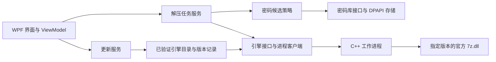

# 项目规划

更新：2026-10-12，Asia/Shanghai。状态：首个正式版 0.1.0 已公开，用户复验通过；仅提供轻量版，构建、安装升级、公开下载及独立引擎渠道检查全部通过。第八预览未逐版人工测试，其余有效结果保留，实际不同 DPI 多屏切换仍未实测。

## 当前进度

2026-10-13 A1 / F01 开发：按用户“按规划继续任务”推进密码库加密备份与迁移，当前回合元数据核实 gpt-6.1-sol / high，与规划一致，无子代理。沿用 WPF 与 ui-ux-pro-max 的错误反馈/键盘指导及已有资源；用 .NET 内置 AES-256-GCM + PBKDF2-HMAC-SHA256（600,000）实现 `.nvault` v1，不引入第三方运行组件。提供全库导出、双输入确认、导入预览、按密码内容跳过重复/保留两份，追加合并一次原子写入，现有记录/路径关联保持不变；不迁移源机器路径。版本独立于本机 APV1，不把未知格式当可兼容。开发版本 0.2.0-preview.1；本地基础 34 项、实际界面导出/导入/取消/错口令/密码复用/窄窗口和模拟高对比度 24 项通过。已增加双 Windows CI 作业，以源 DPAPI 拒绝读取和迁移后实际自动解压作为跨机器证据，当前等待云端；完整操作与格式见 [密码库备份](docs/VAULT_BACKUP.md)。正式版 0.1.0 及原有效验收保留，不读取用户真实密码库。

后续任务规划已更新：用户要求将上一轮建议加入任务并继续比较相关产品。已查看 7-Zip、NanaZip、PeaZip、Bandizip、WinRAR 的官方资料并对照当前源码，统一登记到 [后续任务与相关产品研究](docs/ROADMAP.md)：17 项原建议、9 项新任务，智能解压/现代菜单并入原项避免重复。共 F01–F26，全部未实施；有优先级、相对成本/体积判断、依赖和验收，下一工作包 A1 为密码库加密导入导出。研究发现 Bandizip 同样限制 ZIP 非英文密码并建议 7z，保留当前 ASCII 策略；不引入 RAR 写入、云服务或多后端大包。沿用已核对的 gpt-6.1-sol / high，无子代理。本轮只修改规划/说明，保留正式版 0.1.0 及有效测试，不开始开发或重跑产品检查。

2026-10-12 首个正式版发布完成：[v0.1.0](https://github.com/Nomoziya/nomozip/releases/tag/v0.1.0) 已公开，`draft=false`、`prerelease=false`，标签对应产品提交 `1059801bcb125f6da6e7abc4ca0a42dc4b4f9be3`；[Windows CI 38270823087](https://github.com/Nomoziya/nomozip/actions/runs/38270823087) 全部通过，17 份报告无失败，保留 101 项引擎、48 项组合密码、38 项压缩、45 项桌面、17 项 UIA/焦点、13 项显示及 18 项安装升级等检查范围。实际第九预览到正式版的本地隔离升级 9/9，正式版本显示 0.1.0，文件构建号 0.1.0.11，旧虚构密码库/设置逐字节保留并复用，安装 9292357 字节；云端轻量安装 9320686 字节。四项资产为轻量 EXE、轻量 ZIP、105 文件源码 ZIP 与 SHA256SUMS；载荷 9118187 字节 / 43 文件，EXE 2110924 字节，包审核通过。四项均无登录公开下载，与本地及 GitHub SHA-256 一致，报告 `artifacts/public-stable-validation.json`；稳定引擎仍为 `engine-26.04`，历史资产/标签不覆盖。发布文件位于 `artifacts/release-0.1.0/`，项目本机启动载荷同步为正式版。用户的修复后焦点/朗读复验通过，正式发布授权已经履行；实际多屏缺少第二显示器的限制保留，不再等待已完成的复验。

2026-10-12 正式发布授权：用户“复验完成，没有问题，可以发布第一个正式版”。第十候选的焦点外观和任务文件名朗读复验记为人工通过，既有布局/键盘操作/对比度结果保留。正式版使用 `v0.1.0`，软件显示 0.1.0，Windows 文件构建号 0.1.0.11 递增；安装器对外显示 0.1.0，隔离历史安装夹具仍保留原测试版本。沿用核实的 gpt-6.1-sol / high，无子代理。仅修改发布元数据与说明，不扩展功能；新正式包做安装升级、包审核、Windows CI 和公开下载验证。软件正式 Release 保持 `latest=false`，现有 `/releases/latest` 稳定引擎渠道不变；历史资产不覆盖。实际不同 DPI 多屏切换仍无第二显示器实测，不改写为通过。

2026-10-12 修复验收完成：功能修复 `7480447` 的 [Windows CI 38268684247](https://github.com/Nomoziya/nomozip/actions/runs/38268684247) 全部通过，17 份报告已下载；含既有 101 项引擎/48 项组合密码/38 项压缩/18 项安装，以及 45 项桌面/17 项 UIA 和完整焦点/13 项显示矩阵。随后 `a5a7f7e` 仅修整隐藏验证窗口的截图，本地受影响检查通过；小布局截图已检查。复验候选为 `artifacts/preview-10-candidate-reviewed/`，仅共享运行库轻量 EXE/ZIP，载荷 9118111 字节 / 43 文件，包校验通过。旧记录委派测试已完成（真实已发布第九预览创建的隔离虚构数据升级并复用），单屏实际 150% DPI 与三比例模拟完成，第二块不同 DPI 屏幕缺失，实际多屏未测试。当前没有发布第十预览 Release 或正式版；剩余需要用户实际体验的项为修复后的焦点外观/讲述人语音，正式版继续等反馈。

2026-10-12 极小工作区补充修复：云端首轮 `38267633844` 的表格语义/焦点回归 17/17 与既有桌面布局 45/45 通过，但新显示矩阵在 1024×720 像素的 200% 模拟工作区（512×360 DIP）发现解压/压缩表单不可达。已在本地复现并记录失败控件位置，原因是工具栏拖放提示在极窄剩余空间逐字换行，占满表单高度。小于 800 DIP 时缩小侧栏和外围间距、隐藏重复拖放提示，保留按钮与实际拖放功能，13 项含该边界的显示矩阵通过，45/17 项既有及焦点检查继续通过。当前尚无第二显示器，实际不同 DPI 多屏切换仍未测试；待修复后的云端检查，不使用原样重跑代替修复。

2026-10-12 第十轻量候选本地完成（尚未发布）：代码 `9045847` 修复已通过 45 项桌面检查与 17 项文件任务 UIA/焦点四边像素回归；实际第九预览到候选的隔离安装升级 7/7，旧虚构密码库与设置逐字节保留且实际复用，安装 9287938 字节。登记 7/7，候选包审核通过，载荷 9113811 字节 / 43 文件。当前单屏实际 150% DPI 与模拟三种比例下四页可达 13/13；系统为 system aware，实际不同 DPI 多屏切换因只有一个显示器仍未测试。Windows CI [38267633844](https://github.com/Nomoziya/nomozip/actions/runs/38267633844) 正在检查完整既有流程。正式版未发布，修复后真实讲述人语音/焦点外观等待反馈，不把人工已过项目重置。

2026-10-12 用户系统反馈与修复：保留第九预览的键盘操作和对比度主题人工通过，但焦点外观存在裁切、任务表格文件名朗读失败。沿用 gpt-6.1-sol / high（本回合已核实），无子代理；第十轻量预览候选修复 FocusVisualStyle 向外负边距及表格行/单元格的 UIA 名称。Explorer 弹窗经微软现行说明确认是新应用登记后的系统询问，截图默认项仍为资源管理器，修正软件说明和验收预期。用户指定旧记录、缩放、多屏由代理测试；使用实际已发布第九预览和隔离虚构密码库验证升级，枚举当前显示器并区分实测 DPI 与模拟比例。正式版仍等待用户反馈，不改写未取得的实际多屏或讲述人修复后体验。

2026-10-12 后续范围确认：用户选择“暂不加功能：完成实际系统体验与正式版准备”，随后要求“给出具体操作流程，等我测试完在发布正式版”。实际验收固定为第九预览轻量版，提供 [操作清单](docs/SYSTEM_ACCEPTANCE.md) 与虚构测试包；代理仅验证测试材料正确性，既有产品检查和人工通过范围保留。键盘、讲述人、系统主题/缩放、Explorer 和实际旧记录保留待用户反馈；本轮不签发或发布正式版，不切换验收版本。主会话 gpt-6.1-sol / high，无子代理。

2026-10-12 维护交接完成：当前支持范围、15 份最终 CI 报告、既有公开下载/安装/线上更新与官方维护演练、用户已确认及未确认状态集中到 [验收与交接](docs/ACCEPTANCE.md)。更新说明补齐第九预览的组合密码测试/实际解压签名门槛和独立稳定引擎渠道；核对维护脚本仍默认重建共享运行库载荷。P2/P3/P4/P5 状态更新到第九预览及用户确认的代理测试职责。当前确认范围的功能与代理交接已收尾，剩余实际系统体验保持未验证。当前回合 `01a13068-1213-7d30-acd2-f9c3b30b0cc7` 已核实 gpt-6.1-sol / high，无子代理。本轮仅修改文档和阶段记录，不重跑未改变的产品检查、不签发新引擎包、不发布第十预览，也不覆盖既有资产。

第九公开预览 [v0.1.0-preview.9](https://github.com/Nomoziya/nomozip/releases/tag/v0.1.0-preview.9) 已发布，标签 `8a86c4062d4567daef7dcdc8cc0c518abb7cd1aa`（产品代码 `7bea5ae6ebc0aeb0ce78e2553bc590272b8f9eae` 已通过最终 CI，之后仅增加文档）。四项轻量资产均无登录公开下载，SHA-256 与本地及 GitHub 摘要一致；报告 `artifacts/public-preview-9-validation.json`。43 文件载荷 9085627 字节，100 文件源码快照、包 CRC/私密材料排除/固定公钥及仅轻量发布检查通过，报告 `artifacts/preview-9-package-validation.json`。首次准备的未发布安装器保留在原 staging 目录，实际发布使用修复后 `artifacts/release-preview-9-final-fixed/`。稳定引擎仍为 `engine-26.04`，历史资产不覆盖。本机启动入口为第九预览。新增功能的代理检查已完成，不等待用户逐版重复测试；第八预览人工未测试及其它真正依赖用户环境的状态保持不变。

第九预览最终代码 `7bea5ae6ebc0aeb0ce78e2553bc590272b8f9eae` 的 [Windows CI 38257418706](https://github.com/Nomoziya/nomozip/actions/runs/38257418706) 全部通过，15 份报告及 36 张虚构数据渲染已下载至 `artifacts/github-validation-38257418706/validation-reports/`。101 项引擎、48 项组合密码业务流程、14 项正式桌面组合流程、38 项压缩（每版四次快速取消）、25 项核心、原有浏览/更新/布局/签名/入口检查通过。轻量安装及旧完整到轻量升级 18/18，云端安装 9288888 字节，原有密码库/设置复用及旧运行库清理通过。首轮失败已通过明确修复解决；没有用原样重跑代替修复。仅发布轻量 EXE、ZIP、源码和校验清单，公开下载校验待完成。

第九预览云端首轮 38255391605 在既有压缩取消检查失败：已在本地复现小文件取消时返回 worker_connection_failed（取消令牌已触发且暂存/最终文件均未保留）。原因是引擎快速退出后，发送取消控制消息的管道写入异常覆盖了用户取消状态。ArchiveEngineClient 现在在已取消令牌下统一返回 cancelled，包含读到完成结果与管道异常的时序；未取消时仍报告真实连接错误。限定回归探针 30/30 小文件取消通过，原压缩检查每版重复四次取消并检查真实输出/暂存清理，38/38；组合密码 48/48、桌面组合 14/14 及原有流程再次通过。最终签名规则亦通过缺少组合覆盖的拒签检查；云端修复后结果待确认。

2026-10-12 验收职责更新：用户要求“除了必须由我进行验证外，后续增加的新功能由你进行测试并改进”，并明确第八预览未测试。第八预览的人工状态保持未测试，不把本地/CI 通过写成人工通过；新增功能由主会话完成引擎、业务、正式桌面入口及安装/升级检查和必要改进，不要求逐版重复人工测试或等待第八预览反馈。用户真实密码库是否保留、主观体验、物理键盘/讲述人、系统高对比度/真实 DPI 及 Explorer 的实际使用等尚无确认的项目继续如实记录。第七预览及更早已确认结果保留。

第九预览准备：补齐原计划的同包多密码解压。官方 SDK 的条目回调提供已验证加密文件索引，按索引复用对应密码，继续尝试其它保存密码或请求手动补充；完整验证并解压成功后才记录成功及保存用户选择的新密码，取消或剩余失败不提交文件/密码。只记录加密文件的验证结果，避免把无密码文件的通过误当作密码有效。IPC 协议 1 增加可选条目密码与已验证索引字段，秘密仍只走私有 stdin 管道，单密码流程不重复传输逐条密码。真实传统 ZIP、AES ZIP、RAR5 在 26.04/26.03 两版引擎上完成组合测试及逐字节输出检查，普通 7z/文件名加密等既有流程保留通过；未专项验证其它格式的混合密码情况。本地引擎 101/101、业务组合流程 48/48、正式 WPF 命令 14/14 与既有桌面检查通过。未来引擎签名要求列表、三类组合验证与真实解压证据；缺少组合覆盖的全通过报告仍拒签。本地拒签检查通过，最终工具规则与云端发布验证待完成。主会话 `01a13034-a45c-7e02-ba70-0eae46bde5cf` 已核实 gpt-6.1-sol / high，无子代理。

第八公开预览 [v0.1.0-preview.8](https://github.com/Nomoziya/nomozip/releases/tag/v0.1.0-preview.8) 已发布，标签对应 `f4d800e`（代码提交 `cfbaa60aeac80e5df77fb1daaa57994fd146dc87` 已通过上述 Windows CI，之后仅增加验收说明）。本版只发布四项资产：轻量 EXE、轻量 ZIP、97 文件源码快照和 SHA256SUMS；无登录公开下载均与本地及 GitHub SHA-256 一致，报告 `artifacts/public-preview-8-validation.json`。43 文件轻量载荷 9061633 字节，安装 EXE 2091681 字节、ZIP 3334779 字节；CRC、私密材料排除和固定公钥检查通过，报告 `artifacts/preview-8-package-validation.json`。稳定引擎仍为 `engine-26.04`，历史资产保持不变。本机启动入口已同步第八预览。第七预览布局/浏览的人工通过保留，新增失败详情及其余真实桌面项目继续待确认。

第八预览构建与云端验收完成：代码提交 `cfbaa60aeac80e5df77fb1daaa57994fd146dc87` 的 [Windows CI 38245933629](https://github.com/Nomoziya/nomozip/actions/runs/38245933629) 全部通过；13 份报告和 36 张虚构数据渲染已下载至 `artifacts/github-validation-38245933629/validation-reports/`。81 项引擎、25 项核心、10 项新增桌面失败流程及既有浏览/压缩/更新/签名/入口/44 项布局检查通过。轻量安装 18/18，包括旧完整到轻量升级、移除随包运行库、复用旧密码库、设置保留及卸载数据选项；云端安装 9265736 字节。新版本仅分发轻量 EXE、轻量 ZIP、源码和 SHA256SUMS，公开下载校验仍待完成。

2026-10-12 用户确认已体验第七预览，“布局和浏览正常”。将压缩页、密码库布局及内容浏览的实际体验记为人工通过；不从该回复扩展为所有格式、所有窗口尺寸、键盘/讲述人、系统高对比度、多屏 DPI、旧数据保留或 Explorer 的全部通过。保留第四预览压缩加密/自动解密、第五预览解压布局/体积的原有结果。

第八预览准备：原计划要求失败时展示数量与受影响条目；底层此前仅返回索引，桌面只显示通用错误。现在 worker 为失败条目附带包内路径，旧 worker 无路径时显示条目编号，不虚构文件名；协议 1 保持兼容。解压密码请求获得上次验证结果，显示通过/失败数量与查看入口，取消后保留最后一次失败结果，可从任务列表底部“失败详情”查看。失败详情为只读，处理通过数量不表示最终输出，任务不标为完整成功、不保存未验证密码。未增加同包多密码组合算法。两版真实引擎矩阵 81/81、核心 25/25、新增桌面失败流程 10/10、既有浏览/压缩/更新及 44 项布局检查本地通过；小窗口失败详情已目视检查。本地准备阶段记录，云端及安装结果见上方新增完成记录；公开下载仍待完成。当前主会话 gpt-6.1-sol / high，与共用组合一致，无子代理。

第七公开预览 [v0.1.0-preview.7](https://github.com/Nomoziya/nomozip/releases/tag/v0.1.0-preview.7) 已发布，标签提交 `fa3e6fb84ecb6282a016d39d8b2587d89d643bd7`（代码为下述通过 CI 的提交，之后仅修改文档）。六项资产已无登录公开下载并核对本地及 GitHub SHA-256，报告 `artifacts/public-preview-7-validation.json`；94 文件源码快照、程序包 CRC/私密材料排除/固定公钥检查通过，稳定引擎仍为 `engine-26.04`，旧资产保持不变。本机启动入口已更新为第七预览。

后续发布政策：用户明确要求“之后不再发布带运行组件的版本”。从下一版本起仅发布共享 .NET 运行库轻量版；现已公开的版本及资产不覆盖。安装器默认轻量模式，带运行库安装器只允许在项目隔离升级测试路径构建；ZIP 打包器拒绝含 coreclr.dll 的发行载荷。CI 仅执行轻量升级验收，仍以完整载荷模拟旧安装来验证清理与数据保留，不上传该载荷。调整安装向导和说明，未安装共享运行库时引导安装微软 Desktop Runtime。产品代码及第七预览公开包不因发布政策调整而改动。

发布政策验证通过：本地默认轻量安装器编译、拒绝生产完整安装器/完整 ZIP、正常轻量 ZIP 检查通过，报告 `artifacts/publish-policy-validation.json`。提交 `b36e028277aae31a331cb91432aa3b1a4791ff1e` 的 [Windows CI 38243287174](https://github.com/Nomoziya/nomozip/actions/runs/38243287174) 全部通过，包括调整后的默认轻量安装及历史完整到轻量升级路径；报告下载至 `artifacts/github-validation-38243287174/`。本轮收尾结束，下一步为用户实际体验反馈；没有因此发布新软件版本或修改既有资产。

第七预览发布前验证：代码提交 `3fc065e2b0e77d262a6731de72a93b3914471a95` 的 [Windows CI 38239454113](https://github.com/Nomoziya/nomozip/actions/runs/38239454113) 全部通过，十四份报告和 35 张虚构数据渲染已下载。79 项引擎矩阵、28 项浏览、13 项桌面浏览、44 项布局、原有密码库/压缩/更新/打开方式/签名及桌面流程通过，完整安装 17/17，完整到轻量安装 18/18。云端轻量安装 9244171 字节，使用共享运行库并复用旧密码库。审核载荷轻量 9043567 字节 / 43 文件、完整 155200322 字节 / 438 文件，轻量安装 EXE 2086719 字节、ZIP 3328492 字节。原有人工通过结果保留，新增浏览和其余实际桌面项目未取得确认。

2026-10-12 后续范围核对：原计划 v0.1 的“7z、ZIP、RAR 浏览和解压”此前仅有底层 List 接口，桌面没有内容浏览入口，因此已有功能自动检查通过不等于完整 v0.1 范围完成。本轮补齐只读浏览：选中压缩包后“查看内容”/Control L，搜索包内路径，展示类型、原始大小与加密标记；加密文件名可先按既有策略尝试保存密码，再手动输入或取消。浏览不解压、不保存密码、不记录完整解压成功，任务仍可正常解压。沿用 WPF/ui-ux-pro-max 规范，不增加编辑归档、单项解压或文件预览。两版实际引擎的 28 项浏览检查与 13 项正式桌面命令/对话框检查通过，既有 44 项布局检查保留通过；修复了小工作区列表被标题/搜索区域挤压的问题，并检查完整文件行可见。维护引擎矩阵新增内容列表、文件名加密与错密检查至 79 项；签名工具要求目标版本的列表证据，缺少列表覆盖的旧式全通过报告仍拒绝签名。报告为 `artifacts/browser-validation.json`、`artifacts/desktop-browser-validation.json`，截图为 `artifacts/accessibility-preview/archive-contents-640.png`，数据均为虚构。本回合 `01a12fae-6fbf-74b3-9aa4-90ef697c39df` 核实为 gpt-6.1-sol / high，无子代理。

第六公开预览 [v0.1.0-preview.6](https://github.com/Nomoziya/nomozip/releases/tag/v0.1.0-preview.6) 已发布，标签对应 `fa20f300d337b212166e99ee8a1fcf71e1796888`（代码为下述已通过 CI 的提交，后续只更新文档）。轻量安装 EXE 2081691 字节、ZIP 3318677 字节；完整安装 EXE/ZIP、86 文件源码快照及 SHA256SUMS 同时提供。六项资产均通过无登录公开下载、本地 SHA-256 和 GitHub 资产摘要一致性校验；报告 `artifacts/public-preview-6-validation.json`。包 CRC、私密材料排除和固定公钥检查通过，轻量/完整 worker、两版引擎及信任公钥一致，报告 `artifacts/package-size-validation.json`。稳定引擎渠道仍为 `engine-26.04`，旧发布资产保持不变，本机启动入口已更新为第六预览。

2026-10-12 用户体验更新：用户已安装第五预览，明确确认“解压布局符合预期，体积也在 9 MB 左右”，将这两项记为人工通过；未据此推断旧记录保留、键盘、讲述人、系统主题/DPI 和 Explorer 均通过。用户新增要求压缩与解压布局一致、添加密码后的列表更协调。沿用原 WPF 栈与设计规范：压缩页使用顶部添加工具栏、宽窗口左右分栏/窄窗口堆叠及固定右侧底栏；密码库搜索移入统一工具栏，单行记录 48 DIP、文字居中、平面表头、启停状态文字、空时间显示“尚未使用”，编辑/删除保持在固定底栏。业务/引擎/数据格式不变，不扩展其它功能。本回合 `01a12f9c-baf7-7180-bea1-0756a7e23667` 核实为 gpt-6.1-sol / high，无子代理。局部技能 UX 查询两次未得到桌面行密度的准确匹配，采用现有设计规范与 WPF Grid/附加属性查询，不套用网页/手机建议。

下一步：当前确认范围的代理工作已收尾，参见验收交接文档。剩余真实系统体验保持未验证，不要求补测第八预览。用户反馈实际问题或提出新需求后，按影响范围修复/扩展及验证；候选功能尚未启动，正式版本尚未发布。

第六预览发布前验证：代码提交 `bee2f344e663d95d3a9eda527733d115eeea629f` 的 [Windows CI 38236148792](https://github.com/Nomoziya/nomozip/actions/runs/38236148792) 全部通过，十二份报告和 34 张虚构数据渲染已下载至 `artifacts/github-validation-38236148792/validation-reports/`。44 项桌面检查及四条桌面流程通过；既有引擎/压缩/密码库/更新/签名/入口检查通过，完整安装 17/17，完整到轻量安装 18/18。局部本地轻量安装测试 18/18，安装 9189724 字节；云端轻量安装 9213600 字节，确认复用旧虚构密码库并加载共享 .NET 10.0.12。发布载荷轻量 9015576 字节 / 43 文件，完整 155172327 字节 / 438 文件。第六预览两页实际体验暂不记为人工通过。

2026-10-12 人工验收更新：用户明确反馈“第四预览版已经测试过压缩加密和自动解密，目前没发现问题”。因此将第四预览的压缩加密与自动复用密码解压记录为人工通过；未从该反馈推断 ZIP/7z 具体格式、文件名加密、取消、更新、安装、键盘/Narrator、DPI 或 Explorer 全部通过。对比第四与第五最终代码提交，Core、Infrastructure 和 EngineWorker 无源码变化，保留已通过功能的证据，不因进入后续阶段重新要求用户重复验收。本回合 `01a12f74-73c1-7870-805c-7c7752f94aa9` 核实为 gpt-6.1-sol / high，与共用组合一致，无子代理。第五预览的新布局与轻量安装仍待用户实际确认。

2026-10-12 维护演练完成：从第五预览的源码快照创建隔离工作区，以现有官方稳定版 26.04 作为缺失候选，运行原有 `follow-official-engine.ps1 -Update` 的实际下载/官方资产摘要校验、候选禁用、解压矩阵、压缩矩阵和产品重建分支。成功后候选协议才变为 1 并进入重建程序；模拟 worker 无法启动时，候选保持协议 0，旧程序和 26.03 基线保持不变。主项目程序与固定公钥哈希前后相同，不接触用户密码库、不修改发布渠道。成功报告位于 `artifacts/upstream-maintenance-validation.json`，失败保护位于 `artifacts/upstream-rejection-validation.json`；原始矩阵在各报告所指的隔离目录中，解压 84/84（候选 26.04 与固定基线重合导致重复执行，仅两种独立 DLL）、压缩 38/38。复用实际维护签名工具，将新矩阵生成测试身份的更新包并验签，包内确含两类报告，临时测试私钥已删除；报告为 `artifacts/upstream-package-validation.json`。没有遇到真实未来版本，不能推断其具体兼容性；将来实际新版本仍须执行同样矩阵。本轮不改产品代码，也不为文档和演练发布新软件包。

2026-10-12 用户体验反馈：用户提供解压设置滚动条及安装目录约 148 MB / 439 文件的截图，要求优先保证功能并更轻量。当前回合 `01a12f4c-02d7-7871-a5ad-da0aee3bea23` 核实为 gpt-6.1-sol / high，与共用组合一致，无子代理。审计实测完整载荷 155162596 字节，使用系统共享运行库的相同软件约 9 MB；体积主要来自随包 .NET/WPF。微软当前明确禁用 WPF 裁剪，因此不通过盲删 DLL 降低功能保障。用户明确选择保留 WPF、提供共享 .NET 运行库轻量版，并接受无运行库的电脑需额外安装。没有改为原生 UI，也不声称首次安装的整机空间等同于官方 7-Zip。解压操作移至固定底栏，正常宽度无需设置滚动；窄窗口避免内外设置滚动嵌套，溢出滚动条换为统一细轨，保留实际滑块拖动和键盘/滚动支持。34 项补充桌面检查与四条实际 WPF 流程通过；18 项完整到轻量安装、密码复用、登记/数据/非产品文件保留和卸载检查通过，隔离测试安装占用 9183799 字节，确认实际使用共享运行库且旧随包运行库已清理。完整独立版继续提供，正式新预览云端与公开下载验收待完成。

2026-10-12 P5 继续验收：当前回合 `01a12f1e-54fc-7ff3-8c6c-fc4ead6b1a44` 核实为 gpt-6.1-sol / high，与共用组合一致，无子代理。用户回复尚未体验第三预览，要求先继续验收。发现并修复高对比度导航/提示的文字与背景配色、选中归档辅助文字的颜色继承，以及显示密码状态下提交空密码错误聚焦到隐藏输入框的问题。高对比度设置变更会刷新应用资源；正常模式恢复原设计配色。新增四页两种宽度的 UI Automation 名称、键盘可获焦属性、滚动可达性和密码字段/逻辑焦点检查，生成 100%/125%/150%/200% 像素密度与系统色资源预览。真实操作系统高对比度、物理键盘、Narrator、跨显示器 DPI、安装向导和 Explorer 入口仍须人工验收；不会以程序或模拟渲染检查代替。第四预览将保留已发布资产，使用新版本标签。

用户已于后续回合要求继续，授权进入实施。本回合 turn_context 再次核实为 gpt-6.1-sol / high，与共用组合一致；无模型切换、无子代理。

2026-10-12 第五预览完成：[v0.1.0-preview.5](https://github.com/Nomoziya/nomozip/releases/tag/v0.1.0-preview.5) 已公开，最终代码提交 `ddb3771c8f27e3fc212a3cf143ee1b79945744ef` 的 [Windows CI 38228863264](https://github.com/Nomoziya/nomozip/actions/runs/38228863264) 全部通过。原有 96 项引擎/密码库/更新、38 项压缩、7 项打开方式、四条桌面流程、34 项桌面布局与语义检查、签名证据拒绝、17 项完整安装和 18 项完整到轻量安装均通过；十二份报告与 34 张虚构数据渲染图已下载至 `artifacts/github-validation-38228863264/validation-reports/`。轻量载荷 9010036 字节 / 43 文件，安装 EXE 2079477 字节；本地升级测试安装 9183799 字节，云端为 9207798 字节（构建工具产物差异），均约 9 MB，并确认加载共享 .NET 10.0.12、复用旧 DPAPI 密码库及移除旧随包运行库。完整载荷 155167983 字节 / 438 文件仍提供；两版 worker、两版官方引擎 DLL 和信任公钥逐字节一致，指标报告为 `artifacts/package-size-validation.json`。六项发布资产经无登录公开下载，SHA-256 与本地及 GitHub 摘要一致，报告为 `artifacts/public-preview-5-validation.json`；稳定引擎渠道仍为 `engine-26.04`。旧资产保持不可变。本机启动入口同步为第五预览。已修复用户反馈，不把资源模拟/逻辑焦点称为真人验收；新布局、安装向导、Narrator、实际系统主题与多屏 DPI/Explorer 行为仍待用户确认。

2026-10-12 第四预览完成：[v0.1.0-preview.4](https://github.com/Nomoziya/nomozip/releases/tag/v0.1.0-preview.4) 已公开，最终代码提交为 `3bf9c4443124244ffbf524737ffde373034f2997`，[Windows CI 38223276557](https://github.com/Nomoziya/nomozip/actions/runs/38223276557) 全部通过。P5 本轮修复配色、可见密码输入焦点和启动/对话框尺寸适应工作区；29 项补充检查在 1120×760、800×500 DIP 以及 420×400 对话框的模拟工作区中通过。原有 96 项检查、38 项压缩、7 项打开方式、四条桌面流程、签名证据拒绝及 16 项安装检查均通过。十份云端报告与 34 张虚构数据渲染图已下载到 `artifacts/github-validation-38223276557/validation-reports/`；对小布局、密码框和高密度图进行了目视检查。安装 EXE、438 文件自包含 ZIP、86 文件源码快照与校验清单均经无登录公开下载核验 SHA-256 和 GitHub 摘要，报告为 `artifacts/public-preview-4-validation.json`；稳定引擎通道仍为 `engine-26.04`。此前准备版提交的运行 `38222528406` 也通过，但最终发布以新增工作区适配后的提交与运行 `38223276557` 为准。已更新本机启动入口到第四预览代码。用户尚未体验，真人键盘/Narrator、系统高对比度、多屏 DPI、安装向导及 Explorer/默认应用操作没有取得确认，P5 保持未完成；不得把离屏 UI Automation、逻辑焦点及资源/密度模拟替代人工结果。

2026-10-12 后续授权：用户明确要求下载创建仓库的工具并创建相关公开仓库。已下载官方 GitHub CLI 2.102.0 至项目 `.tools/github-cli/bin/gh.exe`，按官方发布资产的 SHA-256 校验通过；用户完成设备授权，CLI 登录确认为 Nomoziya。已创建公开仓库 https://github.com/Nomoziya/nomozip，并通过无登录凭据的 GitHub REST API 核验 `private=false`。CLI 凭据现以 DPAPI CurrentUser 加密保存在被忽略的 `.tools/gh-config/github-token.dpapi`，已删除其明文 hosts 文件。创建脚本为 `scripts/create-github-repository.ps1`，只在调用 CLI 的子进程环境中临时使用解密凭据。仓库创建完成；当时源码、CI 与更新包尚未上传或发布。

- 已使用本机 MinGW g++ 16.2.0、项目内 .NET SDK 10.0.401，锁定官方 7-Zip 26.04/26.03 完整 DLL；未修改系统 7-Zip 或系统 PATH。
- P0：小型 C++ worker、C# 私有管道客户端已实现，57 项真实引擎检查通过。
- P1：DPAPI 密码库、排序/去重、任务验证、暂存输出、同名处理与保存流程已实现，17 项检查通过。
- P2：WPF 解压/密码库/设置页面、密码对话框、拖放、进度、取消、候选跳过及明确的引擎切换/回退已实现；自动复用、真实密码对话框输入保存、更新后解压和回退三条正式桌面流程已验证。用户实际桌面使用、键盘、Narrator、高对比度与多屏 DPI 仍待验收。
- P4 本地闭环：RSA-PSS 签名清单、所有载荷哈希、独立目录准备、真实引擎验证、原子选择记录、重开持久化、失败保留旧版本和回退已实现；22 项更新检查通过。维护打包器绑定兼容性报告中的实测 DLL 哈希，并验证签名与产品固定公钥匹配。
- P4 线上：源码、Windows CI 与稳定引擎 Release 已部署到 `Nomoziya/nomozip`。GitHub 运行 `38197882961`、`38198404765` 均通过；后者还执行了官方版本维护检查。实际公开网络桌面验收的 8 项检查通过：从 26.03 发现并下载 26.04、固定发布公钥验签、安装启用、使用保存密码解压、密码库保持不变、回退及重开持久化。数据来自独立虚构密码库，不访问用户真实数据。
- 产品发布密钥已创建并固定对应公钥，稳定引擎 26.04 首次真实发布完成；软件第二开发预览的安装、升级与卸载已通过真实 Windows 验证，完整人工桌面验收待完成。官方新版本维护脚本当前只验证了“26.04 无需更新”分支，未来新版本的下载/兼容性验证分支尚未遇到真实新版本。
- P3：7z/ZIP 创建、压缩级别、加密、7z 文件名加密及 Windows 可选打开方式入口已实现。38 项两版引擎压缩检查、7 项隔离注册表检查通过；桌面通过实际按钮的 UI Automation 创建加密包、保存并自动复用密码。Narrator、真人键盘及 Explorer/默认应用选择仍待人工验收。同一包多个不同密码的组合解压仍未实现。

2026-10-12 上传阶段：用户授权“上传，继续任务”，源码已推送至 `main`（初始提交 `cc568bd041a6a5e85d23fb2d700fdc9b7a3e6813`）。GitHub Windows CI 运行 `38197882961` 完成并通过，下载的云端报告为引擎 57/57、核心 17/17、更新 22/22，以及 3 条真实 WPF 流程。稳定引擎包与软件开发预览将分别发布；新 RSA 3072 位产品发布公钥已固定，私钥按当前 Windows 用户加密保存在被忽略的 `.tools/release-signing/private-key.dpapi`，明文私钥已删除。更新签名脚本支持临时解密且结束清理，实际签名与公钥校验通过。新增 `--validate-online` 独立虚构数据验收模式，实际公开网络验证已在稳定引擎 Release 发布后执行并通过；软件预览包继续上传。完整安装卸载与人工桌面验收仍待完成。以上记录更新此前仓库创建阶段的状态。

2026-10-12 第三预览完成：[v0.1.0-preview.3](https://github.com/Nomoziya/nomozip/releases/tag/v0.1.0-preview.3) 已公开，对应代码提交 `fc1c162b46b977aa89895a09d7b6b0aaced87cd5`。沿用同一主会话 gpt-6.1-sol / high，无子代理。P3 新增压缩页面、7z/ZIP 创建与加密、成功后保存和复用密码、可选打开方式入口；沿用已有 WPF 样式和信息层级。原有 96 项检查、新增 38 项压缩检查、7 项入口检查、四条桌面流程、控件与快捷键、签名证据拒绝以及 16 项安装检查全部通过，[云端运行 38206962560](https://github.com/Nomoziya/nomozip/actions/runs/38206962560) 的九份报告已下载。安装 EXE、438 文件自包含 ZIP、83 文件源码快照和校验清单四项资产均经无登录公开下载，SHA-256 与本地及 GitHub 摘要一致；报告为 `artifacts/public-preview-3-validation.json`。客户端稳定引擎渠道仍为 `engine-26.04`，已有资产保持不可变。官方引擎升级现在必须同时通过解压/压缩矩阵且证据匹配实测 DLL。完整真人键盘、Narrator、高对比度、多屏 DPI、安装向导及 Explorer/默认应用选择仍待人工验收，同包多密码组合解压仍未实现；当前 ZIP 创建限制为 ASCII 密码，界面已提示。

可运行程序：[artifacts/app/ArchivePassword.exe](artifacts/app/ArchivePassword.exe)；入口：[启动软件.cmd](启动软件.cmd)。详细运行、维护与验证说明见 [docs/DEVELOPMENT.md](docs/DEVELOPMENT.md)。下文保留初始审计和计划依据，状态以本节为准。

2026-10-12 发布完成：软件预发布 [v0.1.0-preview.1](https://github.com/Nomoziya/nomozip/releases/tag/v0.1.0-preview.1) 已公开，含 Windows x64 程序 ZIP、64 文件源码快照及 SHA256SUMS；从无登录凭据的公开地址下载三项资产，均与本地审核文件及 GitHub 资产摘要一致。对应代码提交 `738ebf5e274f01134114468cabcbf3f35f7a2255` 的云端验证 [38198753411](https://github.com/Nomoziya/nomozip/actions/runs/38198753411) 通过，报告已下载到 `artifacts/github-validation-38198753411/`。稳定引擎 [engine-26.04](https://github.com/Nomoziya/nomozip/releases/tag/engine-26.04) 独立发布，软件预发布不会改变客户端读取的最新稳定引擎。真实公开网络的 `artifacts/online-validation.json` 为 8/8 通过；首次失败源于验收代码检查了错误的签名文件名，已更正为实际安装的 `update-manifest.sig` 后验证通过，产品更新逻辑无需修改。发布私钥仍为 DPAPI 密文，临时解密文件已清理，源码及下载包的凭据/私钥/密码库扫描与 ZIP CRC 检查通过。软件为依赖 .NET 10 Desktop Runtime 的开发预览，尚无安装程序或 Authenticode 签名；人工桌面验收、未来新官方版本分支与 P3 范围继续保留。不得覆盖已公开的不可变资产；后续产品变更使用新预发布标签与包。

## 1. 已确认需求与审计结果

2026-10-12 第二预览完成：[v0.1.0-preview.2](https://github.com/Nomoziya/nomozip/releases/tag/v0.1.0-preview.2) 已公开，包含当前用户安装 EXE、438 文件自包含 ZIP、70 文件源码快照与 SHA256SUMS。对应提交 `50df33855e25b8daa9747b20335efabf3eb0ab17` 的 [CI 38202511444](https://github.com/Nomoziya/nomozip/actions/runs/38202511444) 通过；下载的报告为原有 96 项检查及 3 条桌面流程，加最终 14/14 安装检查，确认升级保留且实际复用旧 DPAPI 密码库，使用安装目录的运行组件离线解压，以及卸载默认保留/明确删除虚构数据。报告位于 `artifacts/github-validation-38202511444/`。四项公开资产已无登录下载并核对本地 SHA-256 和 GitHub 资产摘要；独立稳定引擎渠道仍为 `engine-26.04`。检查了 800 DIP 窄布局渲染，产品名和版本显示一致。上述完成记录更新本节后续保留的准备阶段记录；完整人工安装向导、键盘、Narrator、高对比度与多屏 DPI 验收仍待用户实际使用，未将自动检查算作人工验收。P3 基础压缩、文件关联及同包多密码组合仍未实现。

2026-10-12 安装阶段：继续沿用同一主会话 gpt-6.1-sol / high，无子代理。增加自包含 .NET 10 / WPF 分发及 NSIS 当前用户安装器，安装、升级及默认卸载保留密码库和设置，删除数据需要独立勾选和确认；卸载仅删除产品载荷清单中的文件。下载的 SourceForge 文件实际为网页，校验失败后未执行，改用 MSYS2 官方 NSIS 3.13-2 包，公开 SHA-256 核验通过，编译器解压至 `.tools`。本地两版实际安装/覆盖升级/离线解压/默认卸载/重装/明确删除虚构数据的 13 项检查通过；程序确认实际加载安装目录内的运行组件。新增检查会复用真实格式的旧 DPAPI 密码库，14 项最终版本待云端验证。当前沙箱不能启动 NSIS 32 位安装程序，出现系统 DLL 重定位错误；已在沙箱外执行限定于 `artifacts/installer-validation/` 与独立测试注册表项的本地验证，未接触真实密码库。UI 与程序版本名称统一为 nomozip / 0.1.0-preview.2。安装向导及桌面完整人工无障碍/DPI 验收仍待完成。开发预览 1 与稳定引擎资产保持不可变，新安装包使用预览 2 标签。实现与验证说明见 [INSTALLATION.md](docs/INSTALLATION.md)。

| 项目 | 决定或事实 |
| --- | --- |
| 项目起点 | 用户确认在 D:\Codex\7zip-password 新建 Windows 软件；本轮检查时目录为空，无现有技术栈或项目规范 |
| 产品路线 | 用户选择独立软件＋官方 7-Zip 引擎 |
| 密码复用 | 用户选择自动尝试保存的密码，失败后手动输入 |
| 界面 | 使用 ui-ux-pro-max；操作清晰、信息层级和视觉一致性优先 |
| 后续维护 | 跟进官方引擎更新；支持根据新需求扩展 |
| 当前任务 | 审计、技术推荐、界面规范、开发阶段与验收规划；未开始产品实现 |

难度为中高：主要不确定性是原生引擎密码回调、错误分类、不同引擎版本兼容性及升级恢复。界面与本地数据管理可拆成明确任务。先用小型技术验证解决引擎问题，避免完成界面后才发现接入限制。

以下是规划默认值，实施时可调整，不作为已获得的产品验收：首发 Windows 11 x64、中文界面、本地单用户密码库、更新检查可关闭。Windows 10、ARM64 和跨电脑密码迁移另行确定支持范围。

## 2. 产品范围与发布顺序

**原首发范围：把保存和复用解压密码做成可实际使用的流程（已交付于正式版 0.1.0）。**

- 打开或拖入压缩包；多包任务列表、目标目录、同名文件处理、进度、取消和结果入口。
- 7z、ZIP、RAR 的浏览和解压；其他格式按所选官方引擎的能力显示，不承诺未经验证的格式。
- 加密文件名压缩包在获得密码前显示等待状态，不能假装已读取内容。
- 密码添加、编辑、删除、搜索；成功后由用户决定是否保存新密码；自动复用可在设置关闭。
- 默认按压缩包曾成功使用的密码、最近成功密码、其余可用密码排序，按条尝试并去重。
- 运行中的尝试允许随时跳过并手动输入；显示尝试数量和进度，不显示密码文本。
- 将已验证的引擎和必要运行组件随产品分发，使用户不必另装官方 7-Zip。
- 应用、引擎版本可查看；更新检查、引擎切换及恢复上一可用版本。

**原规划的常用操作与桌面使用入口范围（已并入正式版 0.1.0）。**

- 创建 7z/ZIP，配置压缩参数和加密密码；覆盖相应验收后发布。
- 可选文件关联和资源管理器入口，经过用户启用后生效；不默认替换系统关联。
- 安装、卸载及升级真实验收；首次启动、空密码库和错误状态全部可用。

后续任务统一维护于 [ROADMAP.md](docs/ROADMAP.md)，包括已登记的加密导入导出、来源标签、批量规则、ARM64、多语言及本轮相关产品研究补充。原计划的后续候选已合并，不重复列为首发未完成项；继续使用模块接口和数据迁移机制，动态插件平台或云服务保持观察。

## 3. 技术栈建议与复用判断

| 层 | 首选 | 选择理由与限制 |
| --- | --- | --- |
| 桌面界面 | C#＋WPF＋.NET 10 LTS | 原生 Windows 文件操作、键盘交互和列表控件；XAML 资源支持统一视觉，MVVM 分离界面与业务。微软的新应用方向推荐 WinUI，WPF 是本项目基于文件工具交付与维护需求的工程选择 |
| 业务 | 普通 C# 类库＋显式服务接口 | 密码策略、任务调度和更新流程可脱离界面测试；不提前引入复杂框架 |
| 密码库 | 版本化数据文件＋Windows DPAPI CurrentUser | 首版小型本地库无需数据库服务。将密码及标签等敏感内容整体加密，用户目录落盘，原子替换并保留可恢复副本 |
| 引擎接入 | 小型 C++ 工作进程＋官方完整 7z.dll | 使用原生密码回调；与 WPF 生命周期分开。C++ 只承担引擎适配、进度和错误返回，不承担产品业务 |
| 进程通信 | 父子进程私有管道＋版本化消息 | 密码不出现在命令行、环境变量或临时文本文件；普通诊断输出也不携带密码 |
| 分发 | Windows x64 产品包；发布阶段确定安装形式 | .NET 运行依赖与引擎一起验证；自包含包的运行时更新由产品维护承担 |

不使用仅支持部分格式的 LZMA SDK 代替完整解压引擎；不修改用户系统安装的 7-Zip。优先将官方完整 DLL 放在产品自己管理的版本目录中。

复用调查（本轮已打开原始来源）：

| 方案 | 可复用内容 | 本项目决定 |
| --- | --- | --- |
| 官方 7-Zip | 引擎、格式支持、原生密码接口 | 直接使用官方引擎；适配层保持小型化；发布包随附对应许可证和源码来源信息 |
| PeaZip | 已有加密密码管理器、文件操作流程 | 作为流程对照。不能据此推断已满足自动尝试、独立引擎更新或本项目验收；复制代码前须单独核对相关许可证 |
| NanaZip | 7-Zip 派生桌面产品及上游同步实践 | 借鉴维护经验；用户已选独立引擎路线，不将其完整源码作为基线 |
| squid-box/SevenZipSharp | C# 包装官方 DLL 的接口经验 | 作者已于 2024-04-10 宣布归档；不将它作为核心维护依赖。没有实测，不能断言它不兼容新版本 |
| WinUI 3 | 微软推荐的新 Windows 应用框架 | 保留为真正需要其特性时的备选；当前采用 WPF 方案推荐，不同时维护两套界面 |

实施前必须验证官方 DLL 接口、二进制架构、密码回调、取消、完整格式支持及构建成本。若 C++ 工作进程接入失败，先定位问题，再比较活跃包装库或其他适配途径；不直接退回通过 -p 参数暴露密码的方案。

## 4. 模块边界与数据演进

预定目录：src/Desktop、src/Core、src/Infrastructure、src/EngineWorker、tests、engines、design-system。这是后续实施结构，目前这些代码目录尚未创建。

核心接口：IArchiveEngine（打开、列举、验证、解压、取消、能力信息）、IPasswordVault（存取与迁移）、IPasswordCandidateProvider（排序与去重）、IUpdateService（检查、准备、切换、恢复）。接口依赖任务对象和明确结果类型，不依赖 WPF 控件或官方 COM 指针。

密码条目预定字段：稳定 ID、加密内容内的密码/名称/备注、创建与最后成功时间。压缩包关联独立记录，路径和文件属性仅用于提升候选排序，不能成为密码正确性的证据。文件改名、同名不同内容均须实际验证密码。

设置、密码库和 IPC 分别有版本字段。数据升级先留副本再迁移；遇到未来未知数据版本保持原文件并说明无法读取，不擅自清空。更换密码存储或引擎时只修改对应模块；新需求附影响范围和验收，并更新本计划。

## 5. 密码与解压操作约定

1. 用户选择压缩包与输出目录后，先检查文件可读、目标可写及引擎可用。
2. 无密码包直接解压；加密包按候选顺序逐条验证。没有候选则请求输入。
3. 原生引擎以测试模式验证所选内容，不将错误密码尝试产生的文件写入最终目录。候选验证应及时显示进度，允许跳过或取消；大包成本在阶段 P0 测量后再决定是否增加可靠的快速筛选。
4. 全部候选失败时，在当前任务内请求密码，保留输出目录与操作设置。允许粘贴、显示/隐藏和选择已有密码。
5. 解压时验证实际文件结果；单独成功打开文件头不等于全部文件解压成功。若一个包有多个密码，提示受影响文件并请求补充，不把部分成功报告成完整成功。
6. 新密码仅在相关加密内容通过验证后允许保存；既有密码成功后更新排序信息。取消、损坏、未知错误及部分失败不能被标为完整成功。
7. 解压先使用本任务的暂存位置；成功文件在同名处理决定后进入目标目录。重试清理本任务残留，取消保留或清理由用户可见地选择；不删除用户已有文件。写入路径必须留在用户选定目标内。

错误分类包括密码拒绝、数据损坏或歧义、缺少分卷、格式不支持、无写权限、取消和引擎故障。引擎不能区分密码与 CRC 损坏时，文案明确“密码可能不匹配，或压缩包已损坏”，不能将全部错误强行解释为密码错误并反复尝试。

DPAPI 首版按当前 Windows 用户保护，无需额外主密码；不等于防御同一已登录账户内的所有程序。重装系统、换账户或跨电脑恢复不能假设可用。跨电脑功能需要独立的加密导出设计，不能将 DPAPI 文件直接宣称为便携密码库。

## 6. 跟进官方更新的机制

2026-10-11 打开的官方下载页显示 7-Zip 26.04，发布于 2026-10-05。此版本作为技术验证起点，实施当天须再次确认官方稳定版本。

维护端（未来 CI）：定时或手动发现官方稳定发布 → 从官方下载页指向的仓库取得对应包和源码信息 → 在 Windows 执行兼容性矩阵 → 生成版本、架构、最低适配协议、文件哈希和来源记录 → 发布经签名验证的产品更新清单与引擎包。自动发现失败应明确报告给维护者，仍可手动推进。当前未创建 CI、发布仓库或更新服务。

客户端：只从产品验证过的更新清单选择兼容引擎，显示现用/可更新版本与变化；用户确认后下载，校验清单真实性和包哈希，在新目录准备完成后切换。任务运行期间不替换其 DLL；运行任务继续使用原引擎，新任务使用新版本。切换失败恢复旧版本，密码库与任务设置独立于引擎包。

不能假设官方提供稳定更新 API、每个包都有签名或校验清单，不能把自行计算的哈希当作上游真实性证明。具体上游下载来源、产品签名机制和托管位置在 P4 发布准备时确定。首次真实线上更新发布需要用户确认目标仓库和发布身份。

“跟随官方更新”验收为：可发现新稳定版本；普通兼容更新无需改业务和 UI 即可完成验证、发布及升级；不兼容版本进入适配流程并显示原因。不能承诺任意未来版本零修改或与官方同日发布。

兼容性矩阵至少包含：无密码 7z/ZIP/RAR、7z 文件名加密、ZIP 加密、可合法分发的加密 RAR 样本、中文/特殊字符密码与路径、正确/错误密码、损坏包、分卷缺失、多个密码、取消、同名文件、路径越界样本、两版引擎切换与升级失败恢复。RAR 样本仅作解压验证，不承诺创建 RAR。

## 7. 界面设计与验收

统一规范见 [design-system/MASTER.md](design-system/MASTER.md)，解压界面示意见 [extraction.svg](design-system/extraction.svg)。示意使用虚构数据，不能证明软件可运行。

采用文件管理器风格：左侧稳定导航，中央任务/文件列表，右侧或下方解压设置；一个明确的“开始解压”主操作。密码请求在任务上下文中出现，密码库通过独立页面管理。更新位于设置，列表错误在对应任务行可见。

用户验收覆盖首次使用、无密码包、自动命中、密码库全部失配后输入并保存、重启后复用、取消、更新和恢复。操作须支持键盘与 Narrator，长路径、125%/150%/200% 缩放及高对比度不遮挡主要操作。样式统一不能代替真实桌面验收。

## 8. 阶段、执行设置与交付

**共用组合：主会话 GPT-6.1 Sol / High，执行者为同一主会话，所有阶段在当前本地 Windows 项目执行，无子代理。** 用户本轮已确认切换，本回合对应 turn_context 为 gpt-6.1-sol / high；上一回合为 gpt-6-astra / low。记录配置可以证明该回合设置，不能证明未来回合永不重新路由。

选型依据：需求已有明确边界，但密码、原生接口和升级流程存在耦合，保留 High 做接口判断和整体验收；使用同组合减少交接成本。官方模型选择页将 Sol 定位于兼顾复杂工作和成本的任务；未取得针对本项目且同强度的独立测评，不能声称 Sol 与 Astra 的性能等价或给出额度节省比例。各阶段不降低验收标准，不默认新增 Astra 审查或 Luna 实施。

| 阶段 | 依赖 / 状态 | 职责与交付 | 验收和边界 | 组合差异 |
| --- | --- | --- | --- | --- |
| P：审计与规划 | 当前已完成 | 本计划、设计规范、界面示意、来源与环境记录 | 四项需求均有方案与验收；用户选择准确记录；未将未实现项称为可用 | 无，沿用共用组合 |
| P0：引擎验证 | P；已完成 | 核实工具链、锁定官方 DLL/源码；最小 worker 与 C# 客户端，真实测试样本及结果记录 | 真实 7z/ZIP/RAR 解压、密码回调、加密文件名、取消和错误分类；密码不在参数/日志/临时明文中；至少两版稳定引擎验证。成本过高或接口不满足时修订方案后再进入 P1 | 无 |
| P1：核心与密码库 | P0；已完成 | 任务状态机、候选策略、DPAPI 存储及迁移 | 错密到正确密码、手动补充、重启复用、删除、损坏库恢复、不可解密保持原数据；错误尝试不污染最终输出 | 无 |
| P2：桌面界面 | P0、P1；第九预览实现与代理检查通过，第七预览布局/浏览人工通过；实际系统项目未验证 | WPF 视图与共享资源，完整解压/密码库/设置交互 | 从真实应用入口完成关键流程；键盘、缩放、Narrator、错误与空态；采用设计规范；长任务界面响应和取消经过验证 | 无 |
| P3：基础压缩与桌面入口 | P2；第九预览功能与代理检查通过，压缩加密已获用户确认；实际 Explorer 使用未确认 | 7z/ZIP 创建、可选打开方式入口、多文件与文件夹选择 | 官方 7-Zip 逐字节读取新包；错密、取消与覆盖保护通过；登记/移除入口保留旧默认与其他副本。实际 Explorer 入口与默认选择待人工验收 | 无 |
| P4：更新与分发 | P2；第九轻量预览已公开，安装升级/卸载、线上更新及维护交接已验证；正式版本未发布 | 签名更新包、兼容性检查、版本切换、恢复、产品包及许可证信息 | 安装启动、离线解压、引擎升级/失败恢复、密码库保留、卸载数据选项已验证；完整人工产品验收与正式产品发布待完成 | 无 |
| P5：整体验收与交接 | P4；功能、代理整体验收及维护交接完成；实际系统人工项目未验证 | 完整用户流程、范围核对、升级演练、已支持矩阵、维护说明 | 用户在桌面确认可用；区别自动测试、人工验收和未验证项；未通过项继续修复而非降低标准 | 无 |

P0 属于覆盖主要难点的可回退技术片段，其成功仅支持相近接入任务，不能替代全部产品验收。阶段顺序允许开发 v0.1 后先交付，再补 P3；最终发布范围必须在版本说明中列清。

每个新回合及阶段交接核对当前设置与共用组合；需要换型号/强度时说明原因并等待用户选择。连续两轮同一问题无有效进展，暂停该问题重新审计，不机械升级模型。先保留有效成果，只修复或重验受影响部分。

## 9. 环境与本轮验证范围

- 本机 C:\Program Files\dotnet\dotnet.exe 可调用；SDK 8.0.413、8.0.425；运行时包含 .NET/WindowsDesktop 10.0.12。有 .NET 10 运行时不等于已安装 .NET 10 SDK。
- 常见路径与 PATH 未发现官方 7-Zip、C++ 编译器及 Visual Studio；这是有限范围检查，不能断言整机均未安装。P0 首先精确核对，不在规划回合自动安装工具链。
- ui-ux-pro-max 产品搜索匹配 File Manager & Transfer，采用 Flat Design＋Minimalism；初始设计系统输出含营销页结构，已舍弃不适合桌面工具的部分。WPF 查询匹配键盘导航、Command 和职责分离；密码查询匹配显示/隐藏操作。
- 主文本、次文本、蓝色主按钮、红色错误按钮和绿色状态预定前景/背景对比度计算通过 4.5:1；具体值见设计规范。尚未验证实际控件渲染、高对比度主题或桌面布局。
- 已将 SVG 渲染为 1120×760 PNG，并目视检查中文文本、导航、任务列表、设置区及主操作，无可见文字重叠或裁切；这是规划示意图检查，不是实际 WPF 验收。
- 当前只创建规划和设计文件；没有构建应用、执行引擎测试、搭建 CI 或发布安装包。

初始规划的下一步为 P0；后续用户已启动实施，当前进度见文首。此处初始环境检查和初始验证范围作为历史依据保留。

## 10. 原始来源

本轮访问日期均为 2026-10-11；源码 main 与网页内容会变化，实施时固定版本/提交再引用。

- [7-Zip 官方下载](https://www.7-zip.org/download.html)：版本、架构、完整 DLL 包和源码来源。
- [7-Zip 官方 FAQ](https://www.7-zip.org/faq.html)：引擎集成途径与发布要求。
- [官方密码接口](https://github.com/ip7z/7zip/blob/main/CPP/7zip/IPassword.h)：ICryptoGetTextPassword 原生回调依据；未证明本项目适配实现已成功。
- [7-Zip 官方许可证](https://github.com/ip7z/7zip/blob/main/DOC/License.txt)：按实际分发版本保留相关授权信息。
- [PeaZip 密码管理说明](https://peazip.github.io/extract-encrypted-files)：现有加密密码管理器。
- [NanaZip 原始仓库](https://github.com/M2Team/NanaZip)：派生产品与上游同步参考。
- [SevenZipSharp 原始仓库](https://github.com/squid-box/SevenZipSharp)：归档状态、包装方式及许可。
- [WPF 官方说明](https://learn.microsoft.com/en-us/dotnet/desktop/wpf/overview/)及 [WPF 源码](https://github.com/dotnet/wpf)：XAML、绑定、命令、列表虚拟化；经 Context7 查询原始源码。
- [Windows 开发路线](https://learn.microsoft.com/en-us/windows/apps/get-started/)：WinUI 官方方向，作为框架备选对照。
- [.NET 支持政策](https://dotnet.microsoft.com/en-us/platform/support/policy/dotnet-core)：.NET 10 为 LTS；本轮页面显示支持至 2028-11-14。
- [ProtectedData 官方说明](https://learn.microsoft.com/en-us/dotnet/api/system.security.cryptography.protecteddata?view=net-10.0)：Windows DPAPI 的适用范围。
- [OpenAI 模型选择](https://learn.chatgpt.com/docs/model-selection)：规划组合依据与能力限制；账号实际设置以本回合记录为准。

