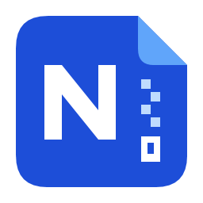

# nomozip

使用官方 7-Zip 引擎的 Windows 压缩工具。保存你提供的解压密码，下次解压时自动尝试。

[下载正式版](https://github.com/Nomoziya/nomozip/releases/tag/v0.3.5) · [使用文档](docs/README.md) · [更新记录](https://github.com/Nomoziya/nomozip/releases) · [反馈问题](https://github.com/Nomoziya/nomozip/issues)

## 下载与安装

当前正式版为 **0.3.5，Windows x64 / ARM64**。仅提供共享运行库轻量版：

| 架构 | 安装包 |
| --- | --- |
| x64（多数 Intel / AMD 电脑） | [EXE](https://github.com/Nomoziya/nomozip/releases/download/v0.3.5/nomozip-0.3.5-light-setup-win-x64.exe) |
| ARM64（Windows on Arm） | [EXE](https://github.com/Nomoziya/nomozip/releases/download/v0.3.5/nomozip-0.3.5-light-setup-win-arm64.exe) |

需要对应架构的 [.NET 10 Windows Desktop Runtime](https://dotnet.microsoft.com/zh-cn/download/dotnet/10.0)（10.0.12 或更新的 10.0 补丁版），无需安装 SDK。安装包不包含系统共享运行库。

安装包用于安装或升级，保留密码库与设置。正式发行默认仅附x64/ARM64安装包及SHA256校验清单；源码、样式规范与历史候选保留在仓库和历史发行中。`engine-*` 发行仅供程序更新引擎，请下载带 `nomozip` 名称的软件包。

## 正式版功能

- **密码库**：自动尝试、分组、来源目录优先与整理、只读匹配顺序试算、独立加密备份，以及可选主密码、空闲锁定和备份提醒。
- **浏览与解压**：7z、ZIP、RAR/RAR5，包内连续预览与文本查找、搜索范围与定位、拖出、高级筛选与选择性解压、队列、单任务暂停/取消、失败重试和可选跨重启续作。
- **压缩与校验**：压缩方案与内容排除/预览、分别压缩、失败重试、加密压缩、分卷、自解压包、格式转换，以及文件 SHA-256 和校验清单。
- **更新与集成**：软件下载反馈与校验、更新成功自动清理安装包、可选 7-Zip 官方引擎源与回退、传统右键菜单和命令行入口。
- **界面**：简体中文/英语、浅色/深色/跟随系统主题，以及原生 ARM64 支持。

## 开始使用

1. 在“密码库”添加常用解压密码，也可以在需要时手动输入。
2. 在“文件”页打开压缩包，或在“任务”页添加多个压缩包后开始解压。
3. 需要创建压缩包时，从“文件”页选择新建压缩包，添加文件并选择格式。

只有完整解压成功后，才保存本次勾选保存的新密码。升级和默认卸载保留本机数据，详见[安装说明](docs/INSTALLATION.md)。

重启续作需先开启“保留解压进度”，以完整文件为检查点，不保存密码。升级或切换架构前，请先完成或丢弃保留任务，详见[续作说明](docs/EXTRACTION_CHECKPOINTS.md)。

## 文档与开发

- [使用文档与功能索引](docs/README.md)
- [0.3.5 发行说明](docs/RELEASE_0.3.5.md)
- [从源码构建](docs/DEVELOPMENT.md)
- [UI 样式修改与历史候选](docs/UI_STYLE_GUIDE.md)
- [支持范围与验收记录](docs/ACCEPTANCE.md)
- [第三方组件及许可](THIRD_PARTY.md)

反馈问题时请提供软件版本、操作步骤与错误提示，并移除截图和日志中的真实密码、文件名及个人路径。
