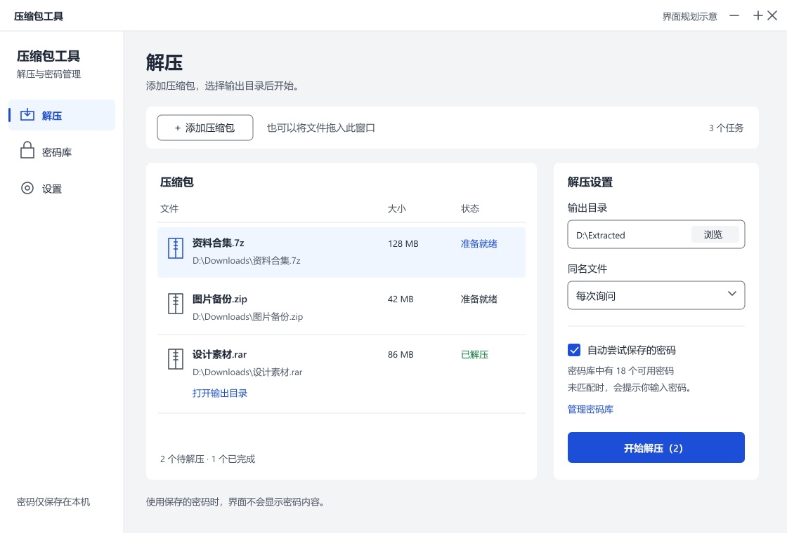

# Windows 压缩包工具设计规范

状态：2026-10-11 规划规范。目标栈：WPF；当前目录没有已有界面需要迁移。

## 方向与信息层级

来自 ui-ux-pro-max 的 File Manager & Transfer 匹配：Flat Design＋Minimalism，功能性中性色，文件层级优先。初始生成结果中的营销页布局不适用于本产品，因此不采用 Hero、宣传视频或营销 CTA。桌面行为使用 WPF 查询与桌面通用规则，不套用手机断点和安全区。

主任务是“把这个压缩包解到这个目录”。一级导航为“解压 / 密码库 / 设置”，每页一个主要操作。用户始终能辨认当前压缩包、输出目录、任务状态与下一步。引擎技术细节仅出现在设置与故障详情中。

压缩页扩展（2026-10-12）：导航顺序更新为“解压 / 压缩 / 密码库 / 设置”，沿用已有 WPF 颜色、字体和间距。压缩页按“内容 → 格式/位置/加密 → 创建”组织，底部固定主要操作、取消与结果入口；设置区可滚动。密码通过独立对话框设置，界面只显示是否已设置。ui-ux-pro-max 的文件工具/Flat Design 方向及 WPF 键盘、标签与 Command 建议与既有规范一致；未采用搜索结果中的营销页面、在线字体或新配色。空态说明拖放与添加方式，ZIP 密码限制在格式提示与校验反馈中可见。

第六预览一致性修整（2026-10-12）：压缩与解压共用页面结构——标题、白底添加工具栏、内容列表/280 DIP 设置栏、右侧固定操作。窄窗口设置移到列表下，只有外层表单滚动，主操作保持可见。压缩进度仅任务运行时显示，任务反馈在操作下方，取消仍可用。密码库采用同一工具栏和固定操作区域；单行记录 48 DIP、垂直居中、列标题使用统一颜色和分隔线，状态用文字说明，“最近使用”为空时显示“尚未使用”。长名称/备注省略显示并可通过提示查看完整文本，不展示密码明文。

## 共享视觉资源

以下颜色集中映射到 WPF ResourceDictionary/DynamicResource，组件不得各自硬编码。

| 资源 | 值 | 用途 |
| --- | --- | --- |
| Surface / Canvas | #FFFFFF / #F3F4F6 | 内容区与窗口背景 |
| TextPrimary / TextSecondary | #1F2937 / #4B5563 | 主信息与辅助信息 |
| Accent / OnAccent | #1D4ED8 / #FFFFFF | 唯一主操作与选中状态 |
| AccentSubtle | #EFF6FF | 当前导航、辅助强调 |
| Error / OnError | #B91C1C / #FFFFFF | 错误与删除操作 |
| Success | #15803D | 完成状态，配合文字 |
| ControlBorder / Divider | #6B7280 / #E5E7EB | 可交互边界与装饰性分隔 |
| Focus | #1D4ED8 | 2 DIP 焦点外框 |

白底主文本 14.68:1，次文本 7.56:1；白字/蓝底 6.70:1，白字/红底 6.47:1，绿字/白底 5.02:1。本轮已计算这些配对；其它状态、浅色选区、系统高对比度与未来深色主题实施时独立验证。装饰分隔不能用作唯一控件边界。

字体使用本机 Segoe UI / Microsoft YaHei 系统回退，不依赖在线字体。正文和列表 14 DIP、辅助文字 13 DIP、分组标题 16 DIP、页面标题 24 DIP；主按钮与行高至少 36/44 DIP。使用 4/8/12/16/24/32 DIP 间距，按钮圆角 6 DIP。图标使用统一 WPF 矢量 Path，16/20 DIP，文字标签优先；不使用 emoji 做功能图标。

首版浅色主题，支持系统高对比度。深色主题属于未来设计扩展，不以直接反色实现。Windows 缩放是 DIP 布局变化，不能按固定物理像素设计。

B2 / F19（2026-10-13）：文件校验通过设置中的独立窗口进入，沿用标题、工具栏、白底紧凑列表和固定操作区。选中行下展示计算值及可选期望值，哈希使用本机等宽字体，错误在输入附近显示。后台按当前文件序号/字节反馈进度，状态文字区分未比较、一致、不一致与无法读取。600×500 短窗口隐藏非交互副标题和重复路径，保留路径提示、完整首行、输入与操作；不通过页面滚动隐藏主操作。

## 页面与关键状态

### 解压

参考 [extraction.svg](extraction.svg)。默认窗口建议 1120×760 DIP，最小 800×600 DIP；窄窗口将右侧设置移到任务列表下方，长内容可滚动，主操作保持可见。导航宽度约 176 DIP。

上方“添加压缩包”支持文件选择；拖放是补充入口。任务列表采用行布局，列为文件、大小、状态；完整路径可展开或键盘访问提示查看。下方/右侧包含输出目录及“浏览”、同名处理下拉、自动尝试保存密码开关和“开始解压”。同名处理默认为询问，不静默覆盖。

| 状态 | 用户看见与可做的操作 |
| --- | --- |
| 空态 | “添加压缩包或拖入文件”，有可点击按钮，不只有拖放提示 |
| 准备就绪 | 所选文件、输出目录和当前策略清楚可见 |
| 尝试密码 | “正在尝试已保存密码，3/18”，可“输入密码”或“取消”，不显示候选内容 |
| 等待密码 | 任务行提示并打开对应输入对话框，其余独立任务可继续 |
| 解压中 | 当前文件、真实进度；无法估计时用不确定进度，不伪造百分比；可取消 |
| 完成 | “已解压”，提供“打开输出目录”，不会仅靠绿色表示完成 |
| 部分失败 | 显示成功/失败文件数量并可查看受影响文件，不标为全部完成 |
| 失败 | 行内原因与相关处理入口，保留任务设置 |

### 密码请求

只读内容浏览（第七预览）：在解压工具栏加入“查看内容”，由所选压缩包启用，支持 Control L。独立窗口沿用标题、白底搜索工具栏、48 DIP 记录行和平面表头，按包内路径显示所有条目，可搜索但不编辑归档或写入文件。展示路径、文件/文件夹、原始大小与引擎加密标记。小工作区仍须完整显示至少一行内容和关闭操作。文件名加密时复用遮罩密码对话框，标题为“输入查看密码”，不提供保存选项；仅打开头部不能作为完整数据验证，保存仍留在解压成功流程。

标题“输入解压密码”，副标题明确对应压缩包；若自动候选耗尽显示“已尝试保存的密码，暂未找到可用密码”。密码框有可见标签，默认遮罩，允许粘贴；“显示密码”切换有可访问名称和状态。

输入框下提供“成功后保存到密码库”，默认未勾选；密码名称在勾选后展开，不强制填写。主按钮“继续解压”，次按钮“取消此任务”。输入错误留在字段附近并保留输出设置。Escape 取消当前对话框，焦点回到任务行；不得隐式取消全部任务。

### 密码库

B2 / F06（2026-10-13）：沿用紧凑 48 DIP 行和固定操作栏；名称下第二行显示分组/来源/优先规则摘要，缺少摘要时单行仍居中，长文本省略并提供完整提示。搜索旁提供分组筛选，统计和重复提示置于表格下方，不覆盖表头。编辑窗口的分组/来源有明确标签，优先规则默认折叠。重复保存和删除其它记录前均说明保留行为，密码明文不进入列表或搜索。

顶部搜索框与“添加密码”；列表展示名称、备注、最后成功时间和自动尝试启用状态，不展示明文密码。详情可编辑或删除；删除说明仅移除本地保存记录。空库直接引导添加或在解压成功后保存。密码显示只在用户显式操作后出现，离开详情重新遮罩。

首版不提供剪贴板复制按钮，避免扩展当前范围；未来如加入，需明确其行为和验收。

### 设置

分组为解压默认值、密码复用、更新、关于。更新区显示产品版本、现用引擎版本、上次检查和“检查更新”；有更新时显示“更新引擎”，失败时说明原因与“恢复上一版本”。技术错误详情默认折叠，主要流程不出现 IPC、DLL、签名字段等内部术语。

当前更新页将现用/上一版本放在顶部，下拉选择后需明确“使用所选版本”；检查、下载和本地导入为并列操作。更新消息留在本组，任务期间禁止切换并显示取消操作。仓库尚未发布时说明没有可用产品包，官方版本号不代表产品已兼容发布。800 DIP 窗口通过自然换行和纵向滚动保持操作可见。

## WPF 实施约定

- ViewModel 负责状态和命令，界面后台代码仅负责焦点等视图行为；文件和密码业务不放在点击事件中。
- InputBindings 对应打开文件、启动任务等 Command；Tab 顺序符合布局，Enter 触发当前主操作，Escape 有明确取消范围。
- PasswordBox 内容不长期保留在 ViewModel 的普通字符串属性；将明文生命周期限于实际验证或解压操作，不能承诺托管内存零残留。
- UI Automation 为输入、图标控件、进度和任务状态提供名称与状态。状态变化适度通知，不能每次进度回调都打断 Narrator。
- 大列表虚拟化，解压与密码尝试在工作进程运行，UI 不阻塞。任务操作应及时反馈且支持取消。
- 禁用控件保留说明；错误不依赖 toast 或颜色。网络更新失败不能阻止本地解压。
- 无装饰性页面入场动画；交互反馈可用短暂色彩变化并遵守系统减少动画设置。

## 交付检查

桌面实现时以真实窗口验收：800×600 与默认窗口、125%/150%/200% 缩放、长中文路径、键盘完成主流程、Narrator、系统高对比度、空态和所有表内任务状态。测量实际控件对比度并检查焦点可见。SVG 仅用于审阅布局与信息层级，不能代替 WPF 行为或可访问性验证。

C / F08（2026-10-14）：密码库标题右侧显示解锁/锁定操作，下方单行保护状态，保留原列表高度；设置中的保护卡片按主密码、空闲计时、本机/独立备份恢复分层。独立密码对话框沿用现有表单、掩码输入、可粘贴、字段标签及固定确认/取消，错误就近显示且输入改变时清除。小窗表单内容可滚动，确认与取消保持完整可见；不另加颜色或字体。

C / F10（2026-10-14）：查看内容沿用紧凑搜索工具栏、48 DIP 行和固定主操作，新增“修改内容”菜单，将添加到根目录、替换单文件和删除勾选内容放入有文字的菜单。删除/替换确认明确子项、数量及原包备份包含旧内容；失败与成功反馈留在窗口，操作中禁用重新选择和修改，可取消。替换保留包内路径，成功刷新列表和选择，不新增独立割裂的编辑页。菜单复用现有动态主题资源和内部焦点框，窄窗保留完整行和主要操作。

C / F11（2026-10-14）：分卷默认不启用，格式与级别沿用原有双列表单；分卷下拉独占一行，单位写全 MiB/GiB。自定义才展示数值和单位，错误就近反馈，主操作保持固定。说明包含首卷、同目录及旧分卷不覆盖，成功显示数量和首卷位置，密码继续掩码输入。高对比度复用动态主题，不增加独立分卷页面。

C / F12（2026-10-14）：自解压选项位于压缩设置的分卷选项之后，默认关闭。ZIP/分卷或缺匹配模块时禁用并就近说明；启用后说明 EXE 的接收者无需解压软件且不自动运行内容。保留现有表单、掩码密码窗口和固定主操作，无独立创建页；已有 EXE 替换先确认再输入密码，创建前的异步模块读取也进入忙碌状态，失败恢复操作。

C / F13（2026-10-14）：格式下拉保留 7z/ZIP 顺序，增加 TAR/GZIP/XZ。TAR 禁用级别并解释仅打包；后三种禁用密码、分卷和 EXE，切换时清除不适用状态及待用密码。GZIP/XZ 的单文件约束在设置中给出完整文字，错误时禁用创建，移除不符来源立即恢复；主操作保持固定。说明流格式以输出包名决定解压名称，复用现有字体、动态颜色、高对比度和内部焦点框。

## F16 深色资源与切换

2026-10-15：沿用现有布局、字体和间距，只扩展语义颜色。跟随系统 / 浅色 / 深色在设置中明确保存，立即更新已有窗口；系统高对比度优先并使用真实 SystemColors，关闭后恢复所选主题。本地双语布局、真实业务和控件验证已通过，完整 CI 的最终状态见 PROJECT_PLAN.md 与 docs/APPEARANCE.md。

| WPF 资源 | 深色值 | 职责 |
| --- | --- | --- |
| CanvasBrush | #111827 | 窗口画布 |
| SurfaceBrush | #1F2937 | 卡片、输入、列表和弹层 |
| TextBrush | #F3F4F6 | 正文与主信息 |
| SecondaryBrush | #CBD5E1 | 辅助信息和滚动滑块 |
| BorderBrush | #94A3B8 | 可交互控件边界 |
| DividerBrush | #475569 | 装饰分隔和进度底轨 |
| AccentBrush | #93C5FD | 主要操作和选中项 |
| OnAccentBrush | #111827 | 主操作/选中项上的文字与勾选符号 |
| SelectionBrush | #1E3A5F | 导航与次选区底色 |
| SelectionTextBrush | #BFDBFE | 导航与次选区文字 |
| FocusBrush | #93C5FD | 焦点框与活动边界 |
| ErrorBrush | #FCA5A5 | 错误文字，始终配合说明 |

正文/辅助/错误、主按钮及选区文字配对按 4.5:1 检查，控件边界与焦点按 3:1 检查；分隔线不充当唯一边界。禁用状态继续使用原生禁用语义和降低强调，不能只靠颜色阻止操作。下拉框保留 Popup、可编辑目录及数据项显示模板；焦点框保留在控件内。横向和纵向滑块使用相同的窄轨道设计。新增页面不得自行写一套深色十六进制值。

F22 转换窗口沿用卡片表单与固定底部操作，参数区独立滚动；输出路径、格式、级别和新加密分组。未启用加密时收起密码字段，启用后两列遮罩输入与确认；原包路径只读，源密码不继承提示常驻，双语与三种主题共用资源。

C / F26（2026-10-15）：在查看内容窗口固定底栏加入“预览文件”，Ctrl+P 使用高亮行，勾选框只决定解压范围；禁用预览时提示格式与大小限制。独立只读预览沿用标题、文件路径、内容卡片、说明和固定关闭按钮，中英/浅色/深色/高对比度共用语义资源。文本可键盘选择/复制并滚动，图片按窗口适配不放大，GIF 明确首帧；关闭恢复浏览窗口并清除视图引用。小窗仍完整显示内容和关闭操作。
